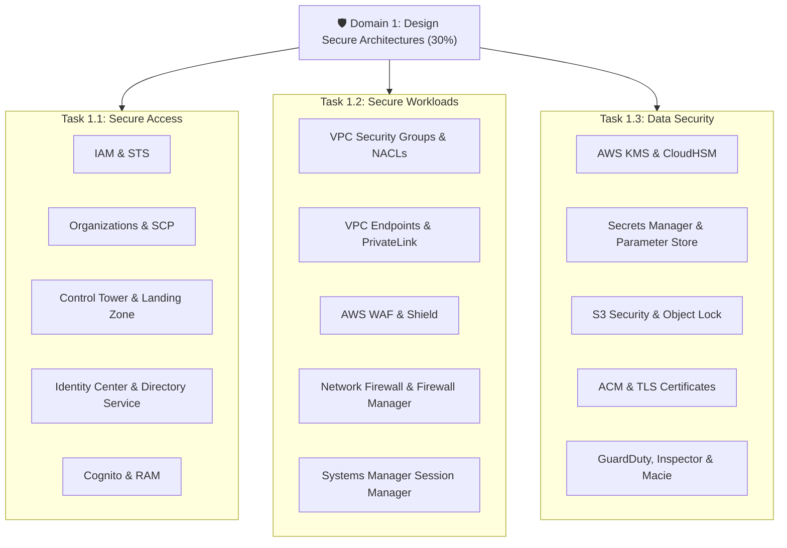

# 🛡️ Map of Content (MOC): Domain 1 - Design Secure Architectures

> **Trọng số kỳ thi:** **30%** (Lớn nhất trong 4 Domain của SAA-C03)  
> **Mục tiêu:** Thiết kế giải pháp bảo mật toàn diện trên AWS tuân theo Well-Architected Security Pillar: Bảo vệ danh tính, kiểm soát truy cập, bảo vệ mạng, mã hóa dữ liệu at-rest/in-transit và phát hiện mối đe dọa liên tục.

---

## 📊 Bảng Theo Dõi Tiến Độ Ôn Tập (Study Tracker)

| Phân loại | Tài liệu / Chủ đề | Liên kết | Trọng số thi | Trạng thái |
| :--- | :--- | :--- | :---: | :---: |
| **Blueprint** | Tổng quan kỳ thi & Tỷ trọng điểm | [[SAA-C03-Exam-Blueprint]] | High | 🟢 |
| **Task 1.1** | Design secure access to AWS resources | [[Task-1.1-Design-Secure-Access-Resources]] | 30% | 🟢 |
| **Task 1.2** | Design secure workloads and applications | [[Task-1.2-Design-Secure-Workloads-Apps]] | 30% | 🟢 |
| **Task 1.3** | Determine appropriate data security controls | [[Task-1.3-Determine-Data-Security-Controls]] | 30% | 🟢 |
| **Deep Dive** | IAM Policies, Evaluation Logic & STS AssumeRole | [[IAM-and-STS-Deep-Dive]] | Very High | 🟢 |
| **Deep Dive** | Multi-account Governance & SCP Guardrails | [[AWS-Organizations-and-SCPs]] | High | 🟢 |
| **Deep Dive** | AWS Control Tower, Landing Zone & Guardrails | [[AWS-Control-Tower-and-Landing-Zone]] | Very High | 🟢 |
| **Deep Dive** | Enterprise Directory & IAM Identity Center (SSO) | [[Directory-Service-and-IAM-Identity-Center]] | Medium | 🟢 |
| **Deep Dive** | Amazon Cognito (User Pools vs Identity Pools) | [[Amazon-Cognito-Architecture]] | Medium | 🟢 |
| **Deep Dive** | VPC Security Layers (SG, NACL, Endpoints, SSM) | [[VPC-Network-Security-Layers]] | Very High | 🟢 |
| **Deep Dive** | Edge Protection (WAF, Shield, Network Firewall) | [[Edge-and-App-Defense]] | High | 🟢 |
| **Deep Dive** | KMS Keys, Rotation, Policies & CloudHSM | [[AWS-KMS-and-CloudHSM]] | Very High | 🟢 |
| **Deep Dive** | Secrets Manager vs Systems Manager Parameter Store | [[Secrets-Manager-and-Parameter-Store]] | High | 🟢 |
| **Deep Dive** | S3 Security, Block Public Access & Object Lock | [[S3-Security-and-Compliance]] | Very High | 🟢 |
| **Deep Dive** | Threat Detection (GuardDuty, Inspector, Macie) | [[Threat-Detection-and-Auditing]] | High | 🟢 |
| **Matrix** | Secrets Manager vs Parameter Store | [[Matrix-Secrets-vs-Parameter-Store]] | High | 🟢 |
| **Matrix** | Security Groups vs Network ACLs | [[Matrix-SG-vs-NACL]] | Very High | 🟢 |
| **Matrix** | KMS Key Types & Cryptographic Options | [[Matrix-KMS-Key-Types]] | High | 🟢 |
| **Matrix** | WAF vs Shield vs Network Firewall | [[Matrix-WAF-vs-Shield-vs-Firewall]] | High | 🟢 |
| **Matrix** | GuardDuty vs Inspector vs Macie vs Detective | [[Matrix-Security-Detection-Tools]] | High | 🟢 |
| **Matrix** | Active Directory Integration Modes | [[Matrix-AD-Integration-Modes]] | Medium | 🟢 |
| **Matrix** | AWS Organizations vs AWS Control Tower | [[Matrix-Organizations-vs-Control-Tower]] | High | 🟢 |
| **Practice** | 10 Kịch bản đề thi thực tế & Phân tích đáp án bẫy | [[Domain-1-Scenario-Walkthroughs]] | Very High | 🟢 |
| **Practice** | Bảng tra cứu từ khóa thi nhanh (Keyword Triggers) | [[Domain-1-Keyword-Triggers]] | Very High | 🟢 |
| **Review** | 30 Câu hỏi phản xạ nhanh (Active Recall Flashcards) | [[Domain-1-Quick-Recall]] | Very High | 🟢 |

---

## 🧭 Lộ trình ôn tập 4 bước được khuyến nghị

1. **Bước 1 - Nắm khung lý thuyết:** Đọc 3 Task Statements (`[[Task-1.1-Design-Secure-Access-Resources]]`, `[[Task-1.2-Design-Secure-Workloads-Apps]]`, `[[Task-1.3-Determine-Data-Security-Controls]]`) để nắm rõ các yêu cầu kiến trúc của AWS.
2. **Bước 2 - Đào sâu các dịch vụ cốt lõi:** Đọc 10 bài [[02-Deep-Dives/IAM-and-STS-Deep-Dive|Deep Dives]] để hiểu rõ cách cấu hình, luồng hoạt động và các giới hạn kỹ thuật.
3. **Bước 3 - Khắc sâu điểm khác biệt:** Ôn kỹ 6 bài [[03-Decision-Matrices/Matrix-SG-vs-NACL|Decision Matrices]] để phân biệt chính xác dịch vụ khi gặp các câu hỏi so sánh tính năng.
4. **Bước 4 - Luyện đề & Phản xạ bẫy:** Làm bài tập trong `[[Domain-1-Scenario-Walkthroughs]]`, tra cứu `[[Domain-1-Keyword-Triggers]]` và kiểm tra phản xạ với `[[Domain-1-Quick-Recall]]`.
