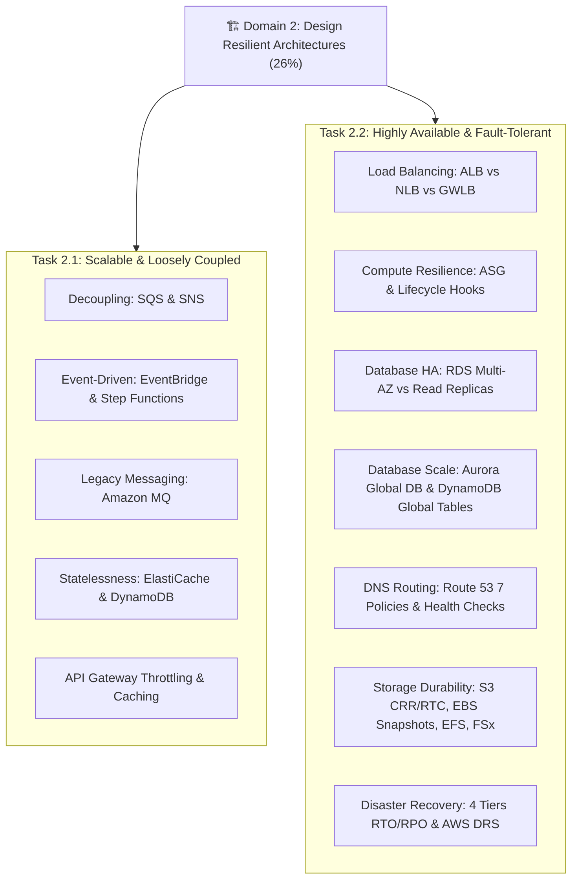

# 🏗️ Map of Content (MOC): Domain 2 - Design Resilient Architectures

> **Trọng số kỳ thi:** **26%** (Đứng thứ 2 trong 4 Domain của SAA-C03)  
> **Mục tiêu:** Thiết kế hệ thống đám mây có khả năng mở rộng linh hoạt, chịu lỗi, phân tán lỏng lẻo (decoupled), duy trì tính liên tục của doanh nghiệp và đáp ứng các tiêu chuẩn RTO/RPO khắt khe.

---

## 📊 Bảng Theo Dõi Tiến Độ Ôn Tập (Study Tracker)

| Phân loại | Tài liệu / Chủ đề | Liên kết | Trọng số thi | Trạng thái |
| :--- | :--- | :--- | :---: | :---: |
| **Blueprint** | Tổng quan kỳ thi & Tỷ trọng điểm | [[SAA-C03-Exam-Blueprint]] | High | 🟢 |
| **Task 2.1** | Design scalable and loosely coupled architectures | [[Task-2.1-Scalable-and-Loosely-Coupled]] | 26% | 🟢 |
| **Task 2.2** | Design highly available and/or fault-tolerant architectures | [[Task-2.2-Highly-Available-and-Fault-Tolerant]] | 26% | 🟢 |
| **Deep Dive** | SQS Visibility Timeout, DLQ, FIFO & SNS Fan-out | [[Decoupling-with-SQS-and-SNS]] | Very High | 🟢 |
| **Deep Dive** | EventBridge Event Buses, Replay & Step Functions | [[Event-Driven-Architectures-EventBridge-StepFunctions]] | High | 🟢 |
| **Deep Dive** | Elastic Load Balancing (ALB, NLB, GWLB, SNI, Draining) | [[Elastic-Load-Balancing-Deep-Dive]] | Very High | 🟢 |
| **Deep Dive** | EC2 Auto Scaling Groups, Policies & Lifecycle Hooks | [[EC2-Auto-Scaling-and-Compute-Resilience]] | Very High | 🟢 |
| **Deep Dive** | RDS Multi-AZ, Read Replicas & Aurora Global Database | [[RDS-and-Aurora-High-Availability]] | Very High | 🟢 |
| **Deep Dive** | DynamoDB Multi-AZ, Global Tables & PITR | [[DynamoDB-Resilience-and-Global-Tables]] | High | 🟢 |
| **Deep Dive** | Route 53 7 Routing Policies, Health Checks & Failover | [[Route-53-Routing-Policies-and-Failover]] | Very High | 🟢 |
| **Deep Dive** | S3 CRR/RTC, EBS Snapshots/Multi-Attach, EFS & FSx | [[Storage-Durability-S3-EBS-EFS-FSx]] | High | 🟢 |
| **Deep Dive** | 4 Mô hình Disaster Recovery (RTO/RPO) & AWS DRS | [[Disaster-Recovery-Strategies-RTO-RPO]] | Very High | 🟢 |
| **Matrix** | ALB vs NLB vs GWLB: Bảng so sánh chuyên sâu | [[Matrix-ALB-vs-NLB-vs-GWLB]] | Very High | 🟢 |
| **Matrix** | SQS vs SNS vs EventBridge vs Kinesis Data Streams | [[Matrix-SQS-vs-SNS-vs-EventBridge-vs-Kinesis]] | High | 🟢 |
| **Matrix** | RDS Multi-AZ (HA) vs Read Replicas (Read Scale) | [[Matrix-RDS-Multi-AZ-vs-Read-Replica]] | Very High | 🟢 |
| **Matrix** | 4 Cấp độ Disaster Recovery (Backup/Pilot/Warm/Active) | [[Matrix-Disaster-Recovery-Tiers]] | Very High | 🟢 |
| **Matrix** | Route 53: Khi nào dùng Routing Policy nào | [[Matrix-Route-53-Routing-Policies]] | High | 🟢 |
| **Matrix** | EBS vs EFS vs S3: Khả năng phục hồi và chịu lỗi lưu trữ | [[Matrix-Storage-Resilience-EBS-vs-EFS-vs-S3]] | High | 🟢 |
| **Practice** | 10 Kịch bản đề thi thực tế Domain 2 & Phân tích bẫy | [[Domain-2-Scenario-Walkthroughs]] | Very High | 🟢 |
| **Practice** | Bảng tra cứu từ khóa thi nhanh (Keyword Triggers) | [[Domain-2-Keyword-Triggers]] | Very High | 🟢 |
| **Review** | 30 Câu hỏi phản xạ nhanh (Active Recall Flashcards) | [[Domain-2-Quick-Recall]] | Very High | 🟢 |

---

## 🧭 Lộ trình ôn tập 4 bước Domain 2

1. **Bước 1 - Nắm khung lý thuyết:** Đọc 2 Task Statements (`[[Task-2.1-Scalable-and-Loosely-Coupled]]` & `[[Task-2.2-Highly-Available-and-Fault-Tolerant]]`).
2. **Bước 2 - Đào sâu các dịch vụ cốt lõi:** Đọc kỹ 9 bài Deep Dives để hiểu sâu cơ chế Visibility Timeout, ALB SNI/Cross-zone, Aurora Storage Quorum, ASG Lifecycle hooks và 4 cấp độ DR.
3. **Bước 3 - Khắc sâu điểm khác biệt:** Ôn tập 6 bảng Decision Matrices để phân biệt rõ ALB vs NLB, Multi-AZ vs Read Replica, SQS vs SNS vs EventBridge.
4. **Bước 4 - Luyện đề & Phản xạ bẫy:** Thực hành với 10 câu hỏi kịch bản trong `[[Domain-2-Scenario-Walkthroughs]]`, tra cứu `[[Domain-2-Keyword-Triggers]]` và tự kiểm tra bằng `[[Domain-2-Quick-Recall]]`.
