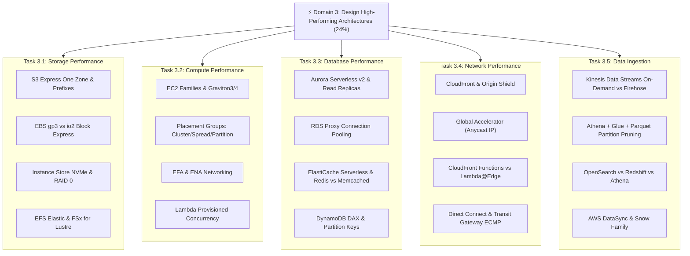

# ⚡ Map of Content (MOC): Domain 3 - Design High-Performing Architectures

> **Trọng số kỳ thi:** **24%** (Đứng thứ 3 trong 4 Domain của SAA-C03)  
> **Mục tiêu:** Thiết kế hệ thống đạt hiệu năng tối đa, độ trễ thấp nhất (sub-millisecond), thông lượng I/O cực đại và khả năng mở rộng quy mô dữ liệu lớn theo Well-Architected Performance Efficiency Pillar.

---

## 📊 Bảng Theo Dõi Tiến Độ Ôn Tập (Study Tracker)

| Phân loại | Tài liệu / Chủ đề | Liên kết | Trọng số thi | Trạng thái |
| :--- | :--- | :--- | :---: | :---: |
| **Blueprint** | Tổng quan kỳ thi & Tỷ trọng điểm | [[SAA-C03-Exam-Blueprint]] | High | 🟢 |
| **Task 3.1** | Determine high-performing and/or scalable storage solutions | [[Task-3.1-High-Performing-Storage]] | 24% | 🟢 |
| **Task 3.2** | Design high-performing and elastic compute solutions | [[Task-3.2-High-Performing-Compute]] | 24% | 🟢 |
| **Task 3.3** | Determine high-performing database solutions | [[Task-3.3-High-Performing-Databases]] | 24% | 🟢 |
| **Task 3.4** | Determine high-performing and/or scalable network architectures | [[Task-3.4-High-Performing-Networking]] | 24% | 🟢 |
| **Task 3.5** | Determine high-performing data ingestion and transformation solutions | [[Task-3.5-High-Performing-Data-Ingestion]] | 24% | 🟢 |
| **Deep Dive** | S3 Express One Zone, Directory Buckets & Prefix Scaling | [[S3-Express-One-Zone-and-Storage-Performance]] | Very High | 🟢 |
| **Deep Dive** | EBS gp3 vs io2 Block Express, RAID 0 & Instance Store | [[EBS-Volume-Types-gp3-and-io2-Block-Express]] | Very High | 🟢 |
| **Deep Dive** | EFS Elastic Throughput & FSx for Lustre HPC Storage | [[EFS-and-FSx-High-Throughput-Modes]] | High | 🟢 |
| **Deep Dive** | EC2 Placement Groups, EFA/ENA & Graviton Compute | [[EC2-Placement-Groups-and-HPC-Accelerators]] | Very High | 🟢 |
| **Deep Dive** | Lambda Memory-CPU Scaling & Provisioned Concurrency | [[Lambda-Performance-and-Provisioned-Concurrency]] | High | 🟢 |
| **Deep Dive** | Caching Deep Dive: ElastiCache Serverless & DynamoDB DAX | [[Caching-Deep-Dive-ElastiCache-and-DAX]] | Very High | 🟢 |
| **Deep Dive** | Aurora Serverless v2 ACU Scaling & RDS Proxy Pooling | [[Aurora-Serverless-v2-and-RDS-Proxy]] | Very High | 🟢 |
| **Deep Dive** | Data Lake Query Tuning: Athena, AWS Glue & Parquet Pruning | [[Data-Lake-Query-Tuning-Athena-Glue-Parquet]] | Very High | 🟢 |
| **Deep Dive** | CloudFront vs Global Accelerator & Edge Compute | [[CloudFront-vs-Global-Accelerator-Edge-Performance]] | Very High | 🟢 |
| **Deep Dive** | Real-Time Streaming: Kinesis On-Demand, Firehose & MSK | [[Real-Time-Streaming-Kinesis-and-MSK]] | High | 🟢 |
| **Matrix** | EBS Volume Types (gp3 vs io2 Block Express vs st1/sc1/Instance Store) | [[Matrix-EBS-Volume-Types]] | Very High | 🟢 |
| **Matrix** | S3 Performance Options (Standard vs Express One Zone vs One Zone-IA) | [[Matrix-S3-Performance-Options]] | Very High | 🟢 |
| **Matrix** | EC2 Placement Groups (Cluster vs Spread vs Partition) | [[Matrix-EC2-Placement-Groups]] | Very High | 🟢 |
| **Matrix** | ElastiCache Redis vs Memcached (Tính năng & Serverless) | [[Matrix-ElastiCache-Redis-vs-Memcached]] | High | 🟢 |
| **Matrix** | Analytics Engines: Athena vs Redshift vs OpenSearch | [[Matrix-Analytics-Athena-vs-Redshift-vs-OpenSearch]] | Very High | 🟢 |
| **Matrix** | CloudFront vs Global Accelerator: So sánh 10 tiêu chí | [[Matrix-CloudFront-vs-Global-Accelerator]] | Very High | 🟢 |
| **Matrix** | CloudFront Functions vs Lambda@Edge: So sánh Edge Compute | [[Matrix-CloudFront-Functions-vs-Lambda-at-Edge]] | High | 🟢 |
| **Practice** | 10 Kịch bản đề thi thực tế Domain 3 chuẩn 2026 & Phân tích bẫy | [[Domain-3-Scenario-Walkthroughs]] | Very High | 🟢 |
| **Practice** | Bảng tra cứu từ khóa thi nhanh (Keyword Triggers) | [[Domain-3-Keyword-Triggers]] | Very High | 🟢 |
| **Review** | 30 Câu hỏi phản xạ nhanh (Active Recall Flashcards) | [[Domain-3-Quick-Recall]] | Very High | 🟢 |

---

## 🧭 Lộ trình ôn tập 4 bước Domain 3

1. **Bước 1 - Khung năng lực:** Đọc 5 Task Statements (`Task 3.1` đến `Task 3.5`) để nắm rõ phạm vi khảo sát theo chuẩn Exam Guide.
2. **Bước 2 - Đào sâu công nghệ 2026:** Nắm vững các công nghệ mới: S3 Express One Zone, io2 Block Express, Aurora Serverless v2, ElastiCache Serverless, Parquet partition pruning và EFA.
3. **Bước 3 - Ma trận ra quyết định:** Ôn tập 7 bảng Decision Matrices để loại suy phương án sai trong vòng 15 giây.
4. **Bước 4 - Luyện đề & Phản xạ bẫy:** Thực hành với `[[Domain-3-Scenario-Walkthroughs]]`, tra cứu `[[Domain-3-Keyword-Triggers]]` và tự kiểm tra bằng `[[Domain-3-Quick-Recall]]`.
