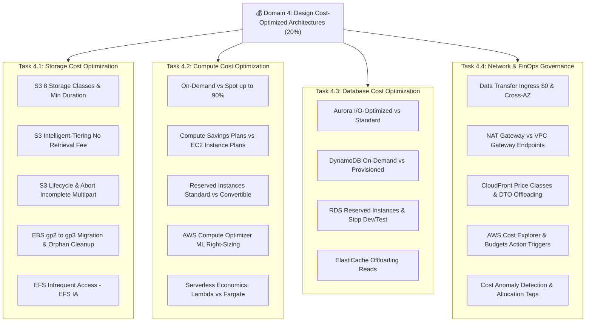

# 💰 Map of Content (MOC): Domain 4 - Design Cost-Optimized Architectures

> **Trọng số kỳ thi:** **20%** (Mảnh ghép cuối cùng hoàn tất 100% giáo trình SAA-C03)  
> **Mục tiêu:** Thiết kế hệ thống đám mây tiết kiệm chi phí tối đa, loại bỏ lãng phí tài nguyên, chọn đúng mô hình định giá (Pricing Models), tối ưu hóa cước truyền tải dữ liệu và quản trị chi phí tài chính (FinOps) theo Well-Architected Cost Optimization Pillar.

---

## 📊 Bảng Theo Dõi Tiến Độ Ôn Tập (Study Tracker)

| Phân loại | Tài liệu / Chủ đề | Liên kết | Trọng số thi | Trạng thái |
| :--- | :--- | :--- | :---: | :---: |
| **Blueprint** | Tổng quan kỳ thi & Tỷ trọng điểm 4 Domain (100%) | [[SAA-C03-Exam-Blueprint]] | High | 🟢 |
| **Task 4.1** | Design cost-optimized storage solutions | [[Task-4.1-Cost-Optimized-Storage]] | 20% | 🟢 |
| **Task 4.2** | Design cost-optimized compute solutions | [[Task-4.2-Cost-Optimized-Compute]] | 20% | 🟢 |
| **Task 4.3** | Design cost-optimized database solutions | [[Task-4.3-Cost-Optimized-Databases]] | 20% | 🟢 |
| **Task 4.4** | Design cost-optimized network architectures | [[Task-4.4-Cost-Optimized-Networking]] | 20% | 🟢 |
| **Deep Dive** | S3 Lifecycle, 8 Storage Classes & Cước lưu tối thiểu | [[S3-Lifecycle-and-Storage-Classes-Cost-Tuning]] | Very High | 🟢 |
| **Deep Dive** | EC2 Pricing Models: Spot 90%, Savings Plans & RIs | [[EC2-Pricing-Models-Spot-Savings-Plans-and-RIs]] | Very High | 🟢 |
| **Deep Dive** | Aurora I/O-Optimized vs Standard (Ngưỡng 25-33% I/O) | [[Aurora-Storage-Configurations-Standard-vs-IO-Optimized]] | Very High | 🟢 |
| **Deep Dive** | Chi phí Data Transfer & NAT Gateway vs Gateway Endpoints | [[Data-Transfer-Costs-and-VPC-Endpoints-vs-NAT]] | Very High | 🟢 |
| **Deep Dive** | DynamoDB Cost Models: On-Demand vs Provisioned Capacity | [[DynamoDB-Cost-Models-On-Demand-vs-Provisioned]] | High | 🟢 |
| **Deep Dive** | Tối ưu hóa lưu trữ EBS (gp3) & EFS Infrequent Access | [[EFS-and-EBS-Storage-Cost-Optimization]] | High | 🟢 |
| **Deep Dive** | AWS Compute Optimizer: Hạ cỡ máy chủ (Right-Sizing) | [[AWS-Compute-Optimizer-and-Right-Sizing]] | High | 🟢 |
| **Deep Dive** | AWS Cost Governance: Budgets, Anomaly Detection & Tags | [[AWS-Cost-Governance-Budgets-Anomaly-and-Tags]] | High | 🟢 |
| **Deep Dive** | CloudFront Cost Optimization & Price Classes | [[CloudFront-Cost-Optimization-and-Price-Classes]] | Medium | 🟢 |
| **Matrix** | EC2 Pricing Models (On-Demand vs Spot vs Savings Plans) | [[Matrix-EC2-Pricing-Models]] | Very High | 🟢 |
| **Matrix** | S3 Storage Classes: Bảng so sánh cước phí và truy xuất | [[Matrix-S3-Storage-Classes-Cost-and-Retrieval]] | Very High | 🟢 |
| **Matrix** | Aurora Standard vs I/O-Optimized: Điểm hòa vốn chi phí | [[Matrix-Aurora-Standard-vs-IO-Optimized]] | Very High | 🟢 |
| **Matrix** | NAT Gateway vs VPC Endpoints: Tiết kiệm hàng ngàn USD | [[Matrix-NAT-Gateway-vs-VPC-Endpoints]] | Very High | 🟢 |
| **Matrix** | DynamoDB On-Demand vs Provisioned: Điểm giao cắt | [[Matrix-DynamoDB-On-Demand-vs-Provisioned]] | High | 🟢 |
| **Matrix** | Bộ công cụ quản lý chi phí (Cost Explorer, Budgets, CUR) | [[Matrix-AWS-Cost-Management-Tools]] | High | 🟢 |
| **Practice** | 10 Kịch bản đề thi thực tế Domain 4 chuẩn 2026 & Phân tích bẫy | [[Domain-4-Scenario-Walkthroughs]] | Very High | 🟢 |
| **Practice** | Bảng tra cứu từ khóa thi nhanh (Keyword Triggers) | [[Domain-4-Keyword-Triggers]] | Very High | 🟢 |
| **Review** | 30 Câu hỏi phản xạ nhanh (Active Recall Flashcards) | [[Domain-4-Quick-Recall]] | Very High | 🟢 |

---

## 🧭 Lộ trình ôn tập 4 bước Domain 4

1. **Bước 1 - Khung năng lực FinOps:** Đọc 4 Task Statements (`Task 4.1` đến `Task 4.4`) để nắm vững các nguyên tắc kiến trúc tối ưu chi phí.
2. **Bước 2 - Các điểm cắt chi phí (Cost Crossover Points):** Nắm chắc ngưỡng 25-33% I/O của Aurora I/O-Optimized, cước $0.045/GB của NAT Gateway, và các mốc ngày tối thiểu của S3 (30, 90, 180 ngày).
3. **Bước 3 - Ma trận so sánh:** Ôn tập 6 bảng Decision Matrices để loại trừ ngay các phương án lãng phí tiền bạc trong đề thi.
4. **Bước 4 - Luyện đề & Phản xạ bẫy:** Thực hành với `[[Domain-4-Scenario-Walkthroughs]]`, tra cứu `[[Domain-4-Keyword-Triggers]]` và tự kiểm tra bằng `[[Domain-4-Quick-Recall]]`.
