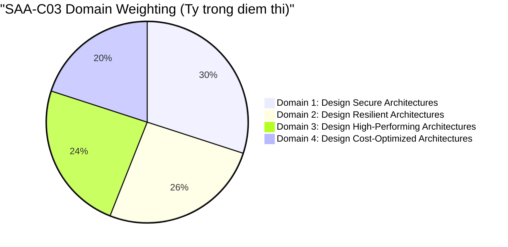

# 📋 AWS Certified Solutions Architect – Associate (SAA-C03) Exam Blueprint

> Trở về: [[00-Domain-1-MOC]] | [[00-Domain-2-MOC]] | [[00-Domain-3-MOC]] | [[00-Domain-4-MOC]]

---

## 1. Tổng quan kỳ thi (Exam Specifications)

| Thông số | Chi tiết |
| :--- | :--- |
| **Mã đề thi (Exam Code)** | SAA-C03 |
| **Thời lượng (Duration)** | 130 phút *(Thêm 30 phút cho người nói tiếng Anh như ngôn ngữ thứ hai - ESL +30 min)* |
| **Số lượng câu hỏi** | 65 câu (50 câu tính điểm + 15 câu thử nghiệm không tính điểm) |
| **Dạng câu hỏi** | Trắc nghiệm chọn 1 (Multiple choice) và chọn nhiều (Multiple response - chọn 2 hoặc 3) |
| **Điểm đỗ (Passing Score)** | **720 / 1000** (Thang điểm chuẩn hóa Scaled Score: 100 - 1000) |
| **Phí thi** | $150 USD |
| **Hiệu lực chứng chỉ** | 3 năm |

---

## 2. Phân bổ trọng số 4 Domain (Domain Weighting)

1. **Domain 1: Design Secure Architectures (30% - ~20 câu hỏi):**
   - Bảo mật danh tính, phân quyền IAM, multi-account, bảo vệ dữ liệu at-rest/in-transit, an ninh mạng VPC, edge security.
2. **Domain 2: Design Resilient Architectures (26% - ~17 câu hỏi):**
   - Multi-AZ, Multi-Region, Auto Scaling, Loosely coupled architectures (SQS, SNS, EventBridge), Disaster Recovery (RTO/RPO).
3. **Domain 3: Design High-Performing Architectures (24% - ~15 câu hỏi):**
   - Compute hiệu năng cao, Caching (ElastiCache, CloudFront), Cơ sở dữ liệu (Aurora, DynamoDB), Storage throughput/IOPS.
4. **Domain 4: Design Cost-Optimized Architectures (20% - ~13 câu hỏi):**
   - Lựa chọn pricing model (Savings Plans, Spot, On-demand), S3 Lifecycle, VPC Endpoint vs NAT Gateway cost, Data transfer cost.

---

## 3. Chiến lược làm bài & Quản lý thời gian

### Phân bổ 130 phút
- **65 câu hỏi / 130 phút** = Trung bình **2 phút / câu**.
- **Vòng 1 (0 - 90 phút):** Đọc nhanh và trả lời các câu hỏi chắc chắn. Nếu câu hỏi quá dài hoặc phân vân 2 đáp án, chọn đáp án tiềm năng nhất và bấm **"Flag for review"**. Tuyệt đối không dừng lại quá 2.5 phút ở một câu.
- **Vòng 2 (90 - 120 phút):** Xem lại toàn bộ các câu đã Flag. Đọc kỹ lại từ khóa yêu cầu (e.g., "LEAST operational overhead", "MOST cost-effective").
- **Vòng 3 (120 - 130 phút):** Kiểm tra lại để đảm bảo không bỏ sót bất kỳ câu nào (không bị trừ điểm khi chọn sai).

---

## 4. Phương pháp loại suy đáp án (Elimination Technique)

Đề thi SAA-C03 luôn có cấu trúc 4 đáp án:
1. **1 Đáp án đúng hoàn toàn**: Giải quyết đúng mục tiêu kiến trúc và thỏa mãn ràng buộc chính (chi phí, độ trễ, công sức vận hành).
2. **1 Đáp án mồi nhử (Distractor) chất lượng cao**: Đúng về mặt kỹ thuật nhưng **không tối ưu nhất** (ví dụ: dùng giải pháp tự dựng EC2 thay vì dịch vụ Managed, hoặc tốn kém chi phí hơn).
3. **2 Đáp án sai rõ ràng**: Vi phạm nguyên tắc bảo mật (ví dụ: hardcode access keys), tính năng không tồn tại, hoặc không giải quyết được vấn đề.

> **Mẹo:** Khi câu hỏi yêu cầu *"LEAST operational overhead"* (ít công sức vận hành nhất) $\rightarrow$ Ưu tiên chọn **Serverless / Fully-managed services** (Lambda, SQS, DynamoDB, Secrets Manager) thay vì tự quản lý EC2.
