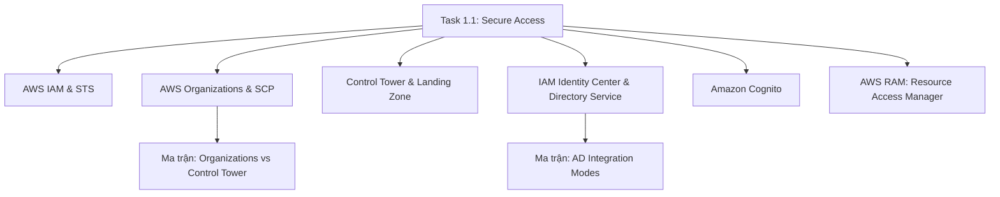

# 🔑 Task 1.1: Design Secure Access to AWS Resources

> Trở về: [[00-Domain-1-MOC]]  
> Trọng số: Chiếm khoảng 35-40% số câu hỏi của Domain 1 (~10-12% tổng bài thi SAA-C03).

---

## 🎯 Mục tiêu khảo sát của AWS (Official Examination Scope)

Task Statement này đánh giá khả năng thiết kế kiến trúc quản lý định danh và quyền truy cập vào tài nguyên AWS:
1. **Kiểm soát truy cập dựa trên nguyên tắc đặc quyền tối thiểu (Principle of Least Privilege)** cho con người và ứng dụng.
2. **Cấp phát chứng chỉ xác thực tạm thời (Temporary Credentials)** thay vì sử dụng khóa dài hạn (Long-term Access Keys).
3. **Thiết lập cơ chế quản trị tài khoản đa cấp (Multi-Account Governance & Guardrails)** bằng AWS Organizations và Service Control Policies (SCPs).
4. **Tích hợp định danh doanh nghiệp (Identity Federation & SSO)** với Active Directory, SAML 2.0 và OpenID Connect (OIDC).
5. **Chia sẻ tài nguyên an toàn giữa các tài khoản AWS** mà không cần trùng lặp tài nguyên.

---

## 🗺️ Bản đồ dịch vụ và liên kết chuyên sâu

---

## 📌 Các chủ đề trọng tâm trong đề thi

### 1. IAM Policies & Quyền hạn tạm thời (STS)
- **IAM Roles vs IAM Users:** Không bao giờ lưu trữ `Access Key ID` và `Secret Access Key` trong file cấu hình hay mã nguồn. Mọi ứng dụng chạy trên EC2, ECS, Lambda đều phải dùng **IAM Role** (gắn qua Instance Profile hoặc Task Role).
- **Cơ chế đánh giá Policy (Evaluation Logic):**
  $$\text{Explicit Deny} > \text{Explicit Allow} > \text{Implicit Deny (Mặc định từ chối)}$$
- **STS AssumeRole & Cross-Account:** Ủy quyền chéo tài khoản an toàn thông qua STS. Sử dụng `ExternalId` để phòng chống tấn công **Confused Deputy Problem** khi chia sẻ quyền cho bên thứ ba (SaaS).
- 👉 *Xem chi tiết tại:* [[IAM-and-STS-Deep-Dive]]

### 2. Quản trị Đa tài khoản & Rào chắn bảo vệ (SCPs & Control Tower)
- **AWS Organizations:** Gom nhóm các tài khoản AWS vào các Đơn vị Tổ chức (Organizational Units - OUs).
- **Service Control Policies (SCPs):** 
  - Đóng vai trò là **Guardrails (Rào chắn an ninh tối đa)**.
  - **Lưu ý cốt lõi:** SCP chỉ giới hạn quyền tối đa có thể có, **không bao giờ trực tiếp cấp quyền (grant permissions)** cho người dùng. Người dùng vẫn bắt buộc phải có IAM Policy Allow tương ứng.
  - SCP áp dụng lên cả Root user của Member Account (nhưng không áp dụng lên Management/Root Account của Organization).
- **AWS Control Tower & Landing Zone:**
  - Thiết lập môi trường đa tài khoản chuẩn mực (Landing Zone) với **ít công sức vận hành nhất (Least operational overhead)**.
  - Tự động dựng sẵn **Security OU** chứa **Log Archive Account** (lưu trữ S3 bất khả xâm phạm gom toàn bộ CloudTrail/Config) và **Audit Account** (cho đội SecOps).
  - Cung cấp **Account Factory** (dựa trên Service Catalog) để tự động cấp phát tài khoản mới đã cài sẵn Guardrails và VPC baseline.
  - Quản trị 3 loại Guardrails: **Preventive (SCPs)**, **Detective (AWS Config)** và **Proactive (CloudFormation Guard)**.
- 👉 *Xem chi tiết tại:* [[AWS-Organizations-and-SCPs]], [[AWS-Control-Tower-and-Landing-Zone]] & [[Matrix-Organizations-vs-Control-Tower]]

### 3. Định danh Doanh nghiệp & Single Sign-On
- **AWS IAM Identity Center (tiền thân là AWS SSO):** Giải pháp chuẩn cho việc đăng nhập 1 lần vào nhiều tài khoản AWS và các ứng dụng đám mây (Salesforce, Microsoft 365).
- **AWS Directory Service:** 
  - *AWS Managed Microsoft AD:* Khi cần join domain Windows hoặc thiết lập Trust Relationship 2 chiều với Active Directory on-premises.
  - *AD Connector:* Đóng vai trò Proxy chuyển tiếp xác thực về On-premises AD mà không lưu cache user trên AWS.
- 👉 *Xem chi tiết tại:* [[Directory-Service-and-IAM-Identity-Center]] & [[Matrix-AD-Integration-Modes]]

### 4. Định danh cho Khách hàng ứng dụng Web/Mobile (Cognito)
- **Cognito User Pools:** Đóng vai trò Identity Provider (Xác thực - Authentication), xử lý Đăng ký, Đăng nhập, MFA, trả về JSON Web Tokens (JWT).
- **Cognito Identity Pools (Federated Identities):** Đóng vai trò Ủy quyền (Authorization), đổi token lấy **Temporary AWS Credentials** để client trực tiếp gọi dịch vụ AWS (như tải file lên S3, đọc DynamoDB).
- 👉 *Xem chi tiết tại:* [[Amazon-Cognito-Architecture]]

### 5. Chia sẻ tài nguyên đa tài khoản (AWS RAM)
- Cho phép chia sẻ tài nguyên giữa các tài khoản trong cùng Organization mà không phải tạo mới.
- **Tài nguyên hỗ trợ tiêu biểu:** VPC Subnets (chia sẻ Subnet dùng chung VPC), Transit Gateway, Route 53 Resolver Rules, License Manager.

---

## ⚠️ Bẫy đề thi hay gặp (Exam Traps)

1. **Bẫy 1 - Gán quyền cho EC2:** Đề bài đưa ra giải pháp "Tạo IAM User, lưu credentials vào file config trên EC2" $\rightarrow$ **SAI**. Đáp án đúng luôn là tạo **IAM Role** và gán vào EC2 Instance Profile.
2. **Bẫy 2 - Bản chất của SCP:** Đề bài hỏi "Làm sao để cho phép Developer trong member account truy cập S3 bucket bằng SCP?" $\rightarrow$ **Bẫy**. SCP không cấp quyền, cần cấp bằng IAM Policy trong member account và đảm bảo SCP không chặn.
3. **Bẫy 3 - Confused Deputy:** Khi tích hợp một dịch vụ của bên thứ ba (Third-party monitoring service) vào tài khoản AWS, đề bài hỏi tham số nào ngăn chặn rủi ro đại diện bị lừa $\rightarrow$ Đáp án bắt buộc phải có **`sts:ExternalId`**.
