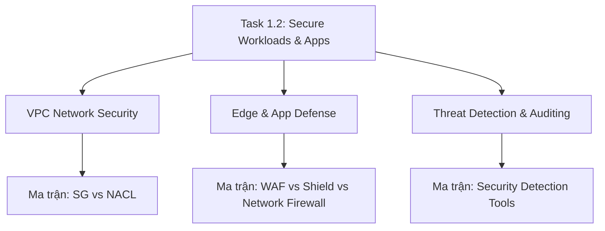

# 🛡️ Task 1.2: Design Secure Workloads and Applications

> Trở về: [[00-Domain-1-MOC]]  
> Trọng số: Chiếm khoảng 35-40% số câu hỏi của Domain 1 (~10-12% tổng bài thi SAA-C03).

---

## 🎯 Mục tiêu khảo sát của AWS (Official Examination Scope)

Task Statement này đánh giá khả năng bảo vệ hạ tầng tính toán, cô lập mạng và phòng thủ đa tầng (Defense in Depth) trước các cuộc tấn công mạng:
1. **Thiết kế ranh giới mạng VPC (Network Segmentation):** Tách biệt Public Subnets (Load Balancer, NAT Gateway) và Private Subnets (App servers, Databases).
2. **Kiểm soát lưu lượng mạng ở cấp Host và Subnet:** Áp dụng kết hợp Security Groups và Network ACLs.
3. **Kết nối riêng tư đến các dịch vụ AWS (Private Connectivity):** Sử dụng VPC Endpoints để lưu lượng không bao giờ đi qua Internet công cộng.
4. **Phòng thủ ở tầng biên (Edge & Application Protection):** Chống tấn công DDoS (AWS Shield) và ngăn chặn các lỗ hổng Web Application phổ biến (AWS WAF).
5. **Truy cập quản trị máy chủ an toàn:** Quản trị EC2 không cần mở cổng SSH (22) hay RDP (3389) và không cần dựng Bastion Host thông qua AWS Systems Manager Session Manager.
6. **Phát hiện mối đe dọa và đánh giá lỗ hổng:** Tự động giám sát hành vi bất thường (Amazon GuardDuty) và quét lỗ hổng phần mềm CVE (Amazon Inspector).

---

## 🗺️ Bản đồ dịch vụ và liên kết chuyên sâu

---

## 📌 Các chủ đề trọng tâm trong đề thi

### 1. Phân tầng bảo vệ mạng VPC (Defense in Depth)
- **Security Groups (SG):**
  - Hoạt động ở cấp độ **Instance / Elastic Network Interface (ENI)**.
  - **Stateful (Có trạng thái):** Lưu lượng được cho phép vào (Inbound) sẽ tự động được phép ra (Outbound) và ngược lại.
  - Chỉ có quy tắc **Allow** (không thể tạo Deny rule).
  - Có thể tham chiếu Security Group khác làm nguồn (`Source: sg-xxxxxx`) thay vì dùng dải IP CIDR.
- **Network ACLs (NACL):**
  - Hoạt động ở cấp độ **Subnet**.
  - **Stateless (Không có trạng thái):** Chiều vào và chiều ra phải được cấu hình độc lập.
  - Đánh số thứ tự (Rule Number từ 1 đến 32766, số nhỏ được kiểm tra trước, gặp luật khớp là dừng).
  - Hỗ trợ cả **Allow và Deny** $\rightarrow$ Dùng để **chặn tức thời 1 địa chỉ IP độc hại**.
  - Bắt buộc phải mở dải cổng tạm thời (**Ephemeral Ports: 1024-65535**) cho chiều phản hồi.
- 👉 *So sánh chi tiết tại:* [[Matrix-SG-vs-NACL]] & [[VPC-Network-Security-Layers]]

### 2. Kết nối riêng tư không qua Internet (VPC Endpoints)
- **Gateway Endpoints:** Chỉ hỗ trợ **S3** và **DynamoDB**. Cấu hình trực tiếp trong Route Table của Subnet, **hoàn toàn miễn phí**.
- **Interface Endpoints (AWS PrivateLink):** Hỗ trợ hầu hết các dịch vụ AWS khác (KMS, Secrets Manager, CloudWatch, v.v.). Tạo một ENI có IP riêng trong Subnet của bạn, **tính phí theo giờ và dung lượng dữ liệu**.

### 3. Quản trị máy chủ EC2 an toàn không cần Bastion Host
- **AWS Systems Manager Session Manager:** 
  - Cho phép kết nối shell/terminal vào EC2 nằm sâu trong Private Subnet qua trình duyệt hoặc AWS CLI.
  - **Không yêu cầu:** Mở cổng Inbound 22/3389, không cần Public IP, không cần quản lý SSH Key pair.
  - **Yêu cầu:** EC2 có cài SSM Agent, có quyền IAM (`AmazonSSMManagedInstanceCore`) và có đường kết nối Outbound tới SSM Endpoint (qua NAT Gateway hoặc Interface Endpoint).

### 4. Phòng thủ biên và tầng ứng dụng (WAF & Shield)
- **AWS WAF:** Bảo vệ ứng dụng ở **Layer 7 (HTTP/HTTPS)** trước các cuộc tấn công SQL Injection (SQLi), Cross-Site Scripting (XSS), HTTP Flood rate limiting. Gắn được vào: ALB, API Gateway, CloudFront, AppSync, Cognito.
- **AWS Shield Standard:** Tự động kích hoạt miễn phí cho mọi tài nguyên AWS, bảo vệ trước DDoS Layer 3/4 (SYN Flood, UDP Reflection).
- **AWS Shield Advanced:** Trả phí ($3,000/tháng), hỗ trợ đội phản ứng nhanh AWS DDoS Response Team (DRT), bảo vệ tài chính chống lại đột biến chi phí (Cost Protection).
- 👉 *So sánh chi tiết tại:* [[Matrix-WAF-vs-Shield-vs-Firewall]] & [[Edge-and-App-Defense]]

### 5. Giám sát an ninh và phát hiện xâm nhập
- **Amazon GuardDuty:** Phân tích thông minh bằng Machine Learning trên các nguồn log hệ thống: **VPC Flow Logs, DNS Query Logs, CloudTrail Management & S3 Data Events, EKS Audit Logs**. Hoạt động hoàn toàn ngầm, không cần cài Agent.
- **Amazon Inspector:** Quét lỗ hổng bảo mật phần mềm (CVE) và phơi bày mạng không chủ ý cho **EC2 (thông qua SSM Agent), Container Images trong ECR, và mã nguồn AWS Lambda**.
- 👉 *So sánh chi tiết tại:* [[Matrix-Security-Detection-Tools]] & [[Threat-Detection-and-Auditing]]

---

## ⚠️ Bẫy đề thi hay gặp (Exam Traps)

1. **Bẫy 1 - Chặn IP đơn lẻ:** "Một hacker đang tấn công web từ IP 203.0.113.50, làm sao ngăn chặn nhanh nhất?"
   - Đề bài đưa ra Security Group Deny rule $\rightarrow$ **SAI** (SG không có Deny rule).
   - Đáp án đúng: Thêm **Deny rule trong Inbound NACL** với số thứ tự nhỏ hơn rule Allow.
2. **Bẫy 2 - Kết nối S3 riêng tư tối ưu chi phí:** Câu hỏi yêu cầu kết nối từ EC2 trong Private Subnet tới S3 không qua Internet và *tối ưu chi phí nhất* $\rightarrow$ Chọn **VPC Gateway Endpoint** (miễn phí), không chọn Interface Endpoint (mất phí).
3. **Bẫy 3 - Quản trị EC2 an toàn:** Yêu cầu admin truy cập terminal của máy chủ EC2 mà không cần public IP và không cần mở cổng mạng $\rightarrow$ Chọn **Systems Manager Session Manager**, loại trừ phương án Bastion Host.
