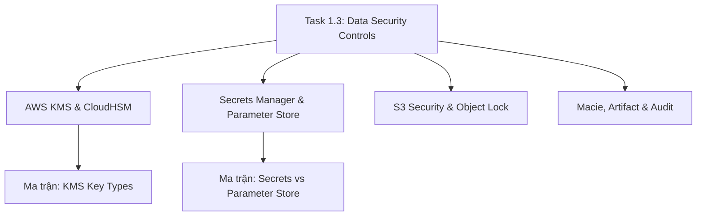

# 🔐 Task 1.3: Determine Appropriate Data Security Controls

> Trở về: [[00-Domain-1-MOC]]  
> Trọng số: Chiếm khoảng 25-30% số câu hỏi của Domain 1 (~8-10% tổng bài thi SAA-C03).

---

## 🎯 Mục tiêu khảo sát của AWS (Official Examination Scope)

Task Statement này tập trung vào việc bảo vệ tính bảo mật, toàn vẹn và tuân thủ pháp lý của dữ liệu:
1. **Mã hóa dữ liệu khi nghỉ (Encryption at Rest):** Lựa chọn đúng giải pháp mã hóa cho S3, EBS, RDS, Aurora, DynamoDB bằng AWS KMS hoặc AWS CloudHSM.
2. **Mã hóa dữ liệu khi truyền tải (Encryption in Transit):** Triển khai giao thức TLS/HTTPS bằng chứng chỉ số từ AWS Certificate Manager (ACM).
3. **Quản lý khóa mã hóa & Phân tách trách nhiệm:** Phân biệt các loại khóa KMS, cơ chế Envelope Encryption và xoay khóa định kỳ (Key Rotation).
4. **Quản lý bí mật và cấu hình an toàn:** Lưu trữ credentials an toàn, tự động xoay mật khẩu cơ sở dữ liệu bằng AWS Secrets Manager vs Parameter Store.
5. **Chống giả mạo và tuân thủ lưu trữ dữ liệu (WORM):** Sử dụng Amazon S3 Object Lock để đáp ứng các quy định khắt khe của ngành tài chính/y tế.
6. **Tự động rà soát dữ liệu nhạy cảm (PII Discovery):** Dùng Amazon Macie để phát hiện thông tin định danh cá nhân bị lộ lọt.

---

## 🗺️ Bản đồ dịch vụ và liên kết chuyên sâu

---

## 📌 Các chủ đề trọng tâm trong đề thi

### 1. Mã hóa Dữ liệu khi nghỉ (AWS KMS vs CloudHSM)
- **AWS Key Management Service (KMS):**
  - **AWS Owned Keys:** Khóa của AWS, miễn phí, người dùng không nhìn thấy, không thể can thiệp hay kiểm toán log.
  - **AWS Managed Keys:** Tạo sẵn theo dịch vụ (`aws/s3`, `aws/rds`), miễn phí tạo khóa, người dùng không thể cấu hình policy hay đổi lịch xoay khóa (mặc định xoay mỗi 1 năm).
  - **Customer Managed Keys (CMKs):** Khách hàng toàn quyền quản trị, có thể bật/tắt, tạo alias, thiết lập **Key Policy**, bật tự động xoay khóa hàng năm (Automatic Key Rotation), hoặc tạo khóa bất đối xứng (Asymmetric Keys). $1/tháng/key.
  - **Multi-Region Keys:** Khóa có cùng Key ID và Key Material được nhân bản giữa nhiều Region, giải quyết bài toán mã hóa trong kiến trúc Multi-Region Disaster Recovery mà không cần giải mã rồi mã hóa lại.
- **AWS CloudHSM:** Phần cứng phần cứng mã hóa chuyên dụng (Hardware Security Module), đạt chuẩn **FIPS 140-2 Level 3**, đơn khách hàng (Single-tenant). Dành cho các yêu cầu pháp lý cực kỳ nghiêm ngặt mà KMS (FIPS 140-2 Level 2/3 multi-tenant) không thỏa mãn.
- 👉 *So sánh chi tiết tại:* [[Matrix-KMS-Key-Types]] & [[AWS-KMS-and-CloudHSM]]

### 2. Quản lý Mật khẩu & Cấu hình Ứng dụng
- **AWS Secrets Manager:**
  - Thiết kế chuyên dụng cho Database Credentials, API Keys, OAuth tokens.
  - Tính năng ăn điểm trong đề thi: **Tự động xoay vòng mật khẩu (Automatic Rotation)** thông qua Lambda function tích hợp sẵn cho Amazon RDS, Aurora, DocumentDB.
  - Cho phép nhân bản Secret sang nhiều Region (Multi-Region Secret Replication).
- **AWS Systems Manager (SSM) Parameter Store:**
  - Kho lưu trữ key-value phân cấp cho cấu hình ứng dụng (`/dev/db/endpoint`, `/prod/app/timeout`).
  - Hỗ trợ kiểu dữ liệu `SecureString` mã hóa bằng KMS.
  - Tầng Standard hoàn toàn miễn phí (tối đa 4KB).
  - **Không hỗ trợ tự động xoay mật khẩu sẵn có** (phải tự viết custom script).
- 👉 *So sánh chi tiết tại:* [[Matrix-Secrets-vs-Parameter-Store]] & [[Secrets-Manager-and-Parameter-Store]]

### 3. Bảo vệ dữ liệu trên Amazon S3
- **4 Chế độ Server-Side Encryption (SSE):**
  - `SSE-S3`: Mã hóa mặc định dùng khóa của S3 (AES-256).
  - `SSE-KMS`: Mã hóa dùng khóa KMS (kiểm toán được qua CloudTrail, áp đặt Key Policy).
  - `DSSE-KMS`: Dual-layer Server-Side Encryption (mã hóa kép 2 lớp bảo vệ).
  - `SSE-C`: Khách hàng tự cung cấp và quản lý khóa mã hóa qua HTTP headers.
- **S3 Block Public Access:** 4 tùy chọn rào chắn toàn diện ở cấp Account hoặc Bucket để ngăn chặn mọi rủi ro lộ lọt dữ liệu ra ngoài Internet.
- **S3 Object Lock (Mô hình WORM - Write Once, Read Many):**
  - **Governance Mode:** Cho phép user có quyền IAM đặc biệt (`s3:BypassGovernanceRetention`) sửa/xóa đối tượng trước thời hạn.
  - **Compliance Mode:** **Tuyệt đối không ai có thể sửa hoặc xóa** đối tượng trước hạn retention, kể cả tài khoản Root của AWS!
  - **Legal Hold:** Đặt khóa giữ đối tượng vô thời hạn cho tới khi được gỡ bỏ rõ ràng.
- 👉 *Xem chi tiết tại:* [[S3-Security-and-Compliance]]

### 4. Phát hiện dữ liệu nhạy cảm & Báo cáo kiểm toán
- **Amazon Macie:** Quét các S3 bucket để tự động nhận diện dữ liệu nhạy cảm PII (Personal Identifiable Information: số thẻ tín dụng, CMND/CCCD, hộ chiếu, thông tin y tế).
- **AWS Artifact:** Cổng thông tin cho phép tải trực tiếp các chứng chỉ và báo cáo kiểm toán bảo mật của chính AWS (SOC 1/2/3, ISO, PCI-DSS) để nộp cho cơ quan kiểm toán của công ty.

---

## ⚠️ Bẫy đề thi hay gặp (Exam Traps)

1. **Bẫy 1 - Yêu cầu xoay mật khẩu DB định kỳ:** Câu hỏi yêu cầu "Lưu trữ thông tin đăng nhập database và xoay vòng mật khẩu tự động mỗi 30 ngày với ít công sức vận hành nhất" $\rightarrow$ Chọn **AWS Secrets Manager**, không chọn SSM Parameter Store (vì Parameter Store không có sẵn cơ chế auto-rotation).
2. **Bẫy 2 - Khóa đối tượng WORM tuyệt đối:** "Quy định tài chính yêu cầu dữ liệu không được xóa hoặc chỉnh sửa trong 5 năm, ngay cả tài khoản quản trị cao nhất cũng không được xóa" $\rightarrow$ Chọn **S3 Object Lock ở Compliance Mode** (chọn Governance Mode là sai vì Admin có thể bypass).
3. **Bẫy 3 - FIPS 140-2 Level 3 và toàn quyền kiểm soát phần cứng:** Khi đề bài nhấn mạnh đến việc "Công ty phải sở hữu thiết bị mã hóa phần cứng chuyên dụng độc lập để thỏa mãn tiêu chuẩn FIPS 140-2 Level 3" $\rightarrow$ Chọn **AWS CloudHSM**, không chọn AWS KMS.
