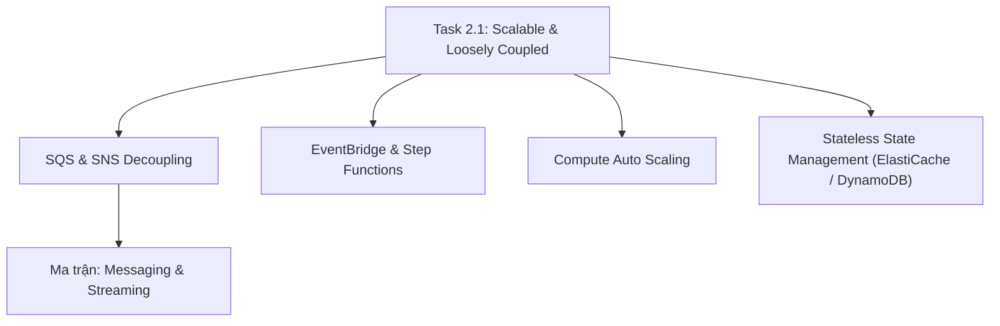

# 🔗 Task 2.1: Design Scalable and Loosely Coupled Architectures

> Trở về: [[00-Domain-2-MOC]]  
> Trọng số: Chiếm khoảng 50% số câu hỏi của Domain 2 (~12-14% tổng bài thi SAA-C03).

---

## 🎯 Mục tiêu khảo sát của AWS (Official Examination Scope)

Task Statement này đánh giá khả năng thiết kế hệ thống phân tán, mở rộng động và không phụ thuộc chặt chẽ giữa các thành phần (loose coupling):
1. **Phân tách các thành phần (Decoupling):** Dùng cơ chế đệm (Buffering) và hàng đợi thông điệp để ngăn ngừa lỗi sập dây chuyền (Cascading Failure).
2. **Thiết kế kiến trúc hướng sự kiện (Event-Driven Architecture):** Xây dựng các luồng xử lý bất đồng bộ phản ứng với sự kiện thông qua Event Bus và Pub/Sub.
3. **Mở rộng ngang (Horizontal Scaling) vs Mở rộng dọc (Vertical Scaling):** Lựa chọn chiến lược mở rộng phù hợp cho từng loại tải.
4. **Kiến trúc phi trạng thái (Stateless Workloads):** Tách trạng thái phiên (Session State) ra khỏi máy chủ ứng dụng lưu vào bộ nhớ đệm hoặc cơ sở dữ liệu NoSQL.
5. **Điều tiết lưu lượng API (Traffic Throttling & Caching):** Sử dụng API Gateway để bảo vệ backend khỏi tình trạng quá tải.

---

## 🗺️ Bản đồ dịch vụ và liên kết chuyên sâu

---

## 📌 Các chủ đề trọng tâm trong đề thi

### 1. Phân tách hệ thống với Amazon SQS (Buffering & Decoupling)
- **Vấn đề kết nối chặt (Tightly Coupled):** Khi Web Tier gọi trực tiếp Database Tier để xử lý đơn hàng, nếu lượng truy cập tăng vọt, Database sẽ cạn kiệt kết nối và sập toàn bộ hệ thống.
- **Giải pháp tách rời (Loosely Coupled):** Chèn một **Amazon SQS Queue** ở giữa. Web Tier chỉ việc đẩy đơn hàng vào hàng đợi (producer), còn Worker Tier (EC2/Lambda) lấy đơn hàng ra xử lý dần (consumer).
- **Các thông số kỹ thuật cốt lõi cần nhớ:**
  - **Visibility Timeout:** Mặc định 30 giây (tối đa 12 giờ). Nếu tác vụ cần 5 phút, worker phải gọi API `ChangeMessageVisibility` để tránh worker khác xử lý trùng.
  - **Long Polling (`WaitTimeSeconds`: 1 - 20s):** Giúp worker chờ tin nhắn mới tới thay vì liên tục gọi API rỗng $\rightarrow$ giảm chi phí request và giảm độ trễ.
  - **Dead Letter Queue (DLQ):** Chứa các tin nhắn lỗi xử lý thất bại sau `maxReceiveCount` lần để cô lập điều tra.
  - **FIFO Queue:** Đảm bảo thứ tự tuyệt đối First-In-First-Out và loại trừ trùng lặp (`MessageDeduplicationId`), xử lý tối đa 300 msg/s (3,000 msg/s với batching).
- 👉 *Xem chi tiết tại:* [[Decoupling-with-SQS-and-SNS]]

### 2. Mô hình Phát tán thông báo (SNS Fan-Out Pattern)
- **Bài toán:** Khi có một sự kiện thanh toán hoàn tất, cần đồng thời:
  1. Gửi thông báo đến kho hàng (Warehouse SQS).
  2. Gửi thông báo đến hệ thống kế toán (Accounting SQS).
  3. Gửi thông báo phân tích gian lận (Analytics SQS).
- **Giải pháp Fan-out:** Đẩy message vào **1 Topic SNS**, sau đó đăng ký (Subscribe) nhiều hàng đợi SQS vào Topic đó.
- **SNS Message Filtering (Filter Policy):** Sử dụng các thuộc tính JSON để từng queue chỉ nhận đúng loại message nó quan tâm (ví dụ: chỉ nhận đơn hàng có giá trị `> $1000`).
- 👉 *Xem chi tiết tại:* [[Decoupling-with-SQS-and-SNS]]

### 3. Điều phối quy trình phức tạp: AWS Step Functions
- Sử dụng **State Machines** để xây dựng quy trình nhiều bước có logic rẽ nhánh, thử lại (Retry), xử lý ngoại lệ (Catch) và thời gian chờ (Wait).
- **Standard Workflows:** Dành cho các quy trình dài (chạy tối đa 1 năm), ghi nhận lịch sử thực thi đầy đủ.
- **Express Workflows:** Dành cho các sự kiện throughput cực cao (xử lý IoT, thanh toán nhanh), chạy tối đa 5 phút.

### 4. Thiết kế ứng dụng Phi trạng thái (Stateless Design)
- Máy chủ web EC2 không lưu phiên đăng nhập của người dùng trong bộ nhớ RAM cục bộ.
- Lưu trữ session người dùng vào:
  - **Amazon ElastiCache (Redis):** Tốc độ dưới 1 mili-giây (sub-millisecond latency).
  - **Amazon DynamoDB:** Cơ sở dữ liệu NoSQL Serverless tự động mở rộng theo nhu cầu.
- Lợi ích: Các máy chủ EC2 có thể bật/tắt tự do theo Auto Scaling mà người dùng không bao giờ bị văng đăng nhập.

---

## ⚠️ Bẫy đề thi hay gặp (Exam Traps)

| Tình huống đề thi | Đáp án bẫy (SAI) | Đáp án chuẩn (ĐÚNG) |
| :--- | :--- | :--- |
| Tin nhắn trong SQS bị xử lý lặp lại bởi nhiều worker khác nhau | Tăng số lượng worker EC2 | Tăng **Visibility Timeout** hoặc gọi **`ChangeMessageVisibility`** trong code |
| Chi phí SQS API calls quá cao khi hàng đợi thường xuyên trống | Đổi sang FIFO Queue | Bật **Long Polling** bằng cách đặt `ReceiveMessageWaitTimeSeconds > 0` (tối đa 20s) |
| Kích thước payload tin nhắn gửi vào SQS vượt quá 256 KB | Nén file zip và gửi vào SQS | Sử dụng **Amazon SQS Extended Client Library** lưu file lớn vào Amazon S3 |
| Di chuyển ứng dụng Java cũ đang dùng RabbitMQ/ActiveMQ lên AWS không sửa code | Viết lại ứng dụng dùng SQS | Triển khai **Amazon MQ** (Managed Apache ActiveMQ / RabbitMQ) |

---

## 🔗 Liên kết liên quan
- [[00-Domain-2-MOC]]
- [[Decoupling-with-SQS-and-SNS]]
- [[Event-Driven-Architectures-EventBridge-StepFunctions]]
- [[Matrix-SQS-vs-SNS-vs-EventBridge-vs-Kinesis]]
