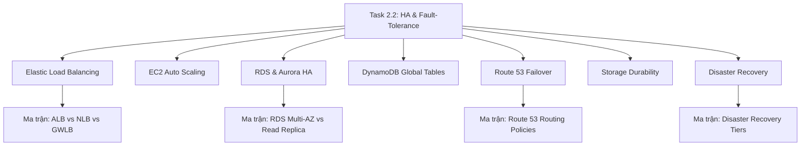

# 🛡️ Task 2.2: Design Highly Available and Fault-Tolerant Architectures

> Trở về: [[00-Domain-2-MOC]]  
> Trọng số: Chiếm khoảng 50% số câu hỏi của Domain 2 (~12-14% tổng bài thi SAA-C03).

---

## 🎯 Mục tiêu khảo sát của AWS (Official Examination Scope)

Task Statement này đánh giá khả năng thiết kế hệ thống có tính sẵn sàng cao, chịu được sự cố hạ tầng ở cấp độ Instance, Availability Zone (AZ) hoặc toàn bộ Region:
1. **Phân phối lưu lượng thông minh (Traffic Distribution & Load Balancing):** Lựa chọn đúng giữa ALB, NLB và GWLB, cấu hình Health Checks và Connection Draining.
2. **Khả dụng cao ở tầng tính toán (Fault-Tolerant Compute):** Thiết lập Auto Scaling Groups trải dài tối thiểu 2-3 Availability Zones với chính sách mở rộng và vòng đời máy chủ phù hợp.
3. **Khả dụng cao ở tầng dữ liệu (Database Resiliency):** Phân biệt RDS Multi-AZ (High Availability) vs Read Replicas (Scalability); tận dụng kiến trúc 6 bản sao của Amazon Aurora và Aurora Global Database.
4. **Định tuyến toàn cầu & Cơ chế Failover DNS:** Cấu hình 7 chính sách định tuyến của Amazon Route 53 kết hợp Health Checks.
5. **Độ bền bỉ dữ liệu lưu trữ (Storage Durability):** Khôi phục dữ liệu nhanh qua EBS Snapshots, EFS Regional Multi-AZ, và S3 Cross-Region Replication (CRR/RTC).
6. **Lập kế hoạch Khắc phục Thảm họa (Disaster Recovery - DR):** Lựa chọn 1 trong 4 chiến lược DR (Backup & Restore, Pilot Light, Warm Standby, Active-Active) tối ưu theo RTO và RPO.

---

## 🗺️ Bản đồ dịch vụ và liên kết chuyên sâu

---

## 📌 Các chủ đề trọng tâm trong đề thi

### 1. Cân bằng tải Elastic Load Balancing (ELB)
- **Application Load Balancer (ALB - Layer 7):** Hỗ trợ routing theo Path (`/api`), Host (`app.example.com`), Headers, Query parameters. Hỗ trợ **Server Name Indication (SNI)** để gắn nhiều chứng chỉ SSL/TLS lên cùng 1 listener. Mặc định Cross-Zone balancing luôn bật (miễn phí).
- **Network Load Balancer (NLB - Layer 4):** Xử lý hàng triệu request/giây với độ trễ cực thấp (micro-giây). Cung cấp **Static IP / Elastic IP cố định cho từng AZ**. Giữ nguyên IP của client (Client IP preservation). Cross-Zone balancing mặc định tắt (tính phí nếu bật).
- **Gateway Load Balancer (GWLB):** Dùng để chèn các cụm tường lửa hoặc IDS/IPS ảo của bên thứ ba (Palo Alto, Check Point) vào luồng mạng bằng giao thức GENEVE (port 6081).
- 👉 *So sánh chi tiết tại:* [[Matrix-ALB-vs-NLB-vs-GWLB]] & [[Elastic-Load-Balancing-Deep-Dive]]

### 2. Tính sẵn sàng cao của Cơ sở dữ liệu: RDS vs Aurora
- **RDS Multi-AZ (HA & DR):**
  - Sao chép **đồng bộ (Synchronous)** sang Standby Instance ở AZ khác.
  - Tự động Failover (60-120 giây) bằng cách đổi bản ghi CNAME DNS.
  - **Điểm chốt thi cử:** Standby instance **KHÔNG THỂ DÙNG ĐỂ ĐỌC HOẶC CHẠY BÁO CÁO**.
- **RDS Read Replicas (Hiệu năng đọc):**
  - Sao chép **bất đồng bộ (Asynchronous)**.
  - Dùng để giảm tải các câu lệnh SELECT (tối đa 15 replica).
  - Có thể tạo Cross-Region Read Replica làm phương án dự phòng DR.
- **Amazon Aurora:**
  - Tự động lưu trữ **6 bản sao dữ liệu trên 3 Availability Zones** (chịu được mất 2 bản sao mà vẫn ghi được, mất 3 bản sao mà vẫn đọc được).
  - **Aurora Global Database:** Tự động đồng bộ tầng lưu trữ xuyên Region với độ trễ replication < 1 giây, RTO < 1 phút.
- 👉 *So sánh chi tiết tại:* [[Matrix-RDS-Multi-AZ-vs-Read-Replica]] & [[RDS-and-Aurora-High-Availability]]

### 3. Amazon Route 53 & Kỹ thuật Failover
- **Alias Record vs CNAME:** Alias trỏ được Zone Apex (`example.com`), miễn phí DNS query tới tài nguyên AWS (ALB, CloudFront, S3 website). CNAME chỉ trỏ được subdomain (`www.example.com`).
- **Failover Routing Policy:** Cơ chế Active-Passive kết hợp Route 53 Health Checks. Khi hệ thống chính (Primary) ở Region A gặp sự cố, Route 53 tự động chuyển hướng traffic sang hệ thống phụ (Secondary) ở Region B hoặc trang thông báo tĩnh trên Amazon S3.
- 👉 *Xem chi tiết tại:* [[Matrix-Route-53-Routing-Policies]] & [[Route-53-Routing-Policies-and-Failover]]

### 4. Bốn Mô hình Khắc phục Thảm họa (Disaster Recovery - DR)
Đề thi luôn kiểm tra sự đánh đổi giữa **Chi phí** và **Thời gian gián đoạn (RTO/RPO)**:
1. **Backup & Restore (RTO/RPO tính bằng Giờ - Chi phí thấp nhất):** Sao lưu dữ liệu lên S3, khi có thảm họa mới dựng lại toàn bộ hạ tầng từ CloudFormation/Terraform.
2. **Pilot Light (RTO hàng chục phút, RPO vài phút - Chi phí Thấp):** Database core được bật cỡ nhỏ và replicate liên tục sang Region DR. Hạ tầng compute (EC2/ASG) tắt hoàn toàn, chỉ bật lên khi có thảm họa.
3. **Warm Standby (RTO vài phút, RPO vài giây - Chi phí Trung bình):** Một phiên bản thu nhỏ (Scaled-down version) của toàn bộ hệ thống chạy 24/7 ở Region DR. Khi có sự cố, hệ thống tự động scale up lên để đón tải.
4. **Multi-Site Active-Active (RTO ~ 0, RPO ~ 0 - Chi phí Cao nhất):** Hệ thống full-capacity chạy song song ở cả 2 Region, Route 53 chia tải liên tục.
- 👉 *So sánh chi tiết tại:* [[Matrix-Disaster-Recovery-Tiers]] & [[Disaster-Recovery-Strategies-RTO-RPO]]

---

## ⚠️ Bẫy đề thi hay gặp (Exam Traps)

| Tình huống đề thi | Đáp án bẫy (SAI) | Đáp án chuẩn (ĐÚNG) |
| :--- | :--- | :--- |
| Hệ thống web cần 1 địa chỉ IP tĩnh cố định duy nhất cho đối tác whitelist firewall | Dùng Application Load Balancer và gắn Elastic IP (ALB không hỗ trợ gán Elastic IP trực tiếp) | Sử dụng **Network Load Balancer (NLB)** (hỗ trợ Elastic IP cố định trên từng AZ) hoặc gán **AWS Global Accelerator** phía trước ALB |
| Database bị quá tải do các báo cáo phân tích nặng, cần giảm tải đọc cho Primary DB | Kích hoạt RDS Multi-AZ (Multi-AZ Standby không thể nhận truy vấn đọc) | Tạo **RDS Read Replicas** và cấu hình ứng dụng trỏ truy vấn đọc sang Reader Endpoint |
| Trỏ tên miền gốc (Zone Apex `example.com`) tới Application Load Balancer | Tạo bản ghi CNAME (CNAME không thể tạo cho Zone Apex theo chuẩn DNS) | Tạo **Route 53 Alias Record (A Record)** trỏ tới ALB |
| Yêu cầu RTO dưới 10 phút với chi phí thấp hơn mô hình Warm Standby | Chọn Multi-Site Active-Active | Chọn **Pilot Light** (giữ DB chạy nhỏ, compute bật khi cần) |

---

## 🔗 Liên kết liên quan
- [[00-Domain-2-MOC]]
- [[Elastic-Load-Balancing-Deep-Dive]]
- [[RDS-and-Aurora-High-Availability]]
- [[Disaster-Recovery-Strategies-RTO-RPO]]
- [[Route-53-Routing-Policies-and-Failover]]
