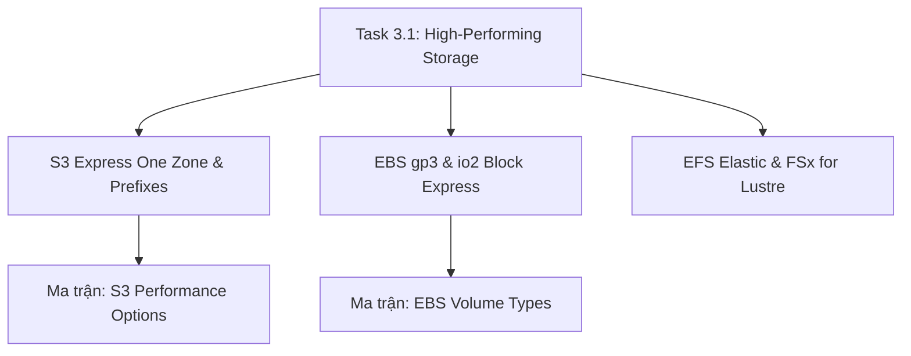

# 💾 Task 3.1: Determine High-Performing and Scalable Storage Solutions

> Trở về: [[00-Domain-3-MOC]]  
> Trọng số: Chiếm khoảng 20-25% số câu hỏi của Domain 3 (~5-6% tổng bài thi SAA-C03).

---

## 🎯 Mục tiêu khảo sát của AWS (Official Examination Scope)

Task Statement này đánh giá khả năng lựa chọn và tối ưu hóa các giải pháp lưu trữ đám mây đạt hiệu năng I/O tối đa, độ trễ thấp nhất và thông lượng mở rộng theo nhu cầu:
1. **Lựa chọn đúng loại lưu trữ (Storage Types):** Phân biệt đặc tính kỹ thuật giữa Block Storage (EBS, Instance Store), File Storage (EFS, FSx) và Object Storage (S3, S3 Express One Zone).
2. **Tối ưu hóa hiệu năng Amazon S3:** Nắm vững cấu trúc Directory Buckets của **S3 Express One Zone** (độ trễ single-digit millisecond), kỹ thuật phân vùng Prefix (3,500/5,500 req/s), Multipart Upload, Transfer Acceleration, Byte-Range Fetches và S3 Select.
3. **Cấu hình hiệu năng Amazon EBS:** Phân biệt `gp3` (baseline độc lập kích thước) và `io2 Block Express` (lên tới 256,000 IOPS), hiểu rõ khi nào dùng RAID 0 striping và khi nào tận dụng **Instance Store NVMe**.
4. **Hệ thống tệp chia sẻ hiệu năng cao:** Phân biệt các chế độ Throughput của EFS (Elastic vs Provisioned) và giải pháp HPC **FSx for Lustre** liên kết trực tiếp với S3.

---

## 🗺️ Bản đồ dịch vụ và liên kết chuyên sâu

---

## 📌 Các chủ đề trọng tâm trong đề thi

### 1. Amazon S3 Express One Zone vs S3 Standard
- **S3 Express One Zone (Trọng điểm mới 2026):**
  - Lưu trữ dưới dạng **Directory Buckets** nằm tại **1 Availability Zone duy nhất**.
  - Độ trễ truy xuất dữ liệu nhất quán **dưới 10 mili-giây (Single-digit ms)**, nhanh gấp **10 lần** so với S3 Standard.
  - Chi phí gọi Request rẻ hơn tới **80%** so với S3 Standard.
  - Phù hợp nhất cho: Huấn luyện Machine Learning, xử lý phân tích tài chính thời gian thực, co-locate máy chủ EC2 tính toán và bộ nhớ trong cùng 1 AZ.
- **S3 Standard & Kỹ thuật tăng tốc Prefix:**
  - Hỗ trợ **3,500 PUT/POST/DELETE** và **5,500 GET/HEAD requests/giây TRÊN MỖI PREFIX**.
  - Tải file lớn: Bắt buộc dùng **Multipart Upload** cho file > 5 GB, khuyến nghị cho file > 100 MB.
  - Tải về song song: Dùng **Byte-Range Fetches** để tải song song từng phần byte của file lớn.
  - Giảm dữ liệu truyền tải: Dùng **S3 Select** để chạy truy vấn SQL lọc dữ liệu trực tiếp tại S3.

### 2. Amazon EBS: gp3 vs io2 Block Express & Instance Store
- **`gp3`:** Mặc định cung cấp **3,000 IOPS và 125 MB/s miễn phí**. Có thể nâng cấp độc lập lên tới 16,000 IOPS và 1,000 MB/s mà không cần mua thêm dung lượng lưu trữ (rẻ hơn gp2 20%).
- **`io2 Block Express`:** Đạt chuẩn SAN trên cloud, tối đa **256,000 IOPS** và **4,000 MB/s throughput**, độ trễ sub-millisecond, độ bền 99.999% dành cho Mission-Critical RDBMS (SAP HANA, Oracle).
- **Instance Store (NVMe SSD):** Ổ đĩa gắn vật lý vào máy chủ, cho hàng triệu IOPS với độ trễ micro-giây. **Lưu ý:** Mất dữ liệu khi Stop instance (Ephemeral).
- **RAID 0 (Striping):** Gộp nhiều ổ đĩa EBS để nhân đôi thông lượng và IOPS cho các tác vụ cần I/O cực đại.

### 3. File Storage: EFS Elastic Throughput & FSx for Lustre
- **EFS Elastic Throughput Mode:** Tự động điều chỉnh thông lượng tức thì theo dung lượng đọc/ghi thực tế của ứng dụng, không cần dự đoán trước tải.
- **Amazon FSx for Lustre:** Hệ thống tệp POSIX cho tính toán hiệu năng cao (HPC), độ trễ sub-millisecond, liên kết 2 chiều đồng bộ với Amazon S3 Bucket.

---

## ⚠️ Bẫy đề thi hay gặp (Exam Traps)

| Tình huống đề thi | Đáp án bẫy (SAI) | Đáp án chuẩn (ĐÚNG) |
| :--- | :--- | :--- |
| Ứng dụng huấn luyện Machine Learning cần đọc hàng triệu file nhỏ từ S3 với độ trễ dưới 10ms và chi phí request rẻ nhất | Dùng S3 Standard hoặc S3 One Zone-IA (One Zone-IA dùng cho dữ liệu ít truy cập, chi phí request đắt) | Triển khai **Amazon S3 Express One Zone (Directory Buckets)** |
| Cơ sở dữ liệu Oracle đòi hỏi 100,000 IOPS và độ trễ dưới 1 mili-giây trên ổ cứng EBS | Mua ổ `gp3` dung lượng 16 TB (gp3 tối đa chỉ đạt 16,000 IOPS) | Sử dụng **Amazon EBS `io2 Block Express`** |
| Cần dung lượng lưu trữ đệm tạm thời (scratchpad) với hàng triệu IOPS cho máy chủ EC2 mà không lo mất dữ liệu khi reboot | Tạo nhiều ổ EBS gp3 | Sử dụng **EC2 Instance Store NVMe** (lưu ý: dữ liệu an toàn khi reboot, chỉ mất khi stop/terminate) |
| Cần tăng tốc tải file dung lượng 50 GB từ các chi nhánh toàn cầu lên S3 | Tăng băng thông Internet của chi nhánh | Sử dụng **S3 Multipart Upload kết hợp S3 Transfer Acceleration** |

---

## 🔗 Liên kết liên quan
- [[00-Domain-3-MOC]]
- [[S3-Express-One-Zone-and-Storage-Performance]]
- [[EBS-Volume-Types-gp3-and-io2-Block-Express]]
- [[EFS-and-FSx-High-Throughput-Modes]]
- [[Matrix-EBS-Volume-Types]]
- [[Matrix-S3-Performance-Options]]
