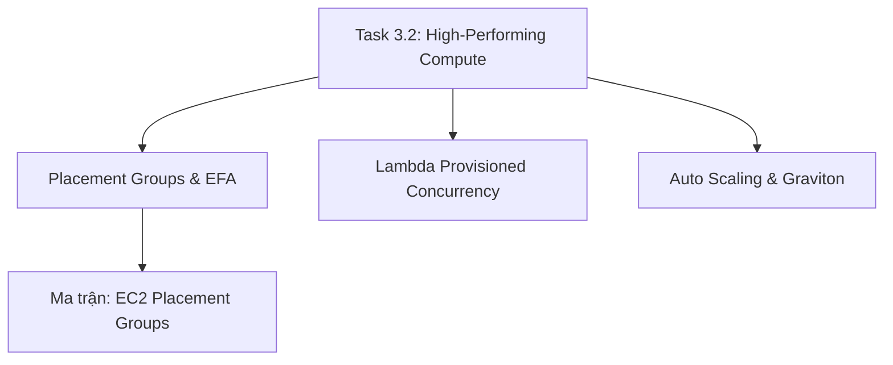

# 💻 Task 3.2: Design High-Performing and Elastic Compute Solutions

> Trở về: [[00-Domain-3-MOC]]  
> Trọng số: Chiếm khoảng 20-25% số câu hỏi của Domain 3 (~5-6% tổng bài thi SAA-C03).

---

## 🎯 Mục tiêu khảo sát của AWS (Official Examination Scope)

Task Statement này đánh giá khả năng thiết kế hạ tầng tính toán đạt hiệu năng xử lý tối ưu cho từng loại khối lượng công việc đặc thù:
1. **Lựa chọn đúng họ máy chủ EC2 (Instance Families):** Khớp đúng nhu cầu tài nguyên với họ máy chủ tối ưu tính toán (`C`), tối ưu bộ nhớ (`R`), tối ưu lưu trữ NVMe (`I`), hoặc tăng tốc GPU (`P`/`G`), và tận dụng chip ARM **AWS Graviton3/4** để tăng 25% hiệu năng và giảm 20% chi phí.
2. **Tối ưu hóa vị trí mạng vật lý máy chủ (EC2 Placement Groups):** Sử dụng **Cluster** cho cụm HPC độ trễ thấp, **Spread** cho ứng dụng cô lập lỗi phần cứng, và **Partition** cho hệ thống dữ liệu lớn phân tán (Hadoop/Kafka).
3. **Bộ tăng tốc mạng hiệu năng cao:** Phân biệt Enhanced Networking (**ENA - Elastic Network Adapter**) và **Elastic Fabric Adapter (EFA)** với công nghệ OS-bypass hỗ trợ giao thức MPI.
4. **Tối ưu hóa Serverless Compute:** Nắm vững cơ chế cấp phát tài nguyên của **AWS Lambda** (tăng RAM tự động tăng CPU/Network) và tính năng **Provisioned Concurrency** xóa bỏ hoàn toàn độ trễ khởi động nguội (Cold Starts).

---

## 🗺️ Bản đồ dịch vụ và liên kết chuyên sâu

---

## 📌 Các chủ đề trọng tâm trong đề thi

### 1. Phân loại họ máy chủ EC2 & AWS Graviton
- **Compute Optimized (`C` series):** Xử lý tính toán chuyên sâu, mã hóa video, máy chủ game, phân tích thuật toán.
- **Memory Optimized (`R`, `X`, `Z` series):** Cơ sở dữ liệu in-memory (Redis, Memcached), cơ sở dữ liệu quan hệ bộ nhớ lớn, xử lý dữ liệu Spark.
- **Storage Optimized (`I`, `D` series):** Ổ SSD NVMe cục bộ IOPS cực cao, cơ sở dữ liệu NoSQL phân tán (Cassandra).
- **Accelerated Computing (`P`, `G`, `Trn`, `Inf` series):** Huấn luyện mô hình Deep Learning, đồ họa 3D, suy luận Machine Learning.
- **AWS Graviton (`c7g`, `m7g`, `r7g`):** Bộ vi xử lý tùy biến kiến trúc ARM của AWS, đem lại hiệu năng/giá (Price-Performance) tốt nhất.

### 2. EC2 Placement Groups: Định vị vật lý máy chủ
- **Cluster Placement Group:** Gom máy chủ vào cùng 1 giá đỡ (Rack) trong 1 Availability Zone duy nhất. Đạt băng thông mạng tối đa (100 Gbps - 400 Gbps) và độ trễ thấp nhất. Dành cho: HPC, Machine Learning distributed training.
- **Spread Placement Group:** Tách riêng từng máy chủ trên các giá đỡ phần cứng khác nhau (tối đa 7 instances/AZ). Dành cho: Ứng dụng quan trọng sống còn cần cách ly tối đa rủi ro hỏng phần cứng.
- **Partition Placement Group:** Chia máy chủ thành các phân vùng logic trên các rack khác nhau. Dành cho: Apache Cassandra, Hadoop HDFS, Apache Kafka.

### 3. Tăng tốc mạng HPC: ENA vs EFA
- **ENA (Elastic Network Adapter):** Cung cấp kết nối mạng Enhanced Networking truyền thống với tốc độ lên tới 100 Gbps.
- **EFA (Elastic Fabric Adapter):** Bỏ qua hệ điều hành (**OS-bypass**) để các ứng dụng chạy trên EC2 giao tiếp trực tiếp bộ nhớ với nhau qua giao thức **MPI (Message Passing Interface)**, giảm độ trễ liên lạc giữa các node tính toán xuống mức thấp nhất.

### 4. AWS Lambda Performance Tuning
- **Mối quan hệ RAM và CPU:** Lambda không cho phép chọn trực tiếp CPU. Khi bạn cấu hình tăng RAM từ 128 MB lên tối đa 10,240 MB, AWS sẽ tự động cấp thêm tỷ lệ tương ứng sức mạnh vCPU và băng thông mạng.
- **Provisioned Concurrency:** Giữ các môi trường thực thi luôn sẵn sàng phục vụ, giải quyết triệt để vấn đề **Cold Starts** cho các ứng dụng yêu cầu độ trễ ổn định.

---

## ⚠️ Bẫy đề thi hay gặp (Exam Traps)

| Tình huống đề thi | Đáp án bẫy (SAI) | Đáp án chuẩn (ĐÚNG) |
| :--- | :--- | :--- |
| Cụm tính toán hiệu năng cao (HPC) chạy thuật toán MPI đòi hỏi độ trễ mạng thấp nhất giữa các node | Dùng Spread Placement Group trên nhiều AZ | Đặt các máy chủ trong **Cluster Placement Group** và gắn card mạng **Elastic Fabric Adapter (EFA)** |
| Ứng dụng Serverless API trên Lambda gặp tình trạng phản hồi chậm đột ngột sau thời gian không có request | Tăng thời gian Lambda Timeout | Bật **Provisioned Concurrency** trên AWS Lambda để loại bỏ Cold Starts |
| Cần triển khai cụm Kafka phân tán quy mô lớn đảm bảo các broker không bị mất dữ liệu khi 1 rack hỏng | Dùng Cluster Placement Group | Triển khai trong **Partition Placement Group** |
| Ứng dụng xử lý video cần tối ưu chi phí và tăng hiệu năng tính toán cao nhất | Dùng dòng máy chủ T4g Burstable | Chuyển sang máy chủ **Compute Optimized chạy chip AWS Graviton (ví dụ `c7g`)** |

---

## 🔗 Liên kết liên quan
- [[00-Domain-3-MOC]]
- [[EC2-Placement-Groups-and-HPC-Accelerators]]
- [[Lambda-Performance-and-Provisioned-Concurrency]]
- [[Matrix-EC2-Placement-Groups]]
