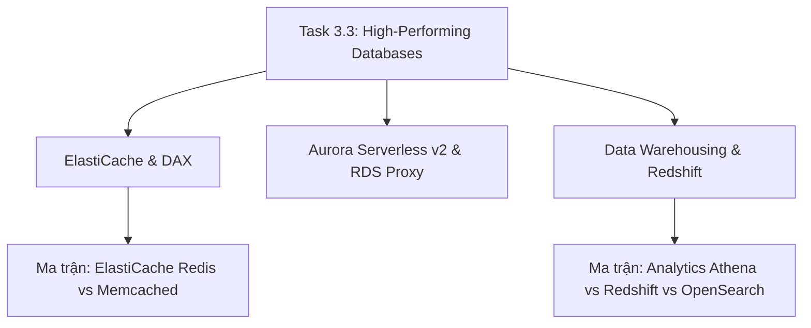

# ⚡ Task 3.3: Determine High-Performing Database Solutions

> Trở về: [[00-Domain-3-MOC]]  
> Trọng số: Chiếm khoảng 20-25% số câu hỏi của Domain 3 (~5-6% tổng bài thi SAA-C03).

---

## 🎯 Mục tiêu khảo sát của AWS (Official Examination Scope)

Task Statement này đánh giá khả năng lựa chọn cơ sở dữ liệu, tối ưu hóa truy vấn và thiết kế các tầng đệm bộ nhớ (Caching layers) để đạt độ trễ phản hồi thấp nhất:
1. **Lớp đệm bộ nhớ In-Memory Caching:** Lựa chọn giữa **Amazon ElastiCache for Redis** và **Memcached**, sử dụng **ElastiCache Serverless** để tự động mở rộng theo tải, và áp dụng đúng các chiến lược caching (Lazy Loading vs Write-Through).
2. **Tăng tốc NoSQL:** Sử dụng **DynamoDB Accelerator (DAX)** để đạt độ trễ phản hồi micro-giây cho các truy vấn lặp lại, và thiết kế Partition Key có độ phân tán cao để tránh tạo thành Hot Partitions.
3. **Cơ sở dữ liệu Quan hệ Tự co giãn:** Nắm vững cơ chế mở rộng tức thì của **Amazon Aurora Serverless v2** (theo đơn vị ACU) và phân tải truy vấn đọc qua tối đa 15 Aurora Replicas.
4. **Quản lý kết nối cơ sở dữ liệu:** Sử dụng **Amazon RDS Proxy** để thiết lập Connection Pooling, bảo vệ database không bị cạn kiệt kết nối khi hàng nghìn hàm Lambda đồng thời truy cập.
5. **Kho dữ liệu phân tích quy mô lớn:** Sử dụng kiến trúc lưu trữ theo cột của **Amazon Redshift** và khả năng truy vấn trực tiếp dữ liệu S3 bằng **Redshift Spectrum**.

---

## 🗺️ Bản đồ dịch vụ và liên kết chuyên sâu

---

## 📌 Các chủ đề trọng tâm trong đề thi

### 1. Amazon ElastiCache: Redis vs Memcached & Serverless
- **ElastiCache for Redis:** Hỗ trợ cấu trúc dữ liệu phong phú (Hashes, Sorted Sets, Bitmaps), hỗ trợ Multi-AZ, tự động failover, lưu trữ bền vững (AOF, Snapshot RDB), Redis Cluster sharding.
- **ElastiCache for Memcached:** Kiến trúc thuần bộ nhớ đa luồng (Multi-threaded), hỗ trợ mở rộng ngang đơn giản, không hỗ trợ lưu trữ bền vững.
- **ElastiCache Serverless (Hiện đại 2026):** Tự động mở rộng dung lượng RAM, CPU và băng thông mạng trong vài giây mà không cần tự cấu hình số lượng node hay dung lượng cụm cache.
- **Chiến lược Caching:**
  - *Lazy Loading (Cache-Aside):* Chỉ ghi vào cache khi có request đọc. Dữ liệu trong cache không bị thừa, nhưng lần đọc đầu tiên bị trễ (Cache Miss).
  - *Write-Through:* Ghi đồng thời vào cache và database. Dữ liệu luôn mới nhưng tốn dung lượng và tăng độ trễ khi ghi.

### 2. DynamoDB Accelerator (DAX) vs ElastiCache
- **DynamoDB Accelerator (DAX):** Bộ đệm in-memory chuyên dụng cho DynamoDB. Cung cấp độ trễ **Micro-giây** cho các truy vấn `GetItem` và `Query` lặp đi lặp lại. Tương thích 100% với SDK của DynamoDB mà **không cần sửa đổi logic code ứng dụng**.
- **ElastiCache:** Dùng làm cache chung cho cả ứng dụng, có thể cache kết quả tính toán phức tạp, lưu session state, hoặc cache cho relational DB.

### 3. Amazon RDS Proxy: Quản lý Connection Pool
- Khi kiến trúc Serverless (AWS Lambda) kết nối trực tiếp vào RDS MySQL/PostgreSQL:
  - Mỗi khi Lambda scale-out có thể tạo ra hàng nghìn kết nối đồng thời.
  - Cơ sở dữ liệu sẽ nhanh chóng bị cạn kiệt RAM và từ chối kết nối (`Too many connections`).
- **Giải pháp:** Đặt **Amazon RDS Proxy** ở giữa. RDS Proxy duy trì một pool các kết nối mở sẵn tới DB và chia sẻ các kết nối này cho hàng nghìn request Lambda, đồng thời **giảm thời gian failover của RDS Multi-AZ tới 66%**.

---

## ⚠️ Bẫy đề thi hay gặp (Exam Traps)

| Tình huống đề thi | Đáp án bẫy (SAI) | Đáp án chuẩn (ĐÚNG) |
| :--- | :--- | :--- |
| Hàng nghìn hàm Lambda truy cập cơ sở dữ liệu RDS đồng thời gây lỗi cạn kiệt kết nối (Connection Timeouts) | Tăng kích thước máy chủ RDS lên cỡ lớn nhất | Đặt **Amazon RDS Proxy** phía trước cơ sở dữ liệu RDS để gom và quản lý Connection Pool |
| Ứng dụng đọc dữ liệu NoSQL từ DynamoDB yêu cầu độ trễ dưới 1 mili-giây (Microsecond latency) mà không muốn đổi code | Tự dựng cụm Memcached và viết lại hàm đọc ghi | Triển khai **Amazon DynamoDB Accelerator (DAX)** |
| Cần giải pháp cache tự động mở rộng theo tải bất thường mà không cần tự tính toán kích thước node | Tạo ElastiCache Cluster với Auto Scaling Group | Triển khai **Amazon ElastiCache Serverless** |
| Phân tích dữ liệu báo cáo BI hàng chục Terabyte lưu trên S3 mà không muốn nạp dữ liệu vào database trước | Nạp toàn bộ dữ liệu vào DynamoDB | Sử dụng **Amazon Redshift Spectrum** hoặc **Amazon Athena** |

---

## 🔗 Liên kết liên quan
- [[00-Domain-3-MOC]]
- [[Caching-Deep-Dive-ElastiCache-and-DAX]]
- [[Aurora-Serverless-v2-and-RDS-Proxy]]
- [[Matrix-ElastiCache-Redis-vs-Memcached]]
