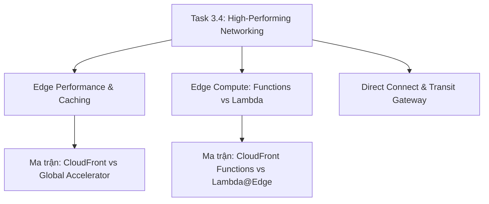

# 🌐 Task 3.4: Determine High-Performing and Scalable Network Architectures

> Trở về: [[00-Domain-3-MOC]]  
> Trọng số: Chiếm khoảng 18-20% số câu hỏi của Domain 3 (~4-5% tổng bài thi SAA-C03).

---

## 🎯 Mục tiêu khảo sát của AWS (Official Examination Scope)

Task Statement này đánh giá khả năng thiết kế hệ sinh thái mạng toàn cầu nhằm giảm thiểu độ trễ, tối đa hóa thông lượng và điều hướng lưu lượng thông minh:
1. **Phân phối nội dung và Tăng tốc biên (Edge Delivery):** Tối ưu hóa **Amazon CloudFront** với tính năng **Origin Shield**, tối ưu TCP/TLS handshake, và lưu bộ nhớ đệm (Caching) cho cả nội dung tĩnh và động.
2. **Tính toán tại biên (Edge Compute):** Phân biệt ranh giới kỹ thuật giữa **CloudFront Functions** (JavaScript nhẹ, độ trễ sub-millisecond, chạy ngay tại Edge Locations) và **Lambda@Edge** (Node.js/Python đầy đủ, chạy tại Regional Edge Caches, cho phép truy cập mạng và xử lý body).
3. **Tăng tốc mạng trục toàn cầu:** Lựa chọn **AWS Global Accelerator** để tối ưu hóa lưu lượng **TCP/UDP không cache được** qua 2 địa chỉ **Static Anycast IPs** chạy trên mạng cáp quang riêng của AWS.
4. **Kết nối mạng Lai (Hybrid Connectivity) hiệu năng cao:** Triển khai đường truyền vật lý chuyên dụng **AWS Direct Connect** kết hợp **AWS Transit Gateway với ECMP (Equal-Cost Multi-Path)** để đạt băng thông hàng chục Gbps ổn định.

---

## 🗺️ Bản đồ dịch vụ và liên kết chuyên sâu

---

## 📌 Các chủ đề trọng tâm trong đề thi

### 1. Amazon CloudFront vs AWS Global Accelerator
- **Amazon CloudFront:**
  - Mạng lưới phân phối nội dung (**CDN**) qua 400+ PoPs toàn cầu.
  - **CÓ LƯU CACHE (Caching):** Phù hợp với nội dung web tĩnh (HTML, ảnh, video) và nội dung động có thể cache theo thời gian ngắn.
  - Chỉ hỗ trợ giao thức **HTTP, HTTPS, và WebSocket**.
  - **Origin Shield:** Tầng đệm tập trung giảm tải triệt để các request trùng lặp gửi về máy chủ gốc.
- **AWS Global Accelerator:**
  - Cung cấp **2 địa chỉ IP tĩnh Anycast duy nhất** trên toàn cầu.
  - **KHÔNG CÓ BỘ NHỚ ĐỆM (No Caching):** Dẫn lưu lượng vào Edge Location gần nhất, sau đó đi qua mạng trục cáp quang riêng của AWS để tới đích.
  - Hỗ trợ cả **TCP và UDP** (Ứng dụng Gaming, Voice over IP, IoT, Live streaming không qua HTTP).
  - Tự động chuyển đổi dự phòng (Failover) tới Region khác trong **dưới 1 phút** mà không bị phụ thuộc vào thời gian sống của bản ghi DNS (DNS TTL).

### 2. CloudFront Functions vs Lambda@Edge

| Tiêu chí | CloudFront Functions | Lambda@Edge |
| :--- | :--- | :--- |
| **Ngôn ngữ hỗ trợ** | **JavaScript (ECMAScript 5.1)** | **Node.js, Python** |
| **Vị trí chạy** | **218+ Edge Locations** (Gần người dùng nhất) | **13 Regional Edge Caches** |
| **Thời gian chạy tối đa** | **Dưới 1 mili-giây (< 1ms)** | **Tối đa 5 - 30 giây** |
| **Truy cập mạng Internet** | **KHÔNG** (Không thể gọi API ngoài) | **CÓ** (Có thể gọi database, API bên ngoài) |
| **Đọc HTTP Request Body**| **KHÔNG** (Chỉ đọc URL, Headers, Cookies) | **CÓ** |
| **Kịch bản điển hình** | URL Rewrite/Redirect, Header normalization | Xác thực JWT phức tạp, A/B Testing, nén ảnh |

### 3. Kết nối Hybrid: AWS Direct Connect & ECMP
- **AWS Direct Connect (DX):** Đường truyền vật lý riêng biệt, cung cấp băng thông từ 1 Gbps đến 100 Gbps, độ trễ cực thấp và nhất quán, không chịu ảnh hưởng bởi biến động mạng Internet.
- **Transit Gateway ECMP (Equal-Cost Multi-Path):** Khi 1 đường VPN bị giới hạn ở 1.25 Gbps, ta có thể thiết lập nhiều đường hầm VPN song song kết nối vào Transit Gateway và bật ECMP để gộp băng thông lên tới hàng chục Gbps.

---

## ⚠️ Bẫy đề thi hay gặp (Exam Traps)

| Tình huống đề thi | Đáp án bẫy (SAI) | Đáp án chuẩn (ĐÚNG) |
| :--- | :--- | :--- |
| Game online nhiều người chơi chạy giao thức UDP cần giảm độ trễ cho game thủ toàn cầu | Dùng Amazon CloudFront (CloudFront không hỗ trợ UDP thuần) | Triển khai **AWS Global Accelerator** (hỗ trợ cả TCP và UDP) |
| Ứng dụng web cần chuyển hướng URL (URL Rewrite) với độ trễ dưới 1ms và chi phí rẻ nhất | Viết hàm Lambda@Edge | Sử dụng **CloudFront Functions** (chạy tại Edge Location trong sub-ms) |
| Cần kết nối mạng từ Data Center on-premise lên AWS với băng thông ổn định 10 Gbps không qua Internet | Dùng AWS Site-to-Site VPN qua Internet | Triển khai đường truyền **AWS Direct Connect** chuyên dụng |
| Website toàn cầu cần 2 địa chỉ IP tĩnh cố định để khách hàng kết nối tới hệ thống đa vùng với failover tức thì | Dùng Route 53 Multi-Value Routing | Sử dụng **AWS Global Accelerator** |

---

## 🔗 Liên kết liên quan
- [[00-Domain-3-MOC]]
- [[CloudFront-vs-Global-Accelerator-Edge-Performance]]
- [[Matrix-CloudFront-vs-Global-Accelerator]]
- [[Matrix-CloudFront-Functions-vs-Lambda-at-Edge]]
