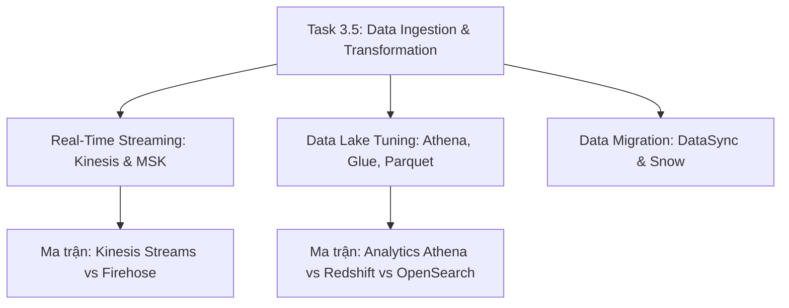

# 📥 Task 3.5: Determine High-Performing Data Ingestion and Transformation Solutions

> Trở về: [[00-Domain-3-MOC]]  
> Trọng số: Chiếm khoảng 18-20% số câu hỏi của Domain 3 (~4-5% tổng bài thi SAA-C03).

---

## 🎯 Mục tiêu khảo sát của AWS (Official Examination Scope)

Task Statement này đánh giá khả năng thiết kế đường ống thu thập dữ liệu lớn (Big Data Pipelines), nạp dữ liệu luồng thời gian thực và tối ưu hóa truy vấn Data Lake:
1. **Nạp và xử lý luồng thời gian thực (Real-Time Ingestion):** Phân biệt giữa **Amazon Kinesis Data Streams** (Real-time, chia Shards hoặc On-Demand) và **Amazon Kinesis Data Firehose** (Near real-time, Serverless tự đệm dữ liệu vào S3/Redshift).
2. **Tối ưu hóa truy vấn Data Lake:** Sử dụng bộ ba **Amazon Athena + AWS Glue + Apache Parquet** để giảm tới 90% lượng dữ liệu quét (Data Scanned), áp dụng kỹ thuật **Partition Pruning** và tránh bẫy **Small Files Trap**.
3. **Phân định công cụ phân tích:** Lựa chọn chính xác giữa **Amazon Athena** (Serverless SQL ad-hoc), **Amazon Redshift** (Data Warehouse xử lý SQL phức tạp) và **Amazon OpenSearch Service** (Tìm kiếm toàn văn bản và phân tích log).
4. **Di chuyển dữ liệu quy mô lớn (Data Migration):** Tận dụng **AWS DataSync** để đồng bộ dữ liệu trực tuyến tốc độ cao và **AWS Snow Family** cho bài toán di chuyển dữ liệu ngoại tuyến quy mô Petabyte.

---

## 🗺️ Bản đồ dịch vụ và liên kết chuyên sâu

---

## 📌 Các chủ đề trọng tâm trong đề thi

### 1. Kinesis Data Streams vs Kinesis Data Firehose
- **Kinesis Data Streams (KDS):**
  - Thời gian thực (**Real-time**, độ trễ mili-giây).
  - Quản lý throughput bằng **Shards** (1 Shard = 1 MB/s In, 2 MB/s Out) hoặc chế độ **On-Demand** tự mở rộng.
  - Dữ liệu lưu trữ từ **24 giờ đến 365 ngày**.
  - Cho phép **nhiều consumer** độc lập cùng đọc dữ liệu song song.
- **Kinesis Data Firehose:**
  - Gần thời gian thực (**Near real-time**, độ trễ tối thiểu 60 giây).
  - Hoàn toàn Serverless, tự động đệm dữ liệu theo dung lượng (1-128 MB) hoặc thời gian (60-900 giây).
  - Không lưu trữ dữ liệu (chỉ là đường ống nạp thẳng vào **Amazon S3, Redshift, OpenSearch, Splunk**).
  - Hỗ trợ gọi **AWS Lambda** để chuyển đổi định dạng dữ liệu (ví dụ nén thành Parquet) trước khi nạp.

### 2. Tối ưu hóa truy vấn Amazon Athena & Data Lake (Trọng điểm 2026)
- **Định dạng cột (Columnar Storage - Apache Parquet / ORC):** Chuyển đổi file CSV/JSON sang Parquet giúp Athena chỉ đọc đúng các cột được chỉ định trong câu lệnh `SELECT`, giảm 90% chi phí scan dữ liệu trên S3.
- **Phân vùng (Partitioning) & Partition Pruning:** Phân chia thư mục S3 theo `year/month/day/region`. Athena sẽ tự động bỏ qua toàn bộ các thư mục không liên quan tới mệnh đề `WHERE` $\rightarrow$ tăng tốc truy vấn gấp hàng chục lần.
- **The "Small Files Trap" (Bẫy đề thi kinh điển):** Không bao giờ phân vùng theo trường có độ phân tán cao (High Cardinality như `user_id` hay `device_id`), vì sẽ sinh ra hàng triệu file nhỏ (vài KB), làm nghẽn Glue Catalog và khiến truy vấn Athena chạy chậm thảm hại.
- **Partition Projection:** Cơ chế tự động tính toán cấu trúc phân vùng theo thuật toán, loại bỏ nhu cầu chạy lệnh `MSCK REPAIR TABLE` tốn kém.

### 3. Di chuyển dữ liệu: AWS DataSync vs Snow Family
- **AWS DataSync:** Đồng bộ dữ liệu mạng tốc độ cao (nhanh gấp 10 lần các công cụ truyền thống như rsync) giữa On-premises (NFS, SMB) và AWS (S3, EFS, FSx).
- **AWS Snow Family (Ngoại tuyến - Offline Transfer):**
  - **Snowcone:** Thiết bị nhỏ gọn, dung lượng 8 TB.
  - **Snowball Edge Storage Optimized:** Thiết bị chuyên dụng 80 TB. Dùng khi khối lượng dữ liệu từ vài chục TB đến hàng trăm TB mà đường truyền mạng on-premise mất hàng tháng mới tải xong.
  - **Snowmobile:** Thùng container xe tải chuyên dụng lên tới 100 PB.

---

## ⚠️ Bẫy đề thi hay gặp (Exam Traps)

| Tình huống đề thi | Đáp án bẫy (SAI) | Đáp án chuẩn (ĐÚNG) |
| :--- | :--- | :--- |
| Nạp dữ liệu log streaming liên tục từ hàng nghìn máy chủ vào Amazon S3 với ít công sức quản lý nhất | Tạo Kinesis Data Streams và viết code EC2 consumer đọc rồi ghi vào S3 | Sử dụng **Amazon Kinesis Data Firehose** nạp trực tiếp vào S3 |
| Truy vấn SQL ad-hoc hàng triệu file JSON trên S3 bị chậm và tốn kém chi phí | Nạp dữ liệu vào RDS MySQL | Dùng **AWS Glue ETL** chuyển đổi JSON sang **Apache Parquet**, phân vùng hợp lý và truy vấn bằng **Amazon Athena** |
| Doanh nghiệp cần chuyển 500 TB dữ liệu từ On-premise lên S3 với đường truyền mạng chỉ có 100 Mbps | Tải dữ liệu qua AWS Direct Connect (mất hàng năm) | Sử dụng thiết bị phần cứng **AWS Snowball Edge** để di chuyển dữ liệu ngoại tuyến |
| Cần tìm kiếm toàn văn bản (Full-text search) và gợi ý từ khóa (Autocomplete) cho catalog sản phẩm | Dùng Amazon Athena hoặc DynamoDB Scan | Triển khai **Amazon OpenSearch Service** |

---

## 🔗 Liên kết liên quan
- [[00-Domain-3-MOC]]
- [[Real-Time-Streaming-Kinesis-and-MSK]]
- [[Data-Lake-Query-Tuning-Athena-Glue-Parquet]]
- [[Matrix-Kinesis-Streams-vs-Firehose]]
- [[Matrix-Analytics-Athena-vs-Redshift-vs-OpenSearch]]
