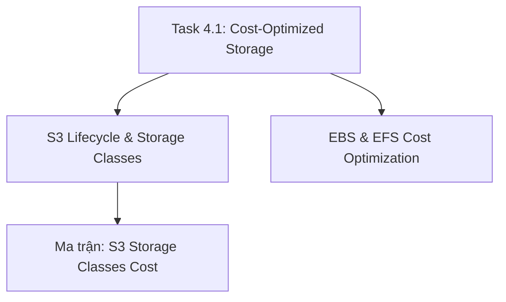

# 💾 Task 4.1: Design Cost-Optimized Storage Solutions

> Trở về: [[00-Domain-4-MOC]]  
> Trọng số: Chiếm khoảng 25-30% số câu hỏi của Domain 4 (~5-6% tổng bài thi SAA-C03).

---

## 🎯 Mục tiêu khảo sát của AWS (Official Examination Scope)

Task Statement này đánh giá khả năng lựa chọn các lớp lưu trữ (Storage Tiers) và thiết lập các chính sách vòng đời tự động để tối thiểu hóa chi phí lưu trữ dữ liệu:
1. **Lựa chọn đúng lớp lưu trữ Amazon S3:** Phân biệt 8 lớp lưu trữ S3, áp dụng **S3 Intelligent-Tiering** cho dữ liệu có tần suất truy cập bất định để không bị tính phí truy xuất, và sử dụng **S3 Glacier Deep Archive** cho sao lưu dài hạn với chi phí chỉ ~$1/TB/tháng.
2. **Thiết lập S3 Lifecycle Policies:** Tự động chuyển đổi lớp lưu trữ (Transition actions) và hủy bỏ các tệp tải lên dở dang (**Abort Incomplete Multipart Uploads**) để dọn rác ngầm.
3. **Tối ưu hóa chi phí Amazon EBS:** Chuyển đổi từ `gp2` sang **`gp3`** (tiết kiệm 20%), tận dụng ổ từ tính `st1`/`sc1` cho dữ liệu tuần tự, và tự động xóa các ổ **EBS Unattached** cùng Snapshot quá hạn.
4. **Tối ưu hóa Amazon EFS:** Bật tính năng **EFS Lifecycle Management** để tự động chuyển các tệp không dùng sang **EFS Infrequent Access (EFS IA)** giúp giảm 92% chi phí lưu trữ.

---

## 🗺️ Bản đồ dịch vụ và liên kết chuyên sâu

---

## 📌 Các chủ đề trọng tâm trong đề thi

### 1. Amazon S3 Storage Classes & Ràng buộc tính tiền ngầm
- **S3 Standard:** Dữ liệu truy cập thường xuyên (~$0.023/GB), không phí truy xuất.
- **S3 Intelligent-Tiering:** **Lựa chọn số 1 khi tần suất truy cập không đoán trước được hoặc thay đổi liên tục**. Tự động chuyển giữa Frequent, Infrequent (sau 30 ngày), Archive Instant (sau 90 ngày) và Deep Archive (sau 180 ngày). **KHÔNG THU PHÍ TRUY XUẤT (No retrieval fee)**.
- **S3 Standard-IA & One Zone-IA:** Lưu trữ rẻ hơn (~$0.0125/GB). Có phí truy xuất. **Ràng buộc:** Tính tiền tối thiểu **30 ngày lưu trữ** và kích thước tính tiền tối thiểu là **128 KB** (file 10 KB vẫn tính cước 128 KB).
- **S3 Glacier Instant Retrieval:** Chi phí lưu trữ rẻ (~$0.004/GB), dữ liệu lấy lại trong **vài mili-giây** (Millisecond retrieval), thời gian lưu tối thiểu **90 ngày**.
- **S3 Glacier Flexible Retrieval:** Lấy dữ liệu từ 1-5 phút (Expedited), 3-5 giờ (Standard), hoặc 5-12 giờ (Bulk miễn phí). Lưu tối thiểu 90 ngày.
- **S3 Glacier Deep Archive:** Rẻ nhất toàn bộ AWS (~$0.00099/GB $\approx$ 1 USD/TB/tháng). Thời gian lấy dữ liệu: 12-48 giờ. Lưu tối thiểu **180 ngày**. Dành cho sao lưu tuân thủ quy định 7-10 năm.

### 2. S3 Lifecycle Rules
- **Transition Actions:** Tự động hạ tầng lưu trữ theo ngày (ví dụ sau 30 ngày chuyển sang Standard-IA, sau 90 ngày chuyển sang Glacier Deep Archive).
- **Expiration Actions:** Tự động xóa vĩnh viễn các object cũ sau 365 ngày.
- **Abort Incomplete Multipart Uploads:** Tự động xóa các mảnh upload dở dang sau 7 ngày để tránh tốn tiền lưu trữ rác.

### 3. Tối ưu hóa Amazon EBS & EFS
- Chuyển `gp2` sang **`gp3`**: Giảm ngay 20% chi phí dung lượng và có sẵn 3,000 IOPS miễn phí.
- Dọn dẹp tài nguyên mồ côi (Orphan resources): Tìm và xóa các volume EBS ở trạng thái `available` (không gắn vào EC2 nào).
- **EFS Lifecycle Management**: Tự động chuyển các file không truy cập sau 30 ngày sang **EFS IA** ($0.025/GB so với $0.30/GB của EFS Standard).

---

## ⚠️ Bẫy đề thi hay gặp (Exam Traps)

| Tình huống đề thi | Đáp án bẫy (SAI) | Đáp án chuẩn (ĐÚNG) |
| :--- | :--- | :--- |
| Dữ liệu có mô hình truy cập thay đổi thất thường, cần tối ưu chi phí lưu trữ mà không tốn công sức quản trị | Chuyển toàn bộ dữ liệu sang S3 Standard-IA (sẽ bị tính phí retrieval rất đắt khi truy cập) | Sử dụng **Amazon S3 Intelligent-Tiering** |
| Báo cáo tài chính phải lưu trữ trong 7 năm theo quy định pháp lý, hiếm khi đọc lại nhưng cần chi phí thấp nhất | Chọn S3 Standard-IA hoặc S3 Glacier Flexible | Sử dụng **Amazon S3 Glacier Deep Archive** (rẻ nhất, chỉ ~1 USD/TB/tháng) |
| Các file dung lượng nhỏ 5 KB được chuyển sang S3 Standard-IA để tiết kiệm chi phí | Cho rằng chi phí sẽ giảm một nửa | **Bẫy 128 KB**: File nhỏ hơn 128 KB vẫn bị tính phí lưu trữ tương đương 128 KB trong Standard-IA $\rightarrow$ Chi phí thực tế sẽ TĂNG! |
| Giảm hóa đơn lưu trữ EFS cho các tài liệu ít dùng mà người dùng vẫn có thể đọc được trong suốt | Sao lưu EFS sang S3 Glacier bằng script thủ công | Bật **EFS Lifecycle Management** để tự động chuyển tệp sang **EFS Infrequent Access (EFS IA)** |

---

## 🔗 Liên kết liên quan
- [[00-Domain-4-MOC]]
- [[S3-Lifecycle-and-Storage-Classes-Cost-Tuning]]
- [[EFS-and-EBS-Storage-Cost-Optimization]]
- [[Matrix-S3-Storage-Classes-Cost-and-Retrieval]]
