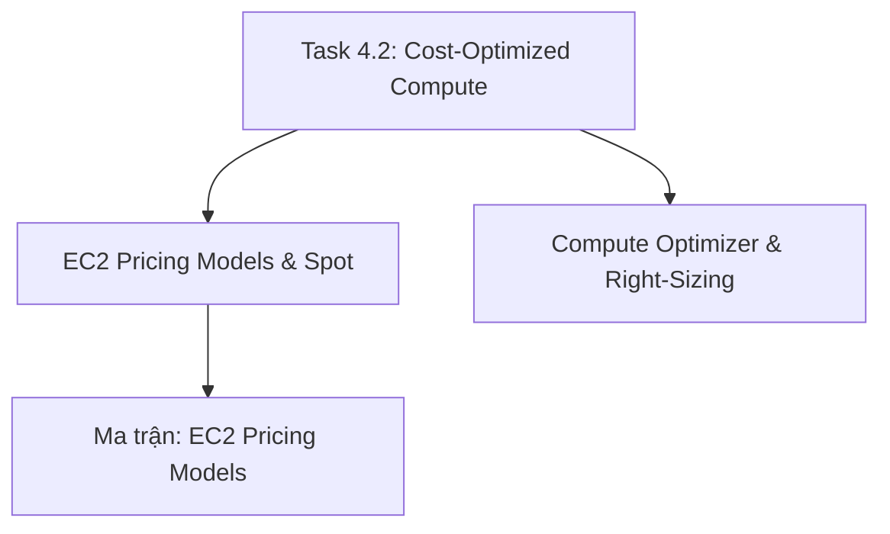

# 💻 Task 4.2: Design Cost-Optimized Compute Solutions

> Trở về: [[00-Domain-4-MOC]]  
> Trọng số: Chiếm khoảng 25-30% số câu hỏi của Domain 4 (~5-6% tổng bài thi SAA-C03).

---

## 🎯 Mục tiêu khảo sát của AWS (Official Examination Scope)

Task Statement này đánh giá khả năng lựa chọn mô hình định giá tính toán (Compute Pricing Models), tối ưu hóa kích cỡ máy chủ (Right-sizing), và tận dụng các công nghệ Serverless để loại bỏ hoàn toàn chi phí tài nguyên nhàn rỗi:
1. **Lựa chọn đúng mô hình mua máy chủ EC2:** Phân biệt khi nào dùng **On-Demand** (ngắn hạn/bất định), **Spot Instances** (giảm tới 90% cho batch processing/stateless), **Compute Savings Plans** (linh hoạt xuyên suốt EC2, Fargate, Lambda giảm 66%), và **Reserved Instances (RIs)**.
2. **Hạ cỡ máy chủ (Right-Sizing) với AWS Compute Optimizer:** Sử dụng Machine Learning phân tích lịch sử sử dụng tài nguyên để nhận diện và hạ cỡ các máy chủ bị dư thừa tài nguyên (Underutilized instances).
3. **Kinh tế học Serverless (Serverless Economics):** Lựa chọn AWS Lambda và AWS Fargate để chỉ trả tiền khi code thực thi, loại bỏ chi phí duy trì cụm máy chủ EC2 chạy rỗng 24/7.
4. **Tối ưu hóa Auto Scaling:** Kết hợp On-Demand cho tải nền và Spot Instances cho tải đột biến, thiết lập lịch thu hẹp quy mô (Scale In) ngoài giờ làm việc.

---

## 🗺️ Bản đồ dịch vụ và liên kết chuyên sâu

---

## 📌 Các chủ đề trọng tâm trong đề thi

### 1. Bốn Mô hình Định giá Amazon EC2
- **On-Demand:** Không cần cam kết trước, thanh toán theo giây. Đắt nhất. Dành cho: Ứng dụng ngắn hạn, môi trường thử nghiệm, hoặc hệ thống mới chưa đo lường được nhu cầu.
- **Spot Instances:** Giảm giá tới **90%** so với On-Demand. AWS có quyền thu hồi máy chủ với **cảnh báo trước 2 phút (2-minute interruption notice)**. Dành cho: Tác vụ chịu lỗi được (Fault-tolerant), xử lý hàng loạt (Batch jobs), phân tích dữ liệu Big Data (EMR), render video, CI/CD pipelines.
- **Compute Savings Plans (Khuyên dùng chuẩn hiện đại):** Cam kết mức chi tiêu cố định tính theo $/giờ trong 1 hoặc 3 năm. **Giảm giá tới 66%**. Cực kỳ linh hoạt: tự động áp dụng xuyên suốt mọi dòng EC2 (bất kể Family, OS, Region), AWS Fargate và AWS Lambda!
- **EC2 Instance Savings Plans:** Cam kết sử dụng một Family máy chủ cụ thể trong 1 Region cụ thể (ví dụ dòng `m5` ở `us-east-1`). Giảm tới **72%**.
- **Reserved Instances (RIs):** Standard RIs (giảm tới 72%, không đổi được họ máy) vs Convertible RIs (giảm tới 54%, cho phép đổi họ máy, OS).

### 2. AWS Compute Optimizer & Right-Sizing
- Dịch vụ phân tích tự động sử dụng Machine Learning dựa trên số liệu **Amazon CloudWatch** trong vòng 14 đến 32 ngày gần nhất.
- Đưa ra khuyến nghị cụ thể:
  - Nhận diện máy chủ bị dư thừa tài nguyên (**Over-provisioned**) $\rightarrow$ khuyến nghị hạ cỡ (Downsize) để tiết kiệm tiền.
  - Nhận diện máy chủ bị thiếu tài nguyên (**Under-provisioned**) $\rightarrow$ khuyến nghị tăng cỡ (Upsize) để đảm bảo hiệu năng.
  - Hỗ trợ khuyến nghị cho: **EC2 instances, EC2 Auto Scaling Groups, EBS volumes, AWS Lambda functions, và Amazon RDS**.

---

## ⚠️ Bẫy đề thi hay gặp (Exam Traps)

| Tình huống đề thi | Đáp án bẫy (SAI) | Đáp án chuẩn (ĐÚNG) |
| :--- | :--- | :--- |
| Hệ thống xử lý dữ liệu batch qua đêm có thể dừng và chạy lại bất kỳ lúc nào, cần tiết kiệm chi phí tối đa | Mua Reserved Instances 3 năm | Sử dụng **Amazon EC2 Spot Instances** (tiết kiệm tới 90%) |
| Doanh nghiệp có tải tính toán ổn định, chạy kết hợp cả EC2, ECS Fargate và Lambda, muốn tối ưu chi phí linh hoạt nhất | Mua EC2 Standard Reserved Instances | Đăng ký gói **Compute Savings Plans** (áp dụng cho cả EC2, Fargate và Lambda) |
| Máy chủ cơ sở dữ liệu production quan trọng chạy 24/7 không được phép gián đoạn | Sử dụng Spot Instances (Spot có thể bị thu hồi sau 2 phút) | Mua **Compute Savings Plans** hoặc **Standard Reserved Instances** |
| Doanh nghiệp nghi ngờ nhiều máy chủ EC2 đang được cấp phát quá lớn so với nhu cầu thực tế | Kiểm tra thủ công từng máy chủ qua SSH | Kích hoạt dịch vụ **AWS Compute Optimizer** để nhận báo cáo khuyến nghị Right-Sizing tự động |

---

## 🔗 Liên kết liên quan
- [[00-Domain-4-MOC]]
- [[EC2-Pricing-Models-Spot-Savings-Plans-and-RIs]]
- [[AWS-Compute-Optimizer-and-Right-Sizing]]
- [[Matrix-EC2-Pricing-Models]]
