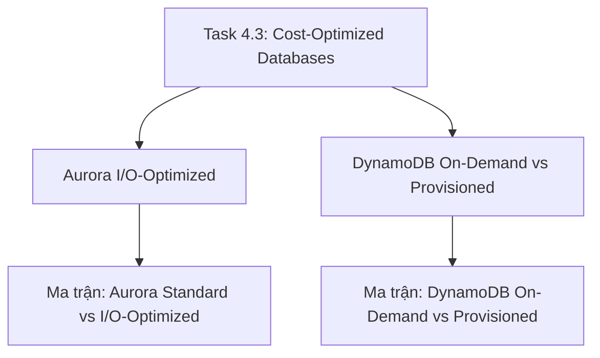

# 🗄️ Task 4.3: Design Cost-Optimized Database Solutions

> Trở về: [[00-Domain-4-MOC]]  
> Trọng số: Chiếm khoảng 20-25% số câu hỏi của Domain 4 (~4-5% tổng bài thi SAA-C03).

---

## 🎯 Mục tiêu khảo sát của AWS (Official Examination Scope)

Task Statement này đánh giá khả năng lựa chọn cơ sở dữ liệu, quản lý tài nguyên và cấu hình lưu trữ database để tối thiểu hóa hóa đơn hàng tháng mà vẫn đảm bảo tính toàn vẹn dữ liệu:
1. **Lựa chọn cấu hình lưu trữ Amazon Aurora:** Nắm vững thời điểm chuyển đổi giữa **Aurora Standard** và **Aurora I/O-Optimized** (khi phí I/O vượt quá ngưỡng 25-33% tổng hóa đơn).
2. **Tối ưu hóa dung lượng Amazon DynamoDB:** Chọn giữa **On-Demand Capacity** (dành cho tải bất định, ít request) và **Provisioned Capacity kết hợp Auto Scaling** (dành cho tải lớn ổn định để tiết kiệm chi phí).
3. **Cắt giảm chi phí Amazon RDS:** Áp dụng **RDS Reserved Instances** cho môi trường Production ổn định, và tự động tắt các database môi trường Dev/Test ngoài giờ làm việc.
4. **Giảm tải Database bằng Caching:** Triển khai **Amazon ElastiCache** để giảm tải các truy vấn đọc đắt đỏ, tránh phải nâng cấp máy chủ database lên các dòng instance khổng lồ.

---

## 🗺️ Bản đồ dịch vụ và liên kết chuyên sâu

---

## 📌 Các chủ đề trọng tâm trong đề thi

### 1. Amazon Aurora Standard vs Aurora I/O-Optimized (Trọng tâm 2026)
- **Aurora Standard:** Bạn trả tiền cho Compute instance + Dung lượng lưu trữ GB + **Cước phí cho từng triệu thao tác I/O đọc/ghi**. Phù hợp với các ứng dụng có I/O thấp đến trung bình.
- **Aurora I/O-Optimized:** **HOÀN TOÀN KHÔNG TÍNH PHÍ I/O ($0 I/O charges)**. Đổi lại, phí instance tăng ~30% và phí dung lượng GB tăng ~2.25x.
- **Quy tắc vàng:** Khi chi phí I/O trong hóa đơn Aurora Standard chiếm **từ 25% đến 33% trở lên** tổng chi phí database $\rightarrow$ Chuyển sang **Aurora I/O-Optimized** sẽ tiết kiệm ngay **30% đến 40% chi phí tổng thể** và giúp hóa đơn hàng tháng hoàn toàn cố định dễ dự toán.

### 2. Amazon DynamoDB: On-Demand vs Provisioned
- **On-Demand Mode:** Thanh toán chính xác theo số lượng request đọc/ghi thực tế. **Rẻ hơn khi lưu lượng thấp, khó dự đoán hoặc có các khoảng thời gian trống dài không có truy cập**.
- **Provisioned Mode with Auto Scaling:** Mua trước chỉ số RCU/WCU và để Auto Scaling tự điều chỉnh theo tải. **Rẻ hơn tới 5 - 7 lần khi hệ thống có lượng truy cập lớn, ổn định và đều đặn theo thời gian**.

### 3. Tối ưu hóa chi phí Amazon RDS
- **Tắt máy chủ ngoài giờ:** Môi trường Development và Test không cần chạy ban đêm hay cuối tuần. Sử dụng **AWS Instance Scheduler** hoặc hàm Lambda để tự động Stop instance vào 18h và Start lại vào 8h sáng hôm sau $\rightarrow$ tiết kiệm ngay 65% chi phí compute.
- **RDS Reserved Instances:** Cam kết 1 hoặc 3 năm cho các cơ sở dữ liệu Production chạy liên tục để nhận chiết khấu lên tới 69%.
- **Offload Reads bằng ElastiCache:** Thay vì nâng cấp instance RDS lên `db.r6g.16xlarge` đắt đỏ, hãy đặt một cụm ElastiCache phía trước để gánh 90% truy vấn đọc với chi phí chỉ bằng một phần nhỏ.

---

## ⚠️ Bẫy đề thi hay gặp (Exam Traps)

| Tình huống đề thi | Đáp án bẫy (SAI) | Đáp án chuẩn (ĐÚNG) |
| :--- | :--- | :--- |
| Ứng dụng Aurora MySQL có chi phí I/O đọc ghi tăng đột biến chiếm 45% hóa đơn database hàng tháng | Nâng cấp kích thước instance lên dòng lớn hơn | Chuyển đổi cấu hình lưu trữ cụm Aurora sang **Aurora I/O-Optimized** |
| Bảng DynamoDB của một ứng dụng nội bộ chỉ có vài chục lượt truy cập mỗi ngày vào giờ hành chính | Mua Provisioned RCU/WCU tối thiểu | Cấu hình bảng DynamoDB ở chế độ **On-Demand Capacity Mode** |
| Doanh nghiệp muốn tiết kiệm chi phí cho 20 cơ sở dữ liệu RDS MySQL môi trường Development | Xóa database mỗi tối rồi khôi phục từ snapshot vào sáng hôm sau (rất nhiều rủi ro và tốn công) | Cấu hình tự động **Stop các RDS instances ngoài giờ làm việc** bằng AWS Instance Scheduler |
| Cơ sở dữ liệu RDS bị quá tải CPU vì các câu lệnh SELECT đọc dữ liệu lặp đi lặp lại | Nâng cấp instance type lên dòng đắt gấp 4 lần | Triển khai **Amazon ElastiCache** để cache kết quả truy vấn đọc |

---

## 🔗 Liên kết liên quan
- [[00-Domain-4-MOC]]
- [[Aurora-Storage-Configurations-Standard-vs-IO-Optimized]]
- [[DynamoDB-Cost-Models-On-Demand-vs-Provisioned]]
- [[Matrix-Aurora-Standard-vs-IO-Optimized]]
