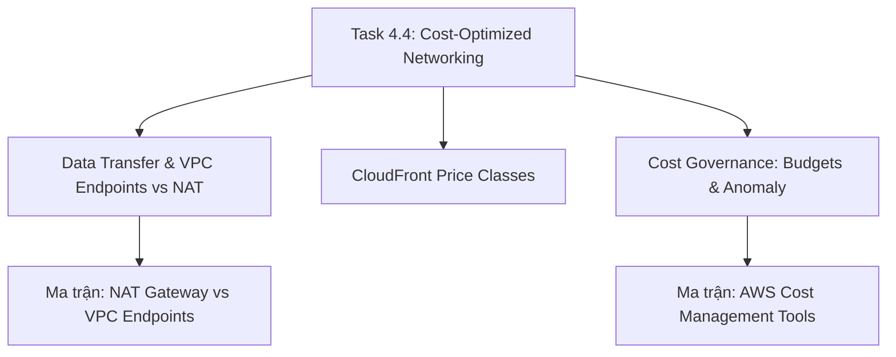

# 🌐 Task 4.4: Design Cost-Optimized Network Architectures

> Trở về: [[00-Domain-4-MOC]]  
> Trọng số: Chiếm khoảng 20-25% số câu hỏi của Domain 4 (~4-5% tổng bài thi SAA-C03).

---

## 🎯 Mục tiêu khảo sát của AWS (Official Examination Scope)

Task Statement này đánh giá khả năng hiểu sâu về biểu phí truyền tải dữ liệu (Data Transfer Charges), tối ưu hóa kiến trúc mạng để triệt tiêu các chi phí trung gian không đáng có, và quản trị ngân sách đám mây (FinOps Governance):
1. **Quy tắc tính cước truyền tải dữ liệu (Data Transfer Pricing):** Nắm chắc cước dữ liệu vào ($0), cước cùng AZ ($0), cước xuyên AZ ($0.01/GB), và cước ra Internet ($0.09/GB).
2. **Triệt tiêu chi phí NAT Gateway bằng VPC Endpoints:** Thay thế luồng dữ liệu đắt đỏ qua NAT Gateway ($0.045/GB) bằng **VPC Gateway Endpoints miễn phí ($0)** cho Amazon S3 và DynamoDB.
3. **Tối ưu hóa phân phối biên (Amazon CloudFront):** Giảm chi phí Data Transfer Out từ máy chủ gốc và lựa chọn đúng **Price Classes** phù hợp với khu vực địa lý của người dùng.
4. **Quản trị chi phí và FinOps:** Sử dụng **AWS Cost Explorer**, **AWS Budgets** (với tính năng tự động thực thi hành động ngăn chặn bội chi), **AWS Cost Anomaly Detection**, và gắn thẻ **Cost Allocation Tags** để kiểm soát chi tiêu.

---

## 🗺️ Bản đồ dịch vụ và liên kết chuyên sâu

---

## 📌 Các chủ đề trọng tâm trong đề thi

### 1. Bản đồ Chi phí Truyền tải Dữ liệu (Data Transfer Rules)
- **Data Transfer IN (Dữ liệu vào):** **HOÀN TOÀN MIỄN PHÍ ($0)** trên toàn bộ các dịch vụ của AWS.
- **Nội bộ cùng 1 Availability Zone:** **MIỄN PHÍ ($0)** khi giao tiếp qua địa chỉ Private IP.
- **Xuyên Availability Zone (Cross-AZ):** **$0.01 / GB mỗi chiều** ($0.02/GB cho cả 2 chiều gửi và nhận). Thiết kế nên giữ lưu lượng nội bộ trong cùng 1 AZ khi có thể.
- **Xuyên Region (Cross-Region):** **$0.02 / GB**.
- **Data Transfer OUT ra ngoài Internet (Egress):** **Đắt nhất (~$0.09 / GB)**.

### 2. NAT Gateway vs VPC Gateway Endpoints (Bẫy đề thi kinh điển!)
- **Chi phí của NAT Gateway:**
  - $0.045 cho mỗi giờ hoạt động của NAT Gateway.
  - **$0.045 cho mỗi 1 GB dữ liệu được xử lý qua NAT Gateway**.
- **Vấn đề thực tế:** Khi hàng trăm máy chủ EC2 trong private subnet tải lên và tải về hàng Terabyte dữ liệu từ Amazon S3 thông qua NAT Gateway, doanh nghiệp phải trả hàng nghìn USD chỉ riêng cho cước xử lý dữ liệu của NAT Gateway!
- **Giải pháp tối ưu:** Tạo **VPC Gateway Endpoint cho Amazon S3 và DynamoDB**.
  - **HOÀN TOÀN MIỄN PHÍ ($0/giờ và $0/GB)**.
  - Dữ liệu đi thẳng qua mạng nội bộ AWS, không chạm vào NAT Gateway, **tiết kiệm 100% cước phí xử lý dữ liệu**.

### 3. Bộ công cụ Quản trị Chi phí (Cost Management Tools)
- **AWS Cost Explorer:** Trực quan hóa xu hướng chi phí theo thời gian, lọc theo dịch vụ/thẻ tag, dự báo hóa đơn trong 12 tháng tới và đưa ra khuyến nghị mua Savings Plans.
- **AWS Budgets:** Thiết lập ngưỡng ngân sách chi tiêu. Điểm ăn tiền trong đề thi: **Hỗ trợ thực thi hành động tự động (Budget Actions)** khi chi phí vượt ngưỡng (gửi cảnh báo SNS, áp dụng SCP hạn chế quyền, hoặc tự động dừng một số máy chủ EC2).
- **AWS Cost Anomaly Detection:** Ứng dụng Machine Learning để giám sát liên tục và phát hiện các đợt tăng vọt chi phí bất thường do cấu hình lỗi hoặc rò rỉ tài nguyên.
- **Cost Allocation Tags:** Gắn thẻ tài nguyên (ví dụ: `Department: Finance`, `Project: MobileApp`) để phân bổ chi phí minh bạch cho từng trung tâm chi phí trong doanh nghiệp.

---

## ⚠️ Bẫy đề thi hay gặp (Exam Traps)

| Tình huống đề thi | Đáp án bẫy (SAI) | Đáp án chuẩn (ĐÚNG) |
| :--- | :--- | :--- |
| Máy chủ EC2 trong Private Subnet truyền tải 50 TB dữ liệu hàng tháng lên Amazon S3 làm chi phí NAT Gateway tăng vọt | Thêm NAT Gateway ở AZ thứ hai (chi phí sẽ tăng gấp đôi) | Tạo **VPC Gateway Endpoint cho S3** (hoàn toàn miễn phí, loại bỏ cước NAT Gateway) |
| Doanh nghiệp chỉ phục vụ người dùng tại Mỹ và Châu Âu, muốn giảm chi phí phân phối nội dung của CloudFront | Giảm thời gian cache TTL của CloudFront | Cấu hình **CloudFront Price Class thành `PriceClass_100`** (chỉ triển khai ở Bắc Mỹ và Châu Âu) |
| Cần tự động áp dụng chính sách hạn chế quyền của các IAM User khi chi phí dự án vượt quá $5,000 | Tự viết script kiểm tra hóa đơn hàng tuần | Thiết lập **AWS Budgets với tính năng Budget Action** tự động áp dụng **Service Control Policy (SCP)** khi chạm ngưỡng ngân sách |
| Phát hiện sớm các đợt phát sinh chi phí bất thường do nhà phát triển quên tắt máy chủ lớn | Đợi đến cuối tháng mở hóa đơn kiểm tra | Kích hoạt dịch vụ **AWS Cost Anomaly Detection** |

---

## 🔗 Liên kết liên quan
- [[00-Domain-4-MOC]]
- [[Data-Transfer-Costs-and-VPC-Endpoints-vs-NAT]]
- [[AWS-Cost-Governance-Budgets-Anomaly-and-Tags]]
- [[CloudFront-Cost-Optimization-and-Price-Classes]]
- [[Matrix-NAT-Gateway-vs-VPC-Endpoints]]
