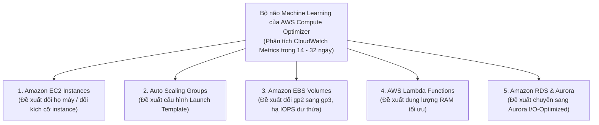

# 🤖 AWS Compute Optimizer & Right-Sizing: Tối Ưu Hóa Tài Nguyên Bằng AI

> Thuộc: [[Task-4.2-Cost-Optimized-Compute]] | Trở về: [[00-Domain-4-MOC]]

---

## 1. Khái niệm cốt lõi (Core Concepts)

**Hạ cỡ đúng chuẩn (Right-Sizing)** là quá trình đối chiếu nhu cầu tài nguyên thực tế của ứng dụng với kích thước cấu hình máy chủ, nhằm loại bỏ hoàn toàn tình trạng lãng phí tiền bạc cho phần cứng nhàn rỗi mà không làm giảm hiệu năng hệ thống.

**AWS Compute Optimizer** là dịch vụ ứng dụng **Học máy (Machine Learning)** độc quyền của AWS, tự động phân tích lịch sử số liệu giám sát của tài nguyên trong vòng **14 đến 32 ngày gần nhất** để đưa ra các khuyến nghị nâng/hạ cỡ chuẩn xác nhất.

---

## 2. Các Tài Nguyên Được Compute Optimizer Hỗ Trợ

### Ba Trạng Thái Đánh Giá (Finding Classifications):
1. **`Under-provisioned` (Thiếu tài nguyên):** Máy chủ đang phải gánh tải vượt quá khả năng (CPU/RAM thường xuyên chạm 90-100%). Compute Optimizer khuyến nghị **nâng cỡ (Upsize)** để tránh nguy cơ sập ứng dụng.
2. **`Over-provisioned` (Thừa tài nguyên - Điểm mấu chốt của Domain 4):** Máy chủ được cấp phát quá lớn nhưng CPU/RAM thực tế chỉ dùng 5-10%. Compute Optimizer khuyến nghị **hạ cỡ (Downsize)** hoặc chuyển sang họ máy tối ưu hơn (như Graviton `c7g`) để **tiết kiệm ngay 30 - 60% chi phí**.
3. **`Optimized` (Đã tối ưu):** Cấu hình hiện tại hoàn toàn phù hợp với tải thực tế.

---

## 3. Khuyến Nghị Aurora I/O-Optimized Bằng Compute Optimizer (Trọng Tâm 2026)

Ngoài việc tối ưu hóa EC2, trong các kỳ thi gần đây, AWS đã tích hợp tính năng phát hiện cơ sở dữ liệu:
- Compute Optimizer tự động phân tích các cụm **Amazon Aurora Standard** có chi phí I/O cao bất thường trong 30 ngày qua.
- Nếu phát hiện thấy chi phí I/O đọc/ghi chiếm tỷ lệ lớn trong hóa đơn, Compute Optimizer sẽ đánh dấu cụm database đó là **`Not Optimized`** kèm lý do: **`DB cluster storage savings available`**.
- Nó đưa ra con số ước tính cụ thể số tiền USD sẽ tiết kiệm được nếu bạn chuyển đổi cụm DB sang **Amazon Aurora I/O-Optimized**!

---

## 4. Tích Hợp Trung Tâm Tối Ưu Chi Phí (Cost Optimization Hub)

- Nằm bên trong **AWS Cost Explorer**, **Cost Optimization Hub** là bảng điều khiển tập trung (**Single Dashboard**) gom toàn bộ các khuyến nghị từ **AWS Compute Optimizer** trên toàn bộ các tài khoản của AWS Organizations.
- Giúp các nhà quản lý FinOps nhìn thấy ngay:
  - Tổng số tiền có thể tiết kiệm hàng tháng (ví dụ: `$12,450 / month`).
  - Danh sách các hành động có thể thực thi ngay lập tức mà ít rủi ro nhất (như chuyển `gp2` sang `gp3`, hạ cỡ EC2 nhàn rỗi).

---

## ⚠️ Bẫy đề thi & Mẹo ghi nhớ (Exam Traps)

| Tình huống đề thi | Đáp án bẫy (SAI) | Đáp án chuẩn (ĐÚNG) |
| :--- | :--- | :--- |
| Doanh nghiệp muốn tự động nhận khuyến nghị hạ cỡ máy chủ EC2 dư thừa tài nguyên bằng Machine Learning | Dùng CloudWatch Alarms gửi email | Kích hoạt dịch vụ **AWS Compute Optimizer** |
| Muốn biết một cụm Amazon Aurora MySQL có nên chuyển sang cấu hình Aurora I/O-Optimized để tiết kiệm tiền hay không | Tính toán thủ công bằng Excel | Kiểm tra khuyến nghị từ **AWS Compute Optimizer** hoặc **Cost Optimization Hub** |
| Nhận diện các hàm Lambda bị cấp phát thừa RAM gây lãng phí ngân sách | Đọc file CloudWatch Logs thủ công | Sử dụng **AWS Compute Optimizer cho AWS Lambda** |
| Ban lãnh đạo muốn một bảng điều khiển duy nhất gom toàn bộ khuyến nghị giảm chi phí EC2, EBS, Lambda trên 50 tài khoản AWS | Đăng nhập từng tài khoản xem Cost Explorer | Kích hoạt **Cost Optimization Hub** trong tài khoản quản trị AWS Organizations |

---

## 🔗 Liên kết liên quan
- [[Task-4.2-Cost-Optimized-Compute]]
- [[EC2-Pricing-Models-Spot-Savings-Plans-and-RIs]]
- [[Aurora-Storage-Configurations-Standard-vs-IO-Optimized]]
- [[Domain-4-Scenario-Walkthroughs]]
