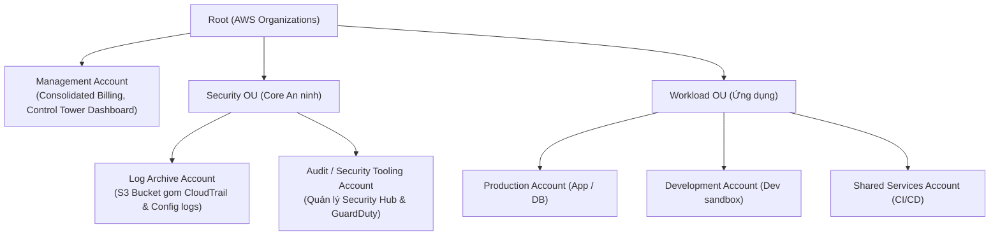
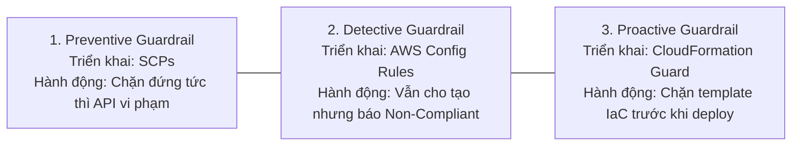

# 🏰 AWS Control Tower & Landing Zone: Quản Trị Đa Tài Khoản Chuẩn Doanh Nghiệp

> Thuộc: [[Task-1.1-Design-Secure-Access-Resources]] | So sánh nhanh: [[Matrix-Organizations-vs-Control-Tower]] | Trở về: [[00-Domain-1-MOC]]

---

## 1. Khái niệm cốt lõi (Core Concepts)

Khi một doanh nghiệp mở rộng quy mô trên AWS, việc chỉ sử dụng một vài tài khoản đơn lẻ sẽ dẫn đến hỗn loạn về bảo mật, khó phân bổ chi phí và dễ bị tấn công dây chuyền (Blast Radius quá rộng).

- **AWS Landing Zone:** Là một **môi trường đám mây đa tài khoản hoàn chỉnh, chuẩn mực và bảo mật (Well-Architected Multi-Account Baseline)** được thiết kế sẵn theo các nguyên tắc an ninh tối cao của AWS.
- **AWS Control Tower:** Là **dịch vụ tự động hóa cấp cao (Managed Orchestrator)** giúp thiết lập, triển khai và quản trị một Landing Zone chuẩn mực **chỉ bằng vài cú click chuột với ít công sức vận hành nhất (Least Operational Overhead)**.
- **Mối quan hệ:** Control Tower tự động kết hợp ngầm 4 dịch vụ nền tảng:
  $$\text{AWS Control Tower} = \text{AWS Organizations} + \text{AWS IAM Identity Center (SSO)} + \text{AWS Config} + \text{AWS Service Catalog}$$

---

## 2. Kiến trúc Landing Zone Chuẩn Của AWS Control Tower

Khi kích hoạt AWS Control Tower, hệ thống sẽ tự động khởi tạo cấu trúc cây phân cấp gồm các tài khoản chuyên trách:

### Chức năng của 2 tài khoản an ninh cốt lõi (Cực kỳ hay hỏi trong đề thi):
1. **Log Archive Account (Tài khoản Lưu trữ Nhật ký Tập trung):**
   - Đóng vai trò là "kho chứa log an toàn tuyệt đối".
   - Chứa một **Amazon S3 Bucket trung tâm** thu gom tự động toàn bộ nhật ký **AWS CloudTrail (API calls)** và **AWS Config (Lịch sử thay đổi cấu hình)** từ tất cả các tài khoản thành viên trong tổ chức.
   - S3 bucket này được bật **Object Lock / MFA Delete**, mã hóa KMS nghiêm ngặt và chỉ cho phép ghi (Write-only), ngăn chặn hoàn toàn nguy cơ hacker hay admin nội bộ vào xóa log phi tang dấu vết.
2. **Audit Account (Tài khoản Kiểm toán / Security Tooling):**
   - Cung cấp quyền truy cập dạng chỉ đọc (Read-only) và quyền kiểm toán bảo mật cho đội ngũ chuyên gia an ninh thông tin (SecOps / Compliance Team).
   - Đóng vai trò là tài khoản quản trị tập trung (Delegated Administrator) cho các dịch vụ: **Amazon GuardDuty, AWS Security Hub, Amazon Detective, AWS IAM Access Analyzer**.

---

## 3. Tam Giác Rào Chắn An Ninh: 3 Loại Guardrails Trong Control Tower

**Guardrails (Rào chắn an ninh)** là các quy tắc quản trị cấp cao được áp dụng lên các Organizational Units (OUs) để đảm bảo tuân thủ bảo mật liên tục. 

Trong đề thi SAA-C03, AWS liên tục kiểm tra sự phân biệt giữa **Preventive**, **Detective** và **Proactive**:

### Bảng So Sánh 3 Loại Guardrails Cần Thuộc Lòng:

| Tiêu chí | Preventive Guardrails | Detective Guardrails | Proactive Guardrails |
| :--- | :--- | :--- | :--- |
| **Công nghệ nền tảng** | **Service Control Policies (SCPs)** | **AWS Config Rules** | **AWS CloudFormation Guard** |
| **Cơ chế thực thi** | **CHẶN ĐỨNG NGAY TỨC THÌ (Hard Gate)** | **CHO PHÉP TẠO $\rightarrow$ Báo vi phạm** | **CHẶN Ở TẦNG MÃ NGUỒN IaC** |
| **Thời điểm tác động**| Tại thời điểm gọi API (Run-time) | Sau khi tài nguyên đã được tạo xong | Trước khi tài nguyên được khởi tạo |
| **Ảnh hưởng Console** | Báo lỗi `Access Denied` ngay trên màn hình | Hiện trạng thái `NON_COMPLIANT` trên Dashboard | Báo lỗi khi chạy CloudFormation Stack |
| **Ví dụ kinh điển** | - Cấm xóa S3 Log Archive bucket. - Cấm tạo tài nguyên ngoài Region phê duyệt. - Cấm tắt AWS Config. | - Phát hiện Security Group bị mở port 22. - Phát hiện EBS volume không gắn tag chi phí. - Phát hiện RDS instance thiếu Multi-AZ. | - Chặn deploy CloudFormation template nếu có định nghĩa Security Group mở `0.0.0.0/0`. |

### Mức độ áp dụng Guardrail:
- **Mandatory Guardrails (Bắt buộc):** Luôn tự động bật sẵn và **không thể tắt** (ví dụ: bảo vệ các tài nguyên cốt lõi của Control Tower, cấm sửa đổi Log Archive).
- **Strongly Recommended Guardrails (Khuyến nghị mạnh):** Dựa trên tiêu chuẩn bảo mật chuẩn (CIS Benchmarks), ví dụ: phát hiện EBS unencrypted.
- **Elective Guardrails (Tùy chọn):** Doanh nghiệp tự bật theo nhu cầu quản trị riêng.

---

## 4. Account Factory: Cấp Phát Tài Khoản Chuẩn Hóa Tự Động

- **Vấn đề thực tế:** Khi nhóm phát triển dự án cần một tài khoản AWS mới, nếu đội Cloud Admin phải tạo tài khoản thủ công, tạo VPC, phân quyền IAM, cấu hình log... sẽ mất nhiều ngày và dễ thiếu sót bảo mật.
- **Giải pháp Account Factory:**
  - Là tính năng tích hợp sẵn của Control Tower, xây dựng dựa trên **AWS Service Catalog**.
  - Cho phép người dùng (hoặc nhóm dự án được phân quyền) yêu cầu tạo tài khoản mới qua cơ chế tự phục vụ (**Self-Service**).
  - **Tự động 100%:** Khi tài khoản mới được sinh ra:
    1. Tự động nằm đúng vào OU được chỉ định.
    2. Tự động thừa hưởng toàn bộ **Guardrails (SCPs và Config rules)** của OU đó.
    3. Tự động thiết lập sẵn một **VPC cơ sở chuẩn (Baseline VPC)**.
    4. Tự động kết nối vào **AWS IAM Identity Center (SSO)** để nhân viên đăng nhập.

---

## 5. Tự Động Hóa Mở Rộng: Customizations for AWS Control Tower (CfCT)

- Khi doanh nghiệp muốn mỗi tài khoản mới tạo ra phải tự động có thêm các tài nguyên tùy biến riêng (ví dụ: tự tạo sẵn IAM Role cho tool CI/CD Jenkins, tự cấu hình Transit Gateway attachment):
- Sử dụng giải pháp **CfCT (Customizations for AWS Control Tower)** kết hợp mã nguồn mẫu **AWS CloudFormation** và kho lưu trữ Git để tự động hóa triển khai trên toàn bộ các tài khoản con.

---

## ⚠️ Bẫy Đề Thi & Mẹo Ghi Nhớ (Exam Traps)

| Tình huống đề thi | Đáp án bẫy (SAI) | Đáp án chuẩn (ĐÚNG) |
| :--- | :--- | :--- |
| Doanh nghiệp cần thiết lập môi trường đa tài khoản chuẩn bảo mật với phân cấp OU, gom log tập trung và rào chắn an ninh với ÍT CÔNG SỨC VẬN HÀNH NHẤT | Tự viết script CloudFormation và cấu hình thủ công AWS Organizations từ đầu | Triển khai **AWS Control Tower** để tự động thiết lập một **Landing Zone** hoàn chỉnh |
| Đảm bảo người dùng trong các tài khoản thành viên TUYỆT ĐỐI KHÔNG THỂ vô hiệu hóa AWS Config hoặc tắt CloudTrail | Dùng AWS Config Detective Rule gửi email cho admin | Sử dụng **Preventive Guardrail (Service Control Policy - SCP)** trong AWS Control Tower |
| Giám sát và tự động phát hiện các tài nguyên EBS volume hoặc RDS instance không tuân thủ quy định mã hóa sau khi được tạo | Dùng Preventive Guardrail chặn tạo | Sử dụng **Detective Guardrail (AWS Config Rules)** trong AWS Control Tower |
| Nơi lưu trữ tập trung, bất khả xâm phạm toàn bộ file log CloudTrail và Config của tất cả tài khoản trong Organization | Lưu trữ trong Management Account gốc | Lưu trữ tập trung trong **Log Archive Account** (thuộc Security OU của Control Tower) |
| Cung cấp cơ chế tự phục vụ (Self-service) cho các nhóm dự án tự tạo tài khoản AWS mới đã cấu hình sẵn mạng và bảo mật | Cấp quyền `organizations:CreateAccount` cho Developer | Sử dụng **Account Factory** trong **AWS Control Tower** (dựa trên AWS Service Catalog) |

---

## 🔗 Liên kết liên quan
- [[Task-1.1-Design-Secure-Access-Resources]]
- [[AWS-Organizations-and-SCPs]]
- [[Matrix-Organizations-vs-Control-Tower]]
- [[Directory-Service-and-IAM-Identity-Center]]
- [[Domain-1-Scenario-Walkthroughs]]
