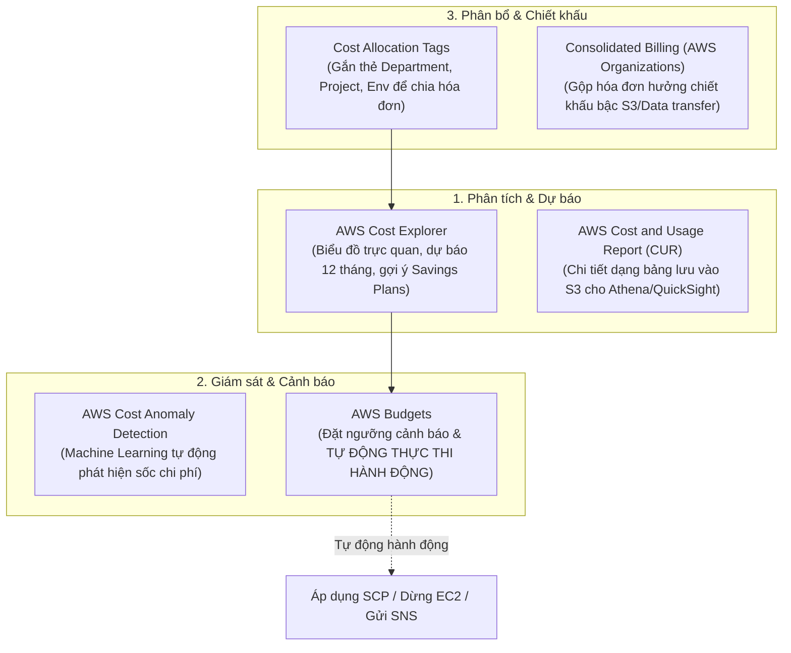

# 📊 AWS Cost Governance: Quản Trị Chi Phí, Budgets & Phát Hiện Bất Thường

> Thuộc: [[Task-4.4-Cost-Optimized-Networking]] | So sánh nhanh: [[Matrix-AWS-Cost-Management-Tools]] | Trở về: [[00-Domain-4-MOC]]

---

## 1. Khái niệm cốt lõi (Core Concepts)

Quản trị tài chính đám mây (**Cloud Financial Management / FinOps**) không chỉ dừng ở việc chọn dịch vụ giá rẻ, mà đòi hỏi khả năng:
1. **Minh bạch hóa chi phí (Cost Visibility):** Biết chính xác từng phòng ban, dự án đang tiêu tốn bao nhiêu tiền qua **Cost Allocation Tags**.
2. **Kiểm soát & Ngăn chặn bội chi (Cost Control):** Đặt hạn mức chi tiêu và tự động kích hoạt hành động cưỡng chế qua **AWS Budgets Actions**.
3. **Phát hiện sớm sự cố rò rỉ ngân sách (Proactive Detection):** Sử dụng AI/ML để cảnh báo các đợt phát sinh chi phí bất thường qua **AWS Cost Anomaly Detection**.
4. **Hưởng chiết khấu quy mô lớn:** Tận dụng **Consolidated Billing** trong AWS Organizations.

---

## 2. Hệ Sinh Thái Các Công Cụ Quản Trị Chi Phí AWS

---

## 3. Phân Biệt Các Công Cụ Quản Lý Chi Phí Trọng Tâm

| Công cụ | Bản chất kỹ thuật | Điểm đặc thù trong đề thi |
| :--- | :--- | :--- |
| **AWS Cost Explorer** | Bảng điều khiển phân tích trực quan xu hướng chi phí theo thời gian (12 tháng qua & dự báo 12 tháng tới). | **Khuyến nghị mua Savings Plans & Reserved Instances** dựa trên lịch sử dùng thực tế. |
| **AWS Budgets** | Công cụ lập kế hoạch ngân sách, gửi email/SNS khi chi phí thực tế (hoặc chi phí dự báo) vượt ngưỡng. | **HỖ TRỢ THỰC THI HÀNH ĐỘNG TỰ ĐỘNG (Budget Actions):** Có thể tự động áp dụng SCP hạn chế quyền hoặc tắt máy chủ EC2 khi vượt ngân sách! |
| **AWS Cost Anomaly Detection**| Sử dụng thuật toán Machine Learning độc quyền phân tích dòng chi phí liên tục. | **Tự động tìm nguyên nhân gốc rễ (Root Cause)** của các đợt tăng vọt chi phí bất thường mà không cần tự đặt ngưỡng thủ công. |
| **Cost and Usage Report (CUR)**| Bản xuất dữ liệu chi tiết nhất của AWS (mức độ từng resource, từng giờ) lưu vào file CSV/Parquet trên S3. | Dành cho nhu cầu phân tích chuyên sâu bằng **Amazon Athena** hoặc tích hợp các công cụ BI (Amazon QuickSight). |

---

## 4. Hành Động Tự Động Trong AWS Budgets (Budget Actions)

Trong các câu hỏi thi SAA-C03 hiện đại, **AWS Budgets** không chỉ gửi email cảnh báo đơn thuần:
- Khi chi phí vượt quá ngưỡng (ví dụ: chạm 100% ngân sách $10,000):
  1. **Tự động áp dụng Service Control Policy (SCP):** Chặn người dùng trong tài khoản tạo thêm máy chủ EC2 hoặc cơ sở dữ liệu mới.
  2. **Tự động áp dụng IAM Policy:** Thu hồi quyền tạo tài nguyên của nhóm Developer.
  3. **Tự động dừng máy chủ (Stop EC2/RDS):** Tắt các máy chủ thuộc môi trường thử nghiệm để chặn ngay việc tiếp tục phát sinh tiền.

---

## 5. Thẻ Phân Bổ Chi Phí (Cost Allocation Tags) & Consolidated Billing

### A. Cost Allocation Tags
- **Hai loại thẻ:**
  - *AWS-generated tags:* Do AWS tự sinh ra (ví dụ: `aws:createdBy`).
  - *User-defined tags:* Do quản trị viên tự đặt (ví dụ: `Department: Marketing`, `Project: MobileApp`, `Environment: Production`).
- **Lưu ý thi cử:** Sau khi gắn thẻ lên tài nguyên, bạn **BẮT BUỘC PHẢI VÀO BILLING CONSOLE ĐỂ KÍCH HOẠT (Activate)** thì các thẻ này mới xuất hiện trong báo cáo chi phí của Cost Explorer.

### B. Consolidated Billing (Thanh toán gộp qua AWS Organizations)
- Doanh nghiệp có 20 tài khoản AWS độc lập. Khi gom tất cả vào **AWS Organizations**:
  - Nhận **1 hóa đơn duy nhất** gửi về Management Account.
  - **Hưởng chiết khấu bậc dung lượng lớn (Volume Discounts):** Dung lượng lưu trữ S3 và lưu lượng Data Transfer Out của tất cả 20 tài khoản được cộng dồn lại để chạm tới các mốc chiết khấu rẻ hơn của AWS $\rightarrow$ tiết kiệm tiền cho toàn tập đoàn.

---

## ⚠️ Bẫy đề thi & Mẹo ghi nhớ (Exam Traps)

| Tình huống đề thi | Đáp án bẫy (SAI) | Đáp án chuẩn (ĐÚNG) |
| :--- | :--- | :--- |
| Nhận thông báo sớm ngay khi có tài nguyên phát sinh chi phí tăng vọt bất thường mà không biết trước ngưỡng | Tự đặt 100 cái CloudWatch Alarms | Kích hoạt dịch vụ **AWS Cost Anomaly Detection** |
| Tự động ngăn chặn việc tạo thêm tài nguyên mới khi chi phí hàng tháng của tài khoản vượt quá ngân sách $5,000 | Viết script cronjob kiểm tra Cost Explorer | Thiết lập **AWS Budgets với tính năng Budget Action áp dụng Service Control Policy (SCP)** |
| Phân bổ hóa đơn AWS chi tiết cho từng phòng ban (Finance, HR, Engineering) | Chia nhỏ thành 100 VPC | Sử dụng **Cost Allocation Tags** (gắn tag và kích hoạt trong Billing Console) |
| Tối ưu hóa chiết khấu lưu trữ S3 cho 15 tài khoản AWS khác nhau của cùng một công ty | Chuyển toàn bộ dữ liệu vào 1 tài khoản | Sử dụng tính năng **Consolidated Billing trong AWS Organizations** để cộng dồn dung lượng hưởng chiết khấu bậc |

---

## 🔗 Liên kết liên quan
- [[Task-4.4-Cost-Optimized-Networking]]
- [[Matrix-AWS-Cost-Management-Tools]]
- [[AWS-Compute-Optimizer-and-Right-Sizing]]
- [[Domain-4-Scenario-Walkthroughs]]
