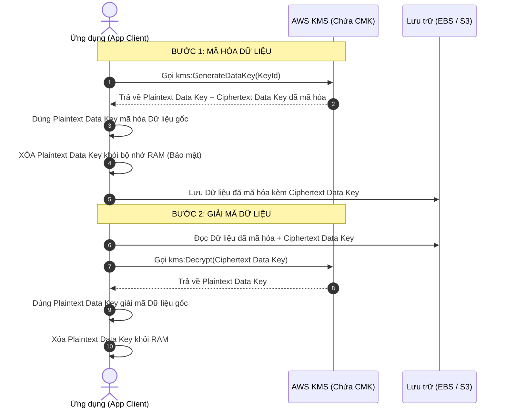

# 🔐 AWS KMS & CloudHSM: Khóa mã hóa, Key Policy & Envelope Encryption

> Thuộc: [[Task-1.3-Determine-Data-Security-Controls]] | So sánh nhanh: [[Matrix-KMS-Key-Types]] | Trở về: [[00-Domain-1-MOC]]

---

## 1. Khái niệm cốt lõi (Core Concepts)

- **AWS Key Management Service (AWS KMS):** Dịch vụ quản lý khóa mã hóa tập trung, tích hợp sẵn với hầu hết các dịch vụ lưu trữ và cơ sở dữ liệu trên AWS. KMS sử dụng các module phần cứng bảo mật (**FIPS 140-2 Level 2/3**) dùng chung (Multi-tenant).
- **AWS CloudHSM:** Thiết bị phần cứng bảo mật chuyên dụng độc lập (**Single-tenant**), đạt chuẩn **FIPS 140-2 Level 3**. Khách hàng có toàn quyền kiểm soát phần cứng và khóa (thông qua chuẩn PKCS#11, JCE), AWS hoàn toàn không có quyền truy cập vào dữ liệu bên trong thiết bị.

---

## 2. Phân loại các loại khóa trong AWS KMS

| Tiêu chí | AWS Owned Keys | AWS Managed Keys | Customer Managed Keys (CMK) |
| :--- | :--- | :--- | :--- |
| **Định dạng hiển thị** | Người dùng không nhìn thấy trong Console/CLI | Có alias dạng `aws/s3`, `aws/rds`, `aws/ebs` | Alias do người dùng tự đặt (ví dụ: `alias/prod-payment-key`) |
| **Chi phí** | **Hoàn toàn miễn phí** | **Miễn phí tạo khóa** (chỉ tính phí API calls) | **$1 / tháng / key** + Phí API calls |
| **Khả năng quản trị** | Không thể xem hay can thiệp | Xem được nhưng **không thể sửa Key Policy**, không thể xóa | **Toàn quyền:** Sửa Key Policy, tạo Alias, bật/tắt, xóa (chờ 7-30 ngày) |
| **Tự động xoay khóa (Key Rotation)**| Do AWS tự quản lý ngầm | **Tự động xoay mỗi 1 năm** (Bắt buộc, không tắt được) | **Tùy chọn:** Có thể bật xoay tự động mỗi 1 năm, hoặc tự xoay thủ công |
| **Ứng dụng đề thi** | Mã hóa mặc định nội bộ | Dành cho nhu cầu mã hóa cơ bản, không yêu cầu audit khắt khe | Dành cho bài toán **yêu cầu kiểm toán chi tiết qua CloudTrail, kiểm soát quyền truy cập khóa nghiêm ngặt** |

---

## 3. Cơ chế mã hóa phong bì (Envelope Encryption)

Khi dữ liệu cần mã hóa có dung lượng lớn (trên 4KB), KMS không mã hóa trực tiếp dữ liệu đó (vì giới hạn payload của API KMS là tối đa 4KB). Thay vào đó, KMS sử dụng cơ chế **Envelope Encryption**:



### Tại sao Envelope Encryption lại tối ưu?
1. **Hiệu năng cao:** Dữ liệu dung lượng hàng GB được mã hóa cục bộ bằng thuật toán đối xứng tốc độ cao (AES-256) trên máy chủ ứng dụng mà không cần gửi dữ liệu qua đường truyền mạng tới KMS.
2. **Tiết kiệm chi phí & Tránh chạm Rate-Limit:** KMS chỉ cần xử lý việc tạo và giải mã Data Key (vài byte), giảm thiểu tối đa tải API call lên KMS.

---

## 4. KMS Key Policy: Chìa khóa quản trị

Trong KMS, **IAM Policy là chưa đủ**. Để một người dùng được phép sử dụng hoặc quản lý khóa KMS, họ bắt buộc phải được cấp phép thông qua **KMS Key Policy**.

### Key Policy mặc định (Default Key Policy):
Cấp toàn quyền quản lý khóa cho **Root Account** của tài khoản hiện tại:
```json
{
  "Sid": "Enable IAM User Permissions",
  "Effect": "Allow",
  "Principal": {
    "AWS": "arn:aws:iam::111122223333:root"
  },
  "Action": "kms:*",
  "Resource": "*"
}
```
> **Ý nghĩa quan trọng trong phòng thi:** Điều khoản này trao lại quyền ủy quyền cho tài khoản IAM của account. Nhờ có điều khoản này, các IAM Policy gán cho User/Role mới có hiệu lực. Nếu xóa điều khoản này và không gán cho Admin cụ thể nào, khóa sẽ bị cô lập (Locked out).

---

## 5. Khóa đa vùng (Multi-Region Keys)

- **Vấn đề:** Khóa KMS thông thường là **Regional (gắn chặt với 1 Region)**. Khi sao chép snapshot RDS hoặc S3 bucket sang Region khác (Disaster Recovery), dữ liệu không thể giải mã được nếu không có khóa.
- **Giải pháp:** Sử dụng **KMS Multi-Region Keys**. Khóa Primary được tạo ở Region A, sau đó nhân bản sang Region B thành Replica Key. Chúng có **cùng Key ID và Key Material**.
- **Lưu ý thi cử:** Dữ liệu mã hóa ở Region A có thể được giải mã trực tiếp ở Region B mà **không cần gọi API xuyên Region** (không phát sinh độ trễ cross-region).

---

## ⚠️ Bẫy đề thi & Mẹo ghi nhớ (Exam Traps)

| Tình huống đề thi | Đáp án bẫy (SAI) | Đáp án chuẩn (ĐÚNG) |
| :--- | :--- | :--- |
| Một IAM User đã có quyền `AdministratorAccess` nhưng vẫn bị lỗi `AccessDenied` khi đọc file S3 mã hóa KMS | Cho rằng S3 Bucket Policy bị sai | Kiểm tra **KMS Key Policy** (IAM Admin không tự động có quyền dùng khóa nếu Key Policy không cho phép) |
| Yêu cầu tuân thủ FIPS 140-2 Level 3 và công ty phải có quyền kiểm soát độc quyền phần cứng HSM | Sử dụng AWS KMS với Customer Managed Key (KMS là multi-tenant) | Sử dụng **AWS CloudHSM** |
| Sao chép dữ liệu mã hóa sang Region thứ hai trong kịch bản Active-Active hoặc DR với độ trễ thấp nhất | Giải mã dữ liệu ở Region 1, gửi qua mạng, rồi mã hóa lại bằng khóa ở Region 2 | Sử dụng **KMS Multi-Region Keys** |
| Tự động xoay khóa mã hóa mà không làm hỏng dữ liệu cũ đã mã hóa | Viết script đổi key và mã hóa lại toàn bộ ổ cứng | Bật tính năng **Automatic Key Rotation** trên CMK (KMS lưu lại key material cũ để tiếp tục giải mã dữ liệu trước đây) |

---

## 🔗 Liên kết liên quan
- [[Task-1.3-Determine-Data-Security-Controls]]
- [[Matrix-KMS-Key-Types]]
- [[Secrets-Manager-and-Parameter-Store]]
- [[S3-Security-and-Compliance]]
