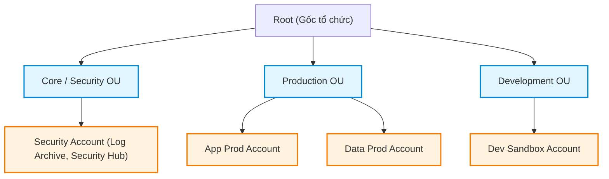

# 🏢 AWS Organizations & Service Control Policies (SCPs)

> Thuộc: [[Task-1.1-Design-Secure-Access-Resources]] | Trở về: [[00-Domain-1-MOC]]

---

## 1. Khái niệm cốt lõi (Core Concepts)

- **AWS Organizations:** Dịch vụ quản trị tập trung nhiều tài khoản AWS trong một doanh nghiệp. Cho phép thanh toán gộp (**Consolidated Billing**), tự động hóa tạo tài khoản mới và áp dụng các chính sách rào chắn an ninh trên diện rộng.
- **Service Control Policies (SCPs):** Các chính sách JSON quản lý quyền hạn tập trung ở cấp độ tổ chức. SCP hoạt động như một **bộ lọc (filter/guardrail)** định nghĩa giới hạn quyền tối đa mà các tài khoản thành viên (Member Accounts) có thể thực hiện.
- **AWS Resource Access Manager (RAM):** Cho phép chia sẻ tài nguyên an toàn giữa các tài khoản trong cùng một Organization mà không phải tạo bản sao (ví dụ: chia sẻ VPC Subnets, Transit Gateway, Route 53 Resolver rules).

---

## 2. Cây phân cấp Tổ chức (Hierarchy Architecture)



---

## 3. Bản chất hoạt động của Service Control Policies (SCPs)

### Nguyên tắc sống còn trong đề thi:
1. **SCP KHÔNG CẤP QUYỀN (SCP does NOT grant permissions):**
   - SCP chỉ thiết lập **trần quyền hạn (Permission Boundary)** cho toàn bộ tài khoản.
   - Để một IAM User/Role trong tài khoản thành viên thực hiện được thao tác, thao tác đó phải:
     $$\textbf{Được ALLOW bởi SCP} \quad \text{VÀ} \quad \textbf{Được ALLOW bởi IAM Policy nội bộ}$$
2. **Ảnh hưởng lên Root User của Member Account:**
   - SCP có hiệu lực đối với **TẤT CẢ** các danh tính trong Member Account, bao gồm cả **Root User của tài khoản thành viên**!
3. **Ngoại lệ duy nhất:**
   - SCP **KHÔNG** áp dụng lên **Management Account (Tài khoản gốc của Organization)**. Do đó, khuyến nghị tốt nhất là **không chạy bất kỳ ứng dụng (workload) nào** trong Management Account.

### Chiến lược triển khai SCP: Blacklisting vs Whitelisting
- **Blacklist Strategy (Mặc định):**
  - Giữ nguyên policy `FullAWSAccess` (`Allow: *`) gắn ở Root.
  - Tạo thêm SCP `Deny` cho các hành động cấm (ví dụ: cấm tắt CloudTrail, cấm sử dụng các Region không được phê duyệt).
  - Vì `Deny` luôn ghi đè `Allow`, chính sách này chặn ngay các rủi ro.
- **Whitelist Strategy (Ngặt nghèo):**
  - Gỡ bỏ `FullAWSAccess`.
  - Chỉ `Allow` danh sách cụ thể các dịch vụ được phép dùng (ví dụ: chỉ cho phép EC2, S3, RDS). Mọi dịch vụ khác tự động bị chặn.

### Mẫu SCP chuẩn thường gặp trong đề thi:
*Ngăn chặn tất cả các tài khoản con tắt CloudTrail hoặc xóa log:*
```json
{
  "Version": "2012-10-17",
  "Statement": [
    {
      "Sid": "DisableCloudTrailProtection",
      "Effect": "Deny",
      "Action": [
        "cloudtrail:StopLogging",
        "cloudtrail:DeleteTrail"
      ],
      "Resource": "*"
    }
  ]
}
```

*Giới hạn chỉ cho phép tạo tài nguyên ở Singapore (`ap-southeast-1`):*
```json
{
  "Version": "2012-10-17",
  "Statement": [
    {
      "Sid": "DenyAllOutsideAllowedRegions",
      "Effect": "Deny",
      "NotAction": [
        "iam:*",
        "organizations:*",
        "route53:*",
        "budgets:*"
      ],
      "Resource": "*",
      "Condition": {
        "StringNotEquals": {
          "aws:RequestedRegion": [
            "ap-southeast-1"
          ]
        }
      }
    }
  ]
}
```

---

## 4. AWS Resource Access Manager (RAM)

Trong mô hình đa tài khoản (Multi-Account Architecture), việc mỗi tài khoản tự tạo một VPC riêng dẫn đến lãng phí IP và phức tạp trong kết nối. **AWS RAM** giải quyết bài toán này:
- **Tài khoản Network (Central Network Account):** Tạo VPC, cấu hình Subnets, Route Tables.
- **Chia sẻ qua RAM:** Chia sẻ Private Subnets cho các tài khoản Production, Development trong cùng Organization.
- **Kết quả:** Các tài khoản con có thể tạo EC2, RDS chạy ngay trong Subnet được chia sẻ, nhưng **không thể** can thiệp hay sửa đổi cấu hình hạ tầng mạng của VPC (đảm bảo phân tách trách nhiệm hoàn hảo).

---

## ⚠️ Bẫy đề thi & Mẹo ghi nhớ (Exam Traps)

| Tình huống đề thi | Đáp án bẫy (SAI) | Đáp án chuẩn (ĐÚNG) |
| :--- | :--- | :--- |
| Muốn Developer trong tài khoản con dùng DynamoDB | Tạo SCP Allow DynamoDB ở cấp OU | Tạo IAM Policy Allow DynamoDB trong tài khoản con + Đảm bảo SCP không chặn |
| Đảm bảo không ai trong công ty dùng được Region lạ | Đăng nhập từng tài khoản, tạo IAM policy chặn | Tạo **SCP chặn Region** (`Condition: aws:RequestedRegion`) gắn ở Root của Organization |
| Chia sẻ VPC Subnet cho nhiều tài khoản không trùng lặp | Thiết lập VPC Peering giữa hàng chục VPC | Dùng **AWS RAM** chia sẻ Subnet từ Central Network Account |
| Ngăn Root User của member account xóa log kiểm toán | Cấu hình IAM policy trong tài khoản đó (Root bypass được IAM) | Áp dụng **SCP Deny CloudTrail** ở cấp Organization (Root member account không thể bypass SCP) |

---

## 🔗 Liên kết liên quan
- [[Task-1.1-Design-Secure-Access-Resources]]
- [[IAM-and-STS-Deep-Dive]]
- [[Directory-Service-and-IAM-Identity-Center]]
- [[Matrix-AD-Integration-Modes]]
