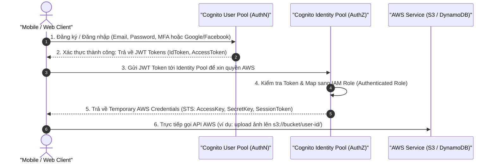

# 👤 Amazon Cognito Architecture: User Pools vs Identity Pools

> Thuộc: [[Task-1.1-Design-Secure-Access-Resources]] | Trở về: [[00-Domain-1-MOC]]

---

## 1. Khái niệm cốt lõi (Core Concepts)

**Amazon Cognito** là dịch vụ quản lý định danh và xác thực dành cho các ứng dụng web và mobile hướng tới người dùng cuối (Customer-facing applications). Nó cho phép mở rộng tới hàng triệu người dùng mà không cần tự dựng máy chủ cơ sở dữ liệu xác thực.

Cognito gồm 2 thành phần độc lập nhưng thường kết hợp với nhau:
1. **Cognito User Pools (CUP) — Authentication (Xác thực):** Cơ sở dữ liệu người dùng (User Directory). Trả lời câu hỏi: *"Bạn là ai?"*.
2. **Cognito Identity Pools (CIP / Federated Identities) — Authorization (Ủy quyền):** Cung cấp quyền truy cập vào AWS. Trả lời câu hỏi: *"Bạn được phép làm gì trên AWS?"*.

---

## 2. Kiến trúc luồng xác thực và ủy quyền (End-to-End Architecture)



---

## 3. So sánh chi tiết: User Pools vs Identity Pools

| Tiêu chí | Cognito User Pools (CUP) | Cognito Identity Pools (CIP) |
| :--- | :--- | :--- |
| **Mục đích chính** | **Xác thực (Authentication - AuthN)** | **Ủy quyền (Authorization - AuthZ)** |
| **Chức năng** | - Form đăng ký, đăng nhập, quên mật khẩu.<br/>- Xác thực 2 bước (MFA).<br/>- Social login (Google, Facebook, Apple).<br/>- Enterprise SAML / OIDC. | - Nhận token từ CUP, Google, Facebook, SAML.<br/>- Đổi lấy **AWS Temporary Credentials**.<br/>- Gán IAM Role cho từng nhóm người dùng. |
| **Kết quả trả về** | **JSON Web Tokens (JWT):**<br/>- `id_token`<br/>- `access_token`<br/>- `refresh_token` | **AWS IAM Temporary Credentials:**<br/>- `AccessKeyId`<br/>- `SecretAccessKey`<br/>- `SessionToken` |
| **Hỗ trợ Guest/Ẩn danh?**| Không (bắt buộc phải có tài khoản) | **Có** (Hỗ trợ Unauthenticated / Guest Access để người dùng dùng thử trước khi đăng nhập) |
| **Tích hợp tiêu biểu** | Gắn làm Authorizer cho **API Gateway** hoặc **Application Load Balancer (ALB)**. | Cấp quyền cho client tải file trực tiếp lên **S3** hoặc đọc ghi vào **DynamoDB**. |

---

## 4. Các tính năng nâng cao thường gặp trong đề thi

### Fine-Grained Role-Based Access Control
- Identity Pools cho phép map các thuộc tính (claims) trong JWT Token tới các **IAM Role khác nhau**.
- Ví dụ: User có thuộc tính `role: admin` được nhận IAM Role có quyền ghi S3; User thường chỉ nhận IAM Role có quyền đọc S3.

### Dynamic Folder Access trên Amazon S3
- Sử dụng biến thay thế trong IAM Policy (`${cognito-identity.amazonaws.com:sub}`) để mỗi người dùng di động chỉ có quyền đọc/ghi vào đúng thư mục mang tên định danh của họ trên S3:
```json
{
  "Version": "2012-10-17",
  "Statement": [
    {
      "Effect": "Allow",
      "Action": ["s3:GetObject", "s3:PutObject"],
      "Resource": [
        "arn:aws:s3:::my-app-photos/${cognito-identity.amazonaws.com:sub}/*"
      ]
    }
  ]
}
```

---

## ⚠️ Bẫy đề thi & Mẹo ghi nhớ (Exam Traps)

| Tình huống đề thi | Đáp án bẫy (SAI) | Đáp án chuẩn (ĐÚNG) |
| :--- | :--- | :--- |
| Ứng dụng mobile cho phép người dùng đăng nhập bằng Google/Facebook, sau đó upload ảnh trực tiếp lên S3 | Tự viết server trung gian nhận ảnh rồi dùng IAM User upload | Dùng **Cognito User Pool** (xác thực Google/Facebook) kết hợp **Cognito Identity Pool** (cấp temporary credentials upload S3) |
| Ứng dụng cần bảo vệ REST API đằng sau Amazon API Gateway | Viết Lambda Authorizer tùy biến phức tạp | Sử dụng **Cognito User Pool làm Authorizer** tích hợp sẵn trên API Gateway |
| Cho phép người dùng khách (Guest) chưa đăng ký tài khoản có thể tải thử dữ liệu xem trước | Bắt buộc người dùng phải tạo tài khoản trước | Bật chế độ **Unauthenticated Identities** trong **Cognito Identity Pool** |

---

## 🔗 Liên kết liên quan
- [[Task-1.1-Design-Secure-Access-Resources]]
- [[IAM-and-STS-Deep-Dive]]
- [[Domain-1-Scenario-Walkthroughs]]
