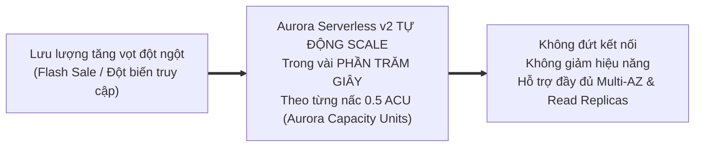
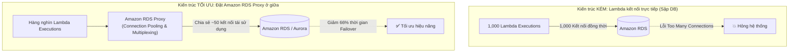

# 🚀 Aurora Serverless v2 & Amazon RDS Proxy: Mở Rộng RDBMS Tức Thì & Quản Lý Kết Nối

> Thuộc: [[Task-3.3-High-Performing-Databases]] | Trở về: [[00-Domain-3-MOC]]

---

## 1. Khái niệm cốt lõi (Core Concepts)

Hai thách thức lớn nhất đối với hiệu năng của cơ sở dữ liệu quan hệ (RDBMS) trong kiến trúc đám mây hiện đại là:
1. **Khả năng co giãn khi lưu lượng biến động khó lường:** Database truyền thống mất hàng chục phút để đổi instance type. $\rightarrow$ Được giải quyết triệt để bởi **Amazon Aurora Serverless v2**.
2. **Cạn kiệt tài nguyên do bùng nổ kết nối (Connection Exhaustion):** Các kiến trúc Serverless (AWS Lambda) hoặc microservices mở hàng nghìn kết nối đồng thời làm treo database. $\rightarrow$ Được giải quyết bởi **Amazon RDS Proxy**.

---

## 2. Amazon Aurora Serverless v2: Đột Phá So Với v1 (Trọng Tâm 2026)

Khác với *Aurora Serverless v1* vốn mất hàng chục giây đến cả phút để scale và bắt buộc phải tạm dừng (pause) gây trễ khởi động nguội, **Aurora Serverless v2 mang đến cơ chế mở rộng mang tính cách mạng**:

### So sánh chi tiết Aurora Serverless v1 vs v2:

| Đặc tính kỹ thuật | Aurora Serverless v1 (Cũ) | Aurora Serverless v2 (Chuẩn Hiện Đại) |
| :--- | :--- | :--- |
| **Tốc độ mở rộng (Scaling Speed)** | Chậm (Mất hàng chục giây hoặc vài phút) | **Tức thì (Trong vài phần trăm giây)** |
| **Mức độ phân mảnh nấc scale**| Nhân đôi (Ví dụ: 2 $\rightarrow$ 4 $\rightarrow$ 8 $\rightarrow$ 16 ACUs) | **Chia nhỏ từng 0.5 ACU** (1 ACU $\approx$ 2 GB RAM + CPU) |
| **Hỗ trợ Multi-AZ** | Giới hạn | **Hỗ trợ Multi-AZ đầy đủ chuẩn Enterprise** |
| **Hỗ trợ Read Replicas** | Không hỗ trợ | **Hỗ trợ tối đa 15 Read Replicas (Serverless hoặc Provisioned)** |
| **Hỗ trợ Aurora Global DB**| Không hỗ trợ | **Hỗ trợ Global Database xuyên lục địa** |
| **Khối lượng công việc tối ưu**| Môi trường dev/test ít dùng | **Production quy mô lớn, tải biến động bất ngờ, ứng dụng SaaS đa khách hàng** |

---

## 3. Amazon RDS Proxy: Giải Quyết Bài Toán Cạn Kiệt Kết Nối

Khi hàng nghìn hàm AWS Lambda chạy song song và mỗi hàm cố gắng mở một kết nối TCP riêng biệt tới cơ sở dữ liệu MySQL hoặc PostgreSQL:
- **Hậu quả nếu không có Proxy:** Database phải dành phần lớn bộ nhớ RAM chỉ để duy trì trạng thái kết nối socket. Khi vượt quá giới hạn `max_connections`, database sẽ từ chối dịch vụ (`Too many connections`).

### Các lợi ích kiến trúc then chốt của RDS Proxy:
1. **Connection Pooling & Multiplexing:** Gom hàng nghìn kết nối từ client và tái sử dụng một nhóm nhỏ kết nối mở sẵn tới database.
2. **Giảm thời gian Failover tới 66%:** Khi RDS Multi-AZ chuyển giao máy chủ ngầm (Failover), RDS Proxy **tự động giữ kết nối của ứng dụng** và điều hướng ngầm tới máy chủ Standby mới mà không làm đứt kết nối hay báo lỗi 500 ra ngoài người dùng.
3. **Bảo mật tập trung:** Tích hợp trực tiếp với **AWS Secrets Manager** để quản lý thông tin đăng nhập database và hỗ trợ xác thực **IAM Authentication** cho client.

---

## ⚠️ Bẫy đề thi & Mẹo ghi nhớ (Exam Traps)

| Tình huống đề thi | Đáp án bẫy (SAI) | Đáp án chuẩn (ĐÚNG) |
| :--- | :--- | :--- |
| Cơ sở dữ liệu quan hệ cho ứng dụng bán vé có lưu lượng tăng vọt đột ngột từ vài chục lên hàng trăm ngàn lượt truy cập trong 1 giây | Tự động nâng cấp instance type bằng cronjob | Sử dụng **Amazon Aurora Serverless v2** để tự động scale tức thì theo ACU |
| Hàng nghìn container ECS hoặc hàm Lambda gây lỗi quá tải kết nối cơ sở dữ liệu trên Amazon RDS Postgres | Tăng thông số `max_connections` trong DB Parameter Group | Triển khai **Amazon RDS Proxy** phía trước cơ sở dữ liệu |
| Cần giảm thiểu thời gian gián đoạn ứng dụng khi Amazon RDS MySQL thực hiện Multi-AZ failover | Giảm thời gian DNS TTL của DB Endpoint | Sử dụng **Amazon RDS Proxy** (giữ kết nối ứng dụng và chuyển đổi ngầm, giảm 66% failover time) |
| Ứng dụng Serverless cần xác thực an toàn vào database mà không lưu mật khẩu trong code Lambda | Lưu mật khẩu vào file cấu hình nén | Cấu hình Lambda dùng **IAM Database Authentication thông qua Amazon RDS Proxy** |

---

## 🔗 Liên kết liên quan
- [[Task-3.3-High-Performing-Databases]]
- [[Caching-Deep-Dive-ElastiCache-and-DAX]]
- [[Lambda-Performance-and-Provisioned-Concurrency]]
- [[Domain-3-Scenario-Walkthroughs]]
