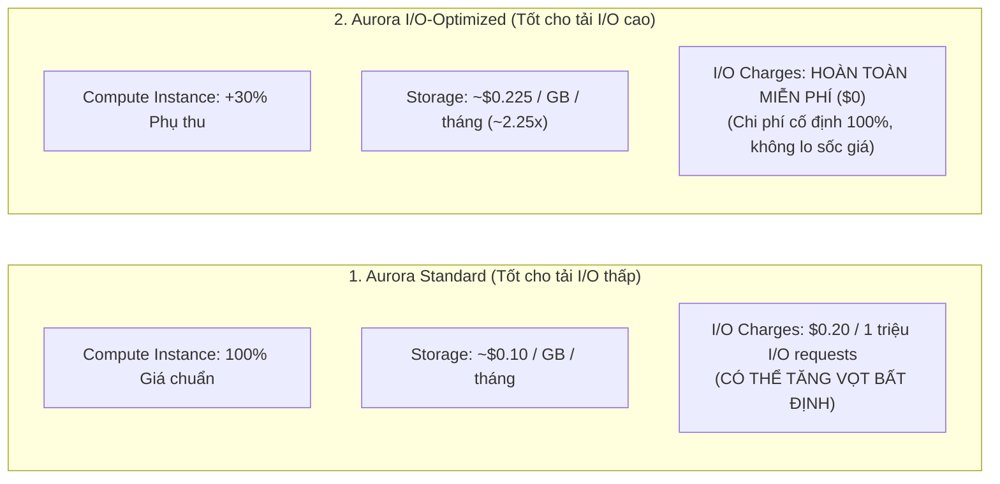

# 🗄️ Aurora Storage Configurations: Standard vs I/O-Optimized & Điểm Hòa Vốn 25%

> Thuộc: [[Task-4.3-Cost-Optimized-Databases]] | So sánh nhanh: [[Matrix-Aurora-Standard-vs-IO-Optimized]] | Trở về: [[00-Domain-4-MOC]]

---

## 1. Khái niệm cốt lõi (Core Concepts)

Trong các hệ thống cơ sở dữ liệu quan hệ giao dịch trực tuyến (**OLTP**) có lưu lượng truy cập cao (thương mại điện tử, thanh toán, game), số lượng thao tác đọc/ghi I/O (Input/Output requests) có thể bùng nổ lên tới hàng tỷ request mỗi tháng.

Trước đây, với cấu hình truyền thống của **Amazon Aurora**, mỗi 1 triệu request I/O đều bị tính phí riêng biệt, dẫn đến tình trạng **hóa đơn cơ sở dữ liệu tăng vọt bất ngờ và không thể dự đoán trước**.

Để giải quyết bài toán này, AWS cung cấp 2 cấu hình lưu trữ độc lập cho cụm Amazon Aurora:
1. **Aurora Standard:** Cấu hình mặc định truyền thống (tính tiền theo từng request I/O).
2. **Aurora I/O-Optimized:** Cấu hình đột phá mới **HOÀN TOÀN MIỄN PHÍ TIỀN I/O ($0 I/O charges)**.

---

## 2. So Sánh Cơ Cấu Tính Tiền (Pricing Breakdown)



| Thành phần hóa đơn | Amazon Aurora Standard | Amazon Aurora I/O-Optimized |
| :--- | :--- | :--- |
| **Phí Compute Instance** | Giá chuẩn cơ sở | Tăng khoảng **~30%** so với Standard |
| **Phí Dung lượng lưu trữ (GB)** | **~$0.10 / GB / tháng** | **~$0.225 / GB / tháng** (Gấp ~2.25 lần) |
| **Phí thao tác I/O (Đọc & Ghi)**| **$0.20 mỗi 1 triệu requests** | **HOÀN TOÀN MIỄN PHÍ ($0.00)** |
| **Tính dự đoán của hóa đơn** | Kém (Phụ thuộc vào số lượng query/I/O thực tế)| **Rất cao (Hóa đơn cố định theo tháng)** |
| **Khối lượng công việc phù hợp**| Ứng dụng có số lượng truy vấn đọc/ghi ít hoặc vừa phải | **E-commerce, Core Banking, Game online, Ứng dụng I/O chuyên sâu** |

---

## 3. Quy Tắc Vàng Trong Đề Thi: Điểm Hòa Vốn 25% – 33% (The Tipping Point)

Khi nào một kiến trúc sư nên chuyển đổi cụm DB sang **Aurora I/O-Optimized**?

```text
CÔNG THỨC QUYẾT ĐỊNH:

Nếu: (Chi phí I/O hàng tháng) > 25% tổng hóa đơn Aurora
-> BẮT BUỘC CHUYỂN SANG AURORA I/O-OPTIMIZED!

Kết quả:
- Tiết kiệm ngay từ 30% đến 40% tổng chi phí cơ sở dữ liệu.
- Loại bỏ hoàn toàn rủi ro bị đội hóa đơn khi có đợt Flash Sale hoặc tấn công tải cao.
```

### Ví dụ minh họa thực tế trong câu hỏi thi:
- Một công ty vận hành Aurora MySQL với hóa đơn hàng tháng là **$10,000**:
  - Tiền Compute + Storage: **$6,000**.
  - Tiền phí I/O (do người dùng truy vấn dồn dập): **$4,000 (chiếm 40% tổng hóa đơn)**.
- Khi chuyển sang **Aurora I/O-Optimized**:
  - Tiền Compute (+30%) + Storage (2.25x) tăng lên thành: **$7,200**.
  - Tiền phí I/O: **$0**.
  - **Tổng hóa đơn mới:** **$7,200 / tháng** $\rightarrow$ **Tiết kiệm ngay $2,800 mỗi tháng (giảm 28%)**!

---

## 4. Chuyển Đổi Không Gián Đoạn (Zero Downtime Migration)

- Bạn có thể chuyển đổi qua lại giữa **Aurora Standard** và **Aurora I/O-Optimized** chỉ bằng **1 cú click chuột** trên AWS Management Console hoặc chạy lệnh AWS CLI:
  ```bash
  aws rds modify-db-cluster \
      --db-cluster-identifier my-aurora-cluster \
      --storage-type iopt1 \
      --apply-immediately
  ```
- **Không gây downtime:** Quá trình chuyển đổi diễn ra ngầm hoàn toàn, ứng dụng vẫn tiếp tục đọc và ghi dữ liệu bình thường.
- Có thể chuyển đổi **1 lần mỗi 30 ngày**.

---

## ⚠️ Bẫy đề thi & Mẹo ghi nhớ (Exam Traps)

| Tình huống đề thi | Đáp án bẫy (SAI) | Đáp án chuẩn (ĐÚNG) |
| :--- | :--- | :--- |
| Hóa đơn Aurora MySQL tăng vọt do phí I/O đọc ghi chiếm 35% tổng chi phí, ban lãnh đạo yêu cầu chi phí ổn định dễ dự đoán | Nâng cấp cấu hình instance lớn hơn hoặc chuyển sang DynamoDB | Sửa cấu hình lưu trữ cụm Aurora sang **Aurora I/O-Optimized** |
| Database có dung lượng lưu trữ khổng lồ (50 TB) nhưng tần suất đọc ghi I/O rất thấp (ít truy vấn) | Chuyển sang Aurora I/O-Optimized (sẽ bị đắt vì phí dung lượng 50 TB tăng 2.25 lần) | Giữ nguyên ở **Aurora Standard** |
| Công cụ nào tự động phát hiện cụm Aurora có thể tiết kiệm chi phí bằng cách chuyển sang I/O-Optimized? | AWS Trusted Advisor kiểm tra Security Group | Sử dụng **AWS Compute Optimizer** (với finding reason `DB cluster storage savings available`) |

---

## 🔗 Liên kết liên quan
- [[Task-4.3-Cost-Optimized-Databases]]
- [[Matrix-Aurora-Standard-vs-IO-Optimized]]
- [[AWS-Compute-Optimizer-and-Right-Sizing]]
- [[Domain-4-Scenario-Walkthroughs]]
