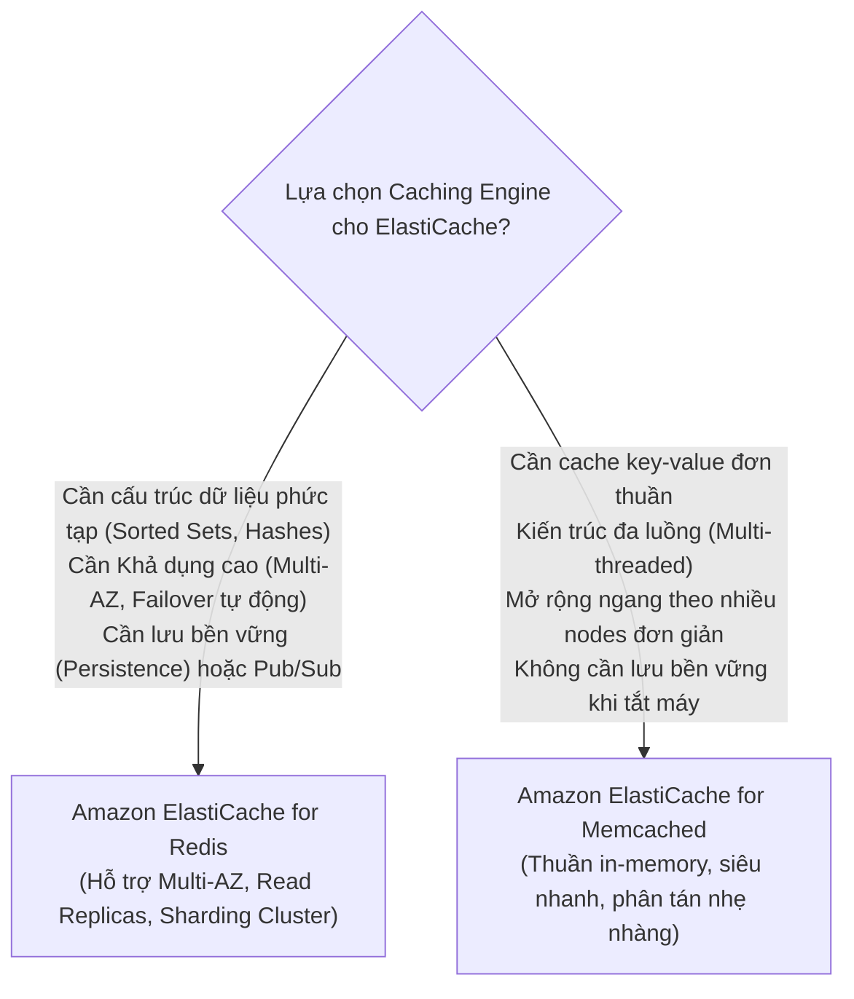
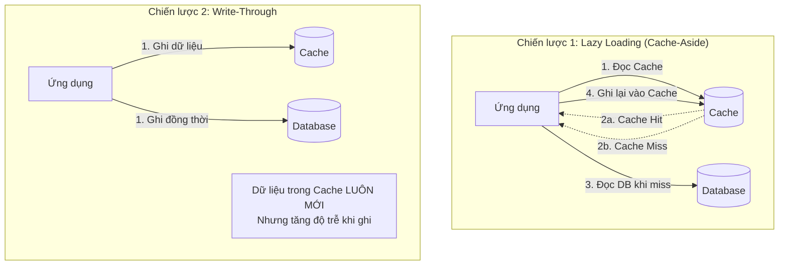

# ⚡ Caching Deep Dive: ElastiCache Serverless, Redis vs Memcached & DAX

> Thuộc: [[Task-3.3-High-Performing-Databases]] | So sánh nhanh: [[Matrix-ElastiCache-Redis-vs-Memcached]] | Trở về: [[00-Domain-3-MOC]]

---

## 1. Khái niệm cốt lõi (Core Concepts)

Bộ nhớ đệm trong bộ nhớ RAM (**In-Memory Caching**) là kỹ thuật tối thượng giúp ứng dụng đạt độ trễ phản hồi **dưới 1 mili-giây (Sub-millisecond)** hoặc thậm chí **Micro-giây**, bằng cách giảm tải tối đa các truy vấn lặp đi lặp lại tới các cơ sở dữ liệu đĩa từ (Disk-based databases như RDS, Aurora, DynamoDB).

AWS cung cấp 2 giải pháp In-Memory Caching hàng đầu:
1. **Amazon ElastiCache:** Dịch vụ quản lý bộ nhớ đệm phân tán hỗ trợ 2 công nghệ nguồn mở phổ biến nhất thế giới: **Redis** và **Memcached**, kèm tùy chọn **ElastiCache Serverless** hiện đại.
2. **Amazon DynamoDB Accelerator (DAX):** Cụm bộ nhớ đệm chuyên biệt gắn liền với DynamoDB, tối ưu riêng cho NoSQL.

---

## 2. So Sánh Chuyên Sâu: ElastiCache for Redis vs Memcached

| Tiêu chí kỹ thuật | ElastiCache for Redis | ElastiCache for Memcached |
| :--- | :--- | :--- |
| **Cấu trúc dữ liệu** | **Rất phong phú:** Strings, Hashes, Lists, Sets, **Sorted Sets**, Bitmaps, HyperLogLogs, Geospatial | **Đơn giản:** Chỉ hỗ trợ chuỗi String và chuỗi Key-Value nhị phân |
| **Mô hình luồng (Threading)**| Đơn luồng (Single-threaded core) | **Đa luồng (Multi-threaded)** tận dụng tối đa đa nhân CPU |
| **Khả dụng cao (High Availability)**| **CÓ:** Hỗ trợ Multi-AZ với tính năng **Tự động chuyển giao (Automatic Failover)** | **KHÔNG:** Không có khái niệm Standby hay tự động failover |
| **Bản sao đọc (Read Replicas)**| **Hỗ trợ tối đa 5 Read Replicas** mỗi shard | Không hỗ trợ (Chỉ mở rộng bằng cách thêm node mới) |
| **Lưu trữ bền vững (Persistence)**| **CÓ:** Hỗ trợ ghi file AOF (Append Only File) và Snapshot RDB lên S3 | **KHÔNG:** Khi node restart là mất toàn bộ dữ liệu trong RAM |
| **Hỗ trợ Pub/Sub** | **CÓ** (Tích hợp sẵn kênh Publish/Subscribe) | Không hỗ trợ |
| **Phân mảnh dữ liệu (Sharding)**| **Redis Cluster:** Phân tán tối đa 500 shards | Sharding do client-side hashing quyết định |
| **Sao lưu & Khôi phục** | Hỗ trợ Backup và Restore tự động/thủ công | Không hỗ trợ |

---

## 3. ElastiCache Serverless (Trọng Điểm Chuẩn Đề 2026)

Trước đây, khi tạo ElastiCache, bạn phải đau đầu tính toán: chọn node loại nào (`cache.r6g.large`), bao nhiêu node, khi nào cần scale.
- **ElastiCache Serverless (Bổ sung mới):**
  - Tự động theo dõi mức tiêu thụ RAM, CPU và băng thông mạng.
  - **Tự động mở rộng dung lượng trong vài giây** để đáp ứng các đợt flash sale hoặc sự kiện đột biến lưu lượng mà không gây gián đoạn ứng dụng.
  - Tự động nhân bản Multi-AZ dự phòng ngầm.
  - Bạn chỉ trả tiền cho dung lượng RAM lưu trữ dữ liệu (tính theo GB-giờ) và số lượng thao tác đọc/ghi ElastiCache Processing Units (ECPUs).

---

## 4. Các Chiến Lược Caching Kinh Điển (Caching Strategies)

### So sánh 3 kỹ thuật:
1. **Lazy Loading (Cache-Aside):** Chỉ nạp dữ liệu vào Cache khi có người yêu cầu.
   - *Ưu điểm:* Cache không bị lãng phí bộ nhớ lưu các dữ liệu không ai đọc. Hệ thống vẫn chạy được nếu node cache bị sập (chỉ chậm hơn).
   - *Nhược điểm:* Lần đọc đầu tiên luôn bị trễ (Cache Miss). Dữ liệu có thể bị cũ (Stale data) nếu DB bị cập nhật trực tiếp mà không cập nhật Cache.
2. **Write-Through:** Ghi đồng thời dữ liệu vào Cache và Database mỗi khi có thao tác tạo mới/cập nhật.
   - *Ưu điểm:* Dữ liệu trong Cache luôn luôn mới 100%.
   - *Nhược điểm:* Tăng độ trễ thao tác ghi. Lãng phí RAM lưu những dữ liệu ghi vào mà không ai đọc.
3. **TTL (Time to Live):** Luôn kết hợp TTL cho mọi key trong cache để dữ liệu tự động bị hủy sau một khoảng thời gian (ví dụ 60 giây), buộc ứng dụng phải nạp lại dữ liệu mới từ DB.

---

## 5. DynamoDB Accelerator (DAX) vs ElastiCache

Khi ứng dụng chạy trên Amazon DynamoDB cần tăng tốc:
- **DAX (DynamoDB Accelerator):**
  - Là cụm Cache In-Memory **chuyên dụng 100% cho DynamoDB**.
  - Đưa độ trễ đọc từ mili-giây xuống **Micro-giây**.
  - **Tương thích tuyệt đối với DynamoDB SDK API:** Ứng dụng chỉ cần trỏ endpoint tới cụm DAX, không cần thay đổi bất kỳ dòng code gọi `GetItem` hay `Query` nào.
  - Sử dụng cơ chế ghi Write-Through mặc định.

---

## ⚠️ Bẫy đề thi & Mẹo ghi nhớ (Exam Traps)

| Tình huống đề thi | Đáp án bẫy (SAI) | Đáp án chuẩn (ĐÚNG) |
| :--- | :--- | :--- |
| Hệ thống bảng xếp hạng game (Leaderboard) thời gian thực cần sắp xếp điểm số liên tục | Dùng ElastiCache for Memcached | Sử dụng **ElastiCache for Redis** với cấu trúc dữ liệu **Sorted Sets (`ZADD`)** |
| Cần giảm tải truy vấn đọc lặp lại cho cơ sở dữ liệu NoSQL DynamoDB với độ trễ micro-giây mà không muốn sửa code | Dựng cụm Redis và viết code kiểm tra cache-aside | Kích hoạt **Amazon DynamoDB Accelerator (DAX)** |
| Ứng dụng thương mại điện tử cần lớp đệm bộ nhớ tự động mở rộng theo lưu lượng đột biến mà không cần quản lý cụm máy chủ | Tạo ASG cho các EC2 Memcached | Triển khai **Amazon ElastiCache Serverless** |
| Dữ liệu trong Cache thường xuyên bị sai lệch so với cơ sở dữ liệu MySQL do cập nhật trực tiếp | Tăng kích thước node cache | Áp dụng chiến lược **Write-Through** hoặc thiết lập **TTL (Time To Live)** ngắn cho các khóa cache |

---

## 🔗 Liên kết liên quan
- [[Task-3.3-High-Performing-Databases]]
- [[Matrix-ElastiCache-Redis-vs-Memcached]]
- [[Aurora-Serverless-v2-and-RDS-Proxy]]
- [[Domain-3-Scenario-Walkthroughs]]
