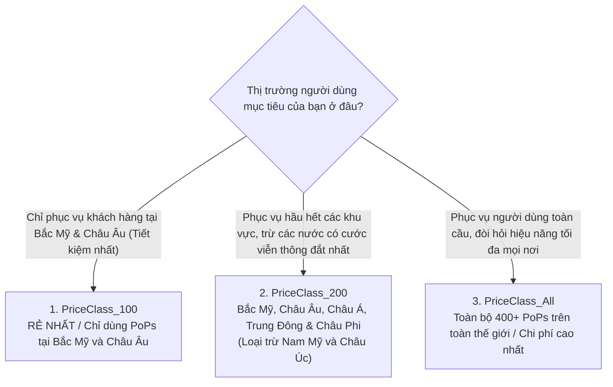

# 🌐 Amazon CloudFront Cost Optimization: Price Classes & Tối Ưu Cước DTO

> Thuộc: [[Task-4.4-Cost-Optimized-Networking]] | Trở về: [[00-Domain-4-MOC]]

---

## 1. Khái niệm cốt lõi (Core Concepts)

**Amazon CloudFront** không chỉ là mạng phân phối nội dung (CDN) giúp tăng tốc độ tải trang, mà còn là **công cụ cắt giảm chi phí mạng (Data Transfer Out - DTO) chủ lực** trên AWS:
1. **Miễn phí 100% cước truyền dữ liệu từ Origin sang CloudFront ($0.00 / GB):** Lưu lượng chuyển từ Amazon S3, EC2 hoặc Application Load Balancer sang CloudFront hoàn toàn không mất tiền.
2. **Cước DTO ra ngoài Internet rẻ hơn:** Cước phí truyền dữ liệu từ các trạm Edge Locations của CloudFront tới người dùng cuối luôn rẻ hơn so với cước truyền trực tiếp từ máy chủ EC2 ra Internet.

---

## 2. Ba Hạng Giá Của Amazon CloudFront (Price Classes)

Chi phí vận hành các trạm biên (PoPs) của AWS ở các khu vực địa lý khác nhau là không giống nhau (ví dụ: cước viễn thông tại Nam Mỹ hoặc Châu Đại Dương đắt hơn đáng kể so với Bắc Mỹ và Châu Âu). 

Để giúp khách hàng tối ưu hóa chi phí, CloudFront cung cấp **3 Hạng giá (Price Classes)**:

| Price Class | Các khu vực địa lý được kích hoạt PoPs | Chi phí tương đối | Kịch bản đề thi điển hình |
| :--- | :--- | :---: | :--- |
| **`PriceClass_100`** | **Chỉ gồm Bắc Mỹ và Châu Âu** | **RẺ NHẤT** | Doanh nghiệp chỉ có khách hàng tại Mỹ và Châu Âu, muốn giảm tối đa hóa đơn CDN. |
| **`PriceClass_200`** | Bắc Mỹ, Châu Âu, Châu Á, Châu Phi, Trung Đông (Loại trừ Úc và Nam Mỹ) | Trung bình | Ứng dụng quốc tế muốn phủ sóng rộng nhưng tránh cước phí đắt đỏ của Nam Mỹ/Úc. |
| **`PriceClass_All`** | **Tất cả các Edge Locations trên toàn cầu** | Cao nhất | Ứng dụng giải trí/game toàn cầu cần độ trễ thấp nhất cho mọi người dùng ở mọi châu lục. |

> **Cơ chế khi chọn Price Class thấp:** Người dùng ở các khu vực bị loại trừ (ví dụ người dùng ở Brazil khi bạn chọn `PriceClass_100`) **vẫn truy cập được bình thường**, nhưng request của họ sẽ được định tuyến tới một trạm biên ở Bắc Mỹ $\rightarrow$ độ trễ sẽ cao hơn nhưng chi phí không bị đội lên!

---

## 3. Tối Ưu Hóa Chi Phí Bằng Origin Shield & Nén Dữ Liệu

### A. Tầng đệm tập trung Origin Shield
- **Bài toán chi phí:** Khi có nhiều Edge Locations trên thế giới cùng bị Cache Miss, chúng sẽ gửi đồng loạt hàng nghìn request về máy chủ Origin (ALB/EC2). Doanh nghiệp phải trả tiền duy trì máy chủ Origin cấu hình lớn để đỡ các đợt tải này.
- **Giải pháp:** Bật **CloudFront Origin Shield**. Nó tạo ra một tầng cache tập trung duy nhất ở khu vực gần Origin nhất, gom toàn bộ các request trùng lặp và phục vụ từ cache $\rightarrow$ **hạ kích thước máy chủ Origin xuống mức nhỏ nhất**, tiết kiệm chi phí compute.

### B. Bật nén tự động Brotli / Gzip
- CloudFront hỗ trợ tự động nén các file tĩnh (HTML, CSS, JS) bằng thuật toán **Brotli** hoặc **Gzip** trước khi gửi tới trình duyệt người dùng.
- **Lợi ích kép:** Dung lượng file giảm tới **70 - 80%** $\rightarrow$ Người dùng tải trang nhanh hơn, và **chi phí Data Transfer Out tính theo GB giảm ngay 70%**!

---

## ⚠️ Bẫy đề thi & Mẹo ghi nhớ (Exam Traps)

| Tình huống đề thi | Đáp án bẫy (SAI) | Đáp án chuẩn (ĐÚNG) |
| :--- | :--- | :--- |
| Một công ty truyền thông chỉ kinh doanh tại Mỹ và Châu Âu, muốn cắt giảm hóa đơn CloudFront hàng tháng | Giảm thời gian TTL của cache | Cấu hình CloudFront phân phối ở mức **`PriceClass_100`** |
| Muốn giảm chi phí truyền tải dữ liệu khi cung cấp kho ảnh 100 TB từ S3 ra cho người dùng Internet | Nén ảnh và cho tải trực tiếp từ S3 qua Internet | Đặt **Amazon CloudFront** phía trước S3 (miễn phí S3-to-CloudFront, cước CloudFront DTO rẻ hơn S3 DTO) |
| Máy chủ web EC2 gốc liên tục bị quá tải CPU do phải xử lý các request lặp lại từ nhiều trạm CloudFront | Tăng kích thước máy chủ EC2 lên gấp đôi | Kích hoạt tính năng **CloudFront Origin Shield** |

---

## 🔗 Liên kết liên quan
- [[Task-4.4-Cost-Optimized-Networking]]
- [[Data-Transfer-Costs-and-VPC-Endpoints-vs-NAT]]
- [[CloudFront-vs-Global-Accelerator-Edge-Performance]]
- [[Domain-4-Scenario-Walkthroughs]]
