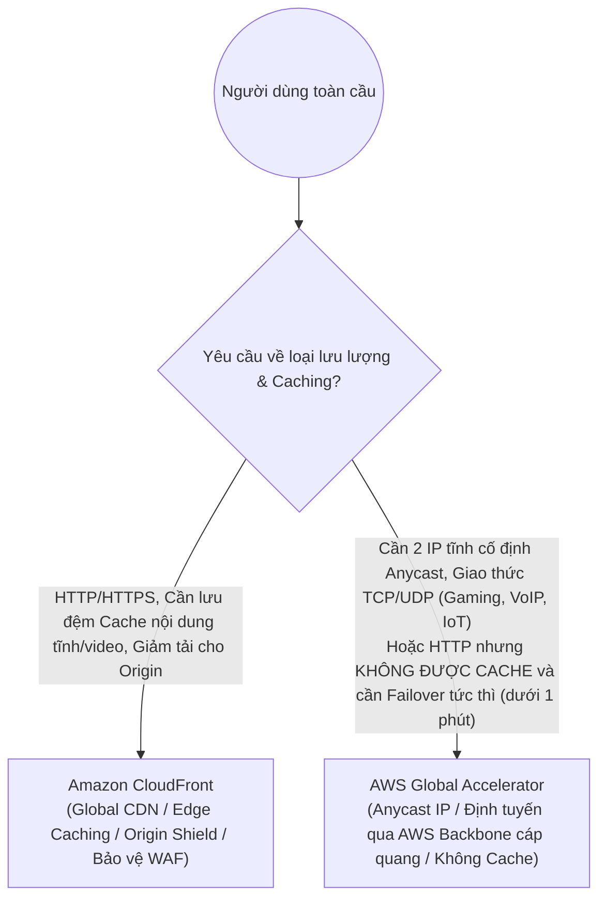
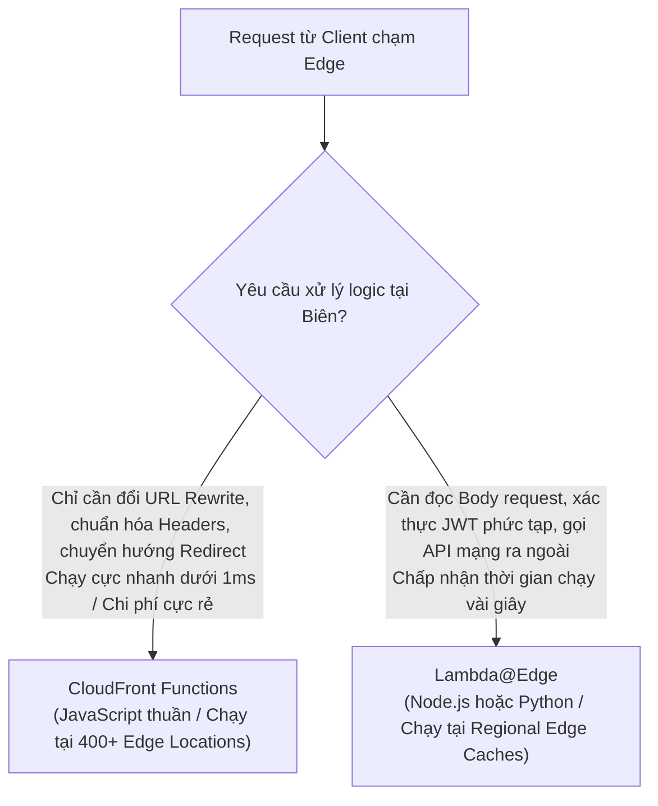

# 🌐 CloudFront vs Global Accelerator: Tăng Tốc Biên Mạng & Tính Toán Tại Biên

> Thuộc: [[Task-3.4-High-Performing-Networking]] | So sánh nhanh: [[Matrix-CloudFront-vs-Global-Accelerator]] | Trở về: [[00-Domain-3-MOC]]

---

## 1. Khái niệm cốt lõi (Core Concepts)

Khi người dùng trên toàn thế giới truy cập vào các ứng dụng đặt tại các AWS Regions cố định, việc lưu lượng phải đi qua nhiều chặng trung gian (Hops) trên mạng Internet công cộng sẽ gây ra độ trễ cao, nghẽn mạng và mất gói tin.

AWS cung cấp 2 giải pháp tăng tốc mạng biên toàn cầu với cơ chế kỹ thuật hoàn toàn khác nhau:
- **Amazon CloudFront:** Mạng lưới phân phối nội dung (**Content Delivery Network - CDN**) hoạt động theo cơ chế **Lưu bộ nhớ đệm (Caching)** cho các giao thức web (HTTP/HTTPS).
- **AWS Global Accelerator:** Dịch vụ tối ưu hóa đường truyền mạng sử dụng công nghệ **Địa chỉ IP tĩnh Anycast**, dẫn toàn bộ lưu lượng **TCP/UDP** vào mạng cáp quang riêng của AWS và **KHÔNG CÓ CƠ CHẾ CACHE**.

---

## 2. So Sánh Bản Chất: CloudFront vs AWS Global Accelerator

| Tiêu chí so sánh | Amazon CloudFront | AWS Global Accelerator |
| :--- | :--- | :--- |
| **Bản chất kỹ thuật** | **Mạng phân phối nội dung (CDN)** | **Dịch vụ tăng tốc mạng trục (Network Layer)** |
| **Cơ chế hoạt động** | **CÓ LƯU TRỮ BỘ NHỚ ĐỆM (Caching)** tại 400+ Edge Locations | **KHÔNG CÓ BỘ NHỚ ĐỆM (No Caching)** |
| **Giao thức hỗ trợ** | **HTTP, HTTPS, WebSocket** | **Tất cả các giao thức TCP và UDP** |
| **Điểm truy cập Client** | Tên miền DNS động (ví dụ: `d111111abcdef8.cloudfront.net`) | **2 Địa chỉ IP tĩnh cố định Anycast IPv4** |
| **Tốc độ Failover** | Phụ thuộc vào thời gian sống của DNS (**DNS TTL**) | **Gần như tức thì (< 1 phút)**, không phụ thuộc DNS |
| **Bảo vệ máy chủ gốc** | **Origin Shield** và bộ nhớ đệm giúp giảm 90% tải về máy chủ | Không giảm tải request (mọi gói tin đều tới đích) |
| **Khối lượng công việc tối ưu**| Web tĩnh, xem video streaming, REST API có thể cache | **Gaming, Voice over IP (VoIP), IoT, Hệ thống tài chính cần IP tĩnh** |

---

## 3. Tính Năng Giảm Tải Origin Shield Của CloudFront

- Thông thường, khi nhiều Regional Edge Caches cùng gửi request về máy chủ gốc (Origin như ALB hay EC2), máy chủ gốc vẫn phải chịu tải lớn.
- **CloudFront Origin Shield:** Tạo ra một tầng đệm tập trung duy nhất nằm giữa Regional Edge Caches và Origin. Toàn bộ các request từ các châu lục khác nhau sẽ gom về Origin Shield trước khi chạm tới Origin $\rightarrow$ **tối đa hóa tỷ lệ Cache Hit Ratio và bảo vệ tuyệt đối máy chủ gốc**.

---

## 4. Điện Toán Tại Biên: CloudFront Functions vs Lambda@Edge

Khi cần can thiệp xử lý logic ngay tại các trạm biên mạng của AWS mà không muốn request phải đi ngược về máy chủ gốc:

| Tiêu chí kỹ thuật | CloudFront Functions | Lambda@Edge |
| :--- | :--- | :--- |
| **Ngôn ngữ lập trình** | **JavaScript (ECMAScript 5.1)** | **Node.js, Python** |
| **Vị trí thực thi** | **400+ Edge Locations** (Sát người dùng nhất) | **13 Regional Edge Caches** |
| **Thời gian chạy tối đa** | **Dưới 1 mili-giây (< 1ms)** | **Tối đa 5 - 30 giây** |
| **Dung lượng bộ nhớ RAM** | 2 MB | 128 MB đến 10 GB |
| **Truy cập mạng / Internet**| **KHÔNG ĐƯỢC PHÉP** (Không thể gọi API ngoài) | **CÓ** (Có thể gọi DB, API bên ngoài) |
| **Đọc Body Request** | **KHÔNG** (Chỉ đọc URL, Headers, Query, Cookies) | **CÓ** (Đọc và sửa đổi toàn bộ HTTP body) |
| **Chi phí** | **Rẻ hơn 6 lần** so với Lambda@Edge | Chi phí theo mô hình Lambda tiêu chuẩn |

---

## ⚠️ Bẫy đề thi & Mẹo ghi nhớ (Exam Traps)

| Tình huống đề thi | Đáp án bẫy (SAI) | Đáp án chuẩn (ĐÚNG) |
| :--- | :--- | :--- |
| Game online đối kháng thời gian thực chạy UDP cần tăng tốc mạng toàn cầu và cung cấp 2 IP tĩnh | Sử dụng Amazon CloudFront | Sử dụng **AWS Global Accelerator** |
| Cần chuyển hướng URL người dùng (URL Redirection) dựa trên quốc gia với độ trễ thấp nhất và chi phí rẻ nhất | Viết hàm Lambda@Edge | Triển khai **CloudFront Functions** |
| Ứng dụng web cần xác thực chữ ký token JWT và gọi API bên ngoài để kiểm tra tài khoản tại trạm biên | Dùng CloudFront Functions (CFF không thể gọi mạng ngoài) | Triển khai **Lambda@Edge** (Viewer Request trigger) |
| Website toàn cầu cần chuyển đổi dự phòng tức thì giữa 2 AWS Regions mà không bị trễ do DNS cache của các nhà mạng ISP | Dùng Route 53 Failover Routing (ISP vẫn cache DNS cũ) | Sử dụng **AWS Global Accelerator** (sử dụng 2 IP tĩnh Anycast chuyển luồng mạng ngầm) |

---

## 🔗 Liên kết liên quan
- [[Task-3.4-High-Performing-Networking]]
- [[Matrix-CloudFront-vs-Global-Accelerator]]
- [[Matrix-CloudFront-Functions-vs-Lambda-at-Edge]]
- [[Domain-3-Scenario-Walkthroughs]]
