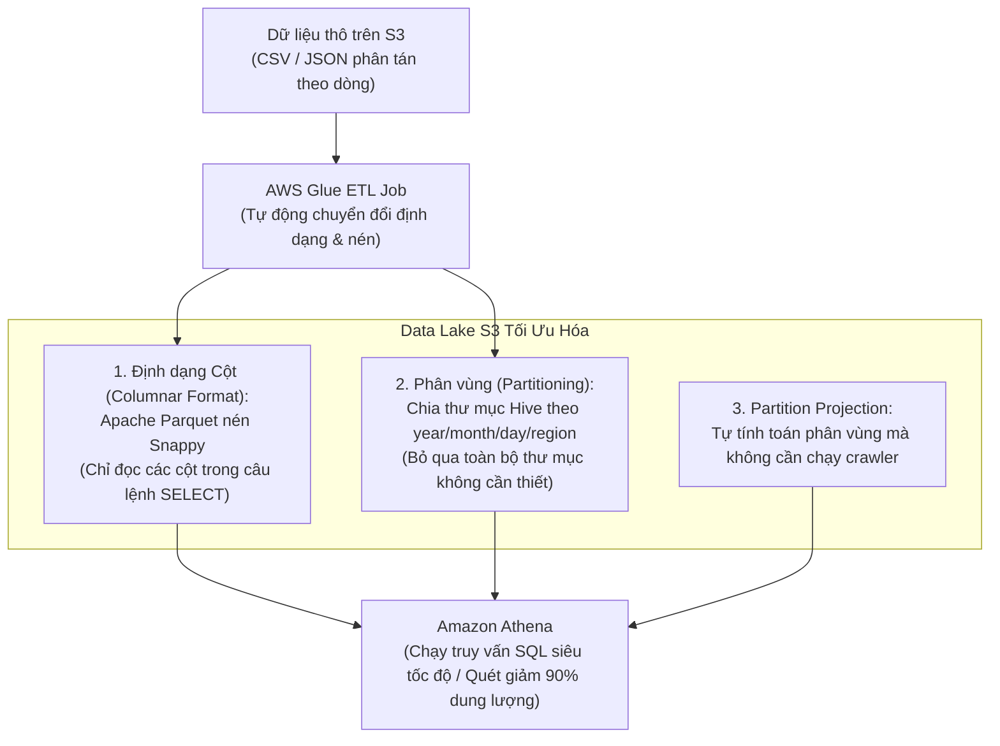

# 📊 Data Lake Query Tuning: Amazon Athena, AWS Glue & Apache Parquet

> Thuộc: [[Task-3.5-High-Performing-Data-Ingestion]] | So sánh nhanh: [[Matrix-Analytics-Athena-vs-Redshift-vs-OpenSearch]] | Trở về: [[00-Domain-3-MOC]]

---

## 1. Khái niệm cốt lõi (Core Concepts)

Trong kiến trúc Data Lake Serverless trên AWS, **Amazon Athena** cho phép bạn chạy các câu lệnh chuẩn ANSI SQL để phân tích trực tiếp hàng Terabyte đến Petabyte dữ liệu lưu trữ trên **Amazon S3** mà không cần nạp dữ liệu vào bất kỳ cơ sở dữ liệu nào.

- **Mô hình tính giá của Athena:** **$5.00 cho mỗi 1 Terabyte (TB) dữ liệu được quét (Data Scanned)** từ S3.
- **Mục tiêu hiệu năng & tối ưu chi phí:** Giảm thiểu tối đa dung lượng dữ liệu Athena phải quét từ S3 $\rightarrow$ Truy vấn chạy **nhanh hơn gấp hàng chục lần** và chi phí **giảm tới 90%**.

---

## 2. Bộ Ba Tối Ưu Hóa Hiệu Năng Data Lake



---

## 3. Định Dạng Cột: Tại Sao Apache Parquet Lại Thống Trị?

### So sánh cơ chế quét dữ liệu giữa Row-based và Columnar:

```text
Giả sử file dữ liệu chứa 50 cột thông tin (user_id, age, address, transaction_amount, ...).
Bạn chỉ chạy câu lệnh: SELECT SUM(transaction_amount) FROM transactions;

1. File CSV / JSON (Lưu theo dòng):
   Athena bắt buộc phải đọc toàn bộ từ đầu đến cuối 50 cột của hàng triệu dòng -> Quét 100 GB dữ liệu!

2. File Apache Parquet (Lưu theo cột):
   Athena CHỈ ĐỌC DUY NHẤT 1 CỘT transaction_amount -> Bỏ qua 49 cột còn lại -> Quét đúng 2 GB dữ liệu!
   Kết quả: Tốc độ nhanh gấp 50 lần, chi phí giảm 98%!
```

- Ngoài ra, Apache Parquet hỗ trợ các thuật toán nén mạnh mẽ như **Snappy** hoặc **GZIP**, giúp giảm dung lượng lưu trữ trên S3 thêm **60 - 80%**.

---

## 4. Kỹ Thuật Phân Vùng (Partitioning) & Partition Pruning

- **Khái niệm:** Tổ chức dữ liệu trên S3 theo cấu trúc thư mục phân cấp (Hive-style), ví dụ:
  `s3://my-datalake/transactions/year=2026/month=03/day=30/data.parquet`
- **Partition Pruning (Cắt tỉa phân vùng):** Khi người dùng chạy câu lệnh:
  ```sql
  SELECT * FROM transactions 
  WHERE year = '2026' AND month = '03' AND day = '30';
  ```
  Athena sẽ **bỏ qua hoàn toàn** dữ liệu của các năm và tháng khác, chỉ quét duy nhất thư mục ngày 30/03/2026!

### ⚠️ Bẫy Đề Thi Kinh Điển: The "Small Files Trap" (Bẫy File Nhỏ)
- **Sai lầm phổ biến:** Phân vùng dữ liệu theo một cột có độ phân tán quá cao (**High Cardinality** như `customer_id`, `transaction_id`, hoặc `device_id`).
- **Hậu quả:** Tạo ra hàng triệu thư mục con trên S3, mỗi thư mục chỉ chứa 1 file nhỏ xíu vài Kilobyte (KB). Việc này làm **nghẽn Metadata Catalog của AWS Glue**, khiến Athena mất nhiều thời gian đọc metadata hơn cả đọc dữ liệu thật $\rightarrow$ **Truy vấn chạy cực kỳ chậm và chi phí tăng vọt**!
- **Giải pháp chuẩn:** Chỉ phân vùng theo các cột có độ phân tán thấp/trung bình (như ngày tháng, khu vực địa lý). Với các trường có độ phân tán cao, hãy sử dụng kỹ thuật **Bucketing** hoặc để Parquet tự lọc theo thống kê Row Group.

---

## 5. Partition Projection vs `MSCK REPAIR TABLE`

- **Vấn đề truyền thống:** Khi có dữ liệu mới ghi vào các phân vùng S3 mới, bảng Athena sẽ không nhận diện được các phân vùng này cho đến khi bạn chạy lệnh `MSCK REPAIR TABLE` hoặc chạy lại AWS Glue Crawler.
- **Partition Projection (Khuyên dùng 2026):** Đối với các bảng có khối lượng phân vùng dự đoán được (như log phát sinh theo từng giờ/ngày), bạn cấu hình **Partition Projection** trong bảng Glue Catalog. Athena sẽ tự động tính toán vị trí phân vùng theo thuật toán số học mà **không cần quét S3 để tìm phân vùng mới**, loại bỏ hoàn toàn công sức vận hành thủ công.

---

## ⚠️ Bẫy đề thi & Mẹo ghi nhớ (Exam Traps)

| Tình huống đề thi | Đáp án bẫy (SAI) | Đáp án chuẩn (ĐÚNG) |
| :--- | :--- | :--- |
| Truy vấn SQL trên dữ liệu log JSON lưu ở S3 bằng Athena chạy chậm và phát sinh chi phí quét dữ liệu cao | Nâng cấp cấu hình compute của Athena (Athena là Serverless, không có nút chọn compute) | Sử dụng **AWS Glue ETL chuyển đổi dữ liệu sang định dạng Apache Parquet**, nén Snappy và cấu hình phân vùng (Partitioning) |
| Bảng Athena có hàng nghìn phân vùng theo giờ, việc chạy `MSCK REPAIR TABLE` bị timeout và tốn công sức | Viết script cronjob gọi crawler Glue mỗi 5 phút | Cấu hình tính năng **Partition Projection** trên bảng AWS Glue Data Catalog |
| Một công ty phân vùng dữ liệu S3 theo `user_id` và nhận thấy hiệu năng truy vấn Athena bị giảm sút nghiêm trọng | Tăng số lượng partition cho user_id | Đây là **Small Files Trap**: Hãy đổi sang phân vùng theo thời gian (`year/month/day`) và gom các file nhỏ thành file lớn (128 MB - 512 MB) |

---

## 🔗 Liên kết liên quan
- [[Task-3.5-High-Performing-Data-Ingestion]]
- [[Matrix-Analytics-Athena-vs-Redshift-vs-OpenSearch]]
- [[Real-Time-Streaming-Kinesis-and-MSK]]
- [[Domain-3-Scenario-Walkthroughs]]
