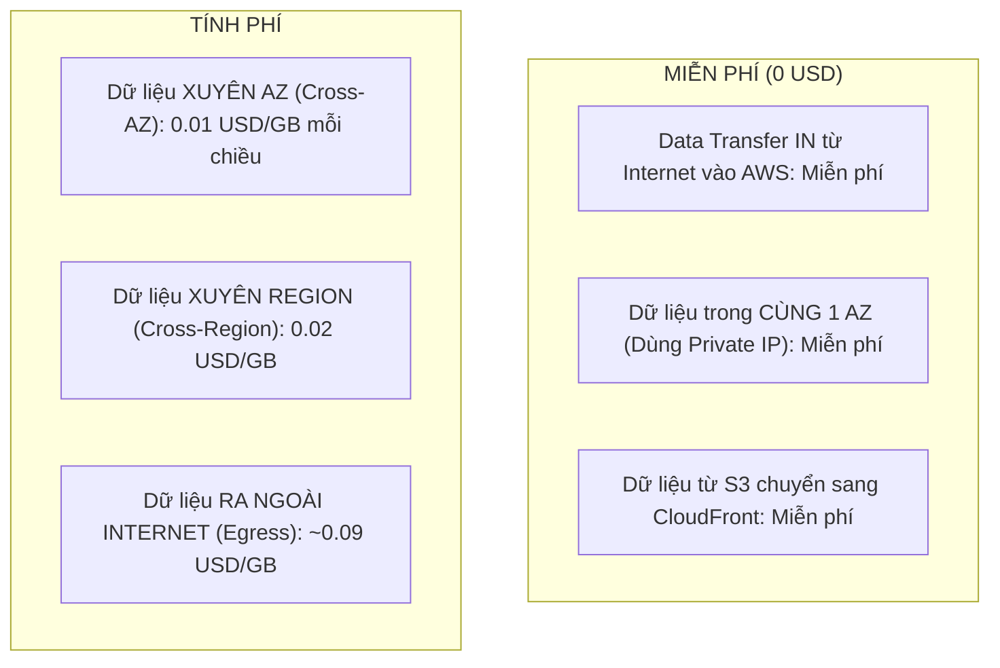
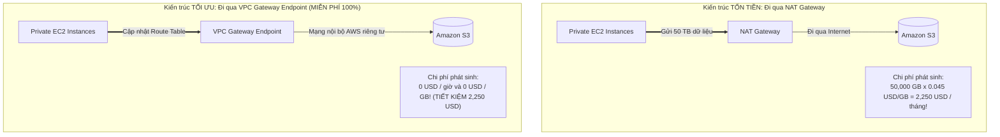

# 💸 Data Transfer Costs & VPC Endpoints vs NAT Gateway: Cắt Giảm Chi Phí Mạng Ẩn

> Thuộc: [[Task-4.4-Cost-Optimized-Networking]] | So sánh nhanh: [[Matrix-NAT-Gateway-vs-VPC-Endpoints]] | Trở về: [[00-Domain-4-MOC]]

---

## 1. Khái niệm cốt lõi (Core Concepts)

Chi phí truyền tải dữ liệu (**Data Transfer Charges**) thường là "kẻ giết người thầm lặng" làm hóa đơn AWS tăng vọt ngoài dự tính. Nhiều doanh nghiệp phải trả hàng nghìn USD mỗi tháng chỉ vì:
1. Dữ liệu chạy xuyên giữa các Availability Zones (**Cross-AZ Data Transfer**) mà không cần thiết.
2. Máy chủ trong Private Subnet truyền tải dữ liệu lên Amazon S3 thông qua **NAT Gateway**, làm phát sinh phí xử lý dữ liệu khổng lồ **$0.045 / GB**.

---

## 2. Bản Đồ Chi Phí Truyền Tải Dữ Liệu Trên AWS

### ⚠️ Bẫy ngầm trong cùng 1 Availability Zone:
- Nếu hai máy chủ EC2 nằm trong **CÙNG 1 AZ** giao tiếp với nhau bằng **Private IP**: **MIỄN PHÍ ($0)**.
- Nhưng nếu chúng giao tiếp với nhau bằng **Public IP hoặc Elastic IP**: AWS sẽ tính cước **$0.01 / GB mỗi chiều** (vì gói tin bị định tuyến ra cổng biên Internet Gateway rồi quay lại)! $\rightarrow$ **Luôn luôn dùng Private IP cho kết nối nội bộ!**

---

## 3. Cơn Ác Mộng Chi Phí NAT Gateway vs Vị Cứu Tinh Gateway Endpoint

### So sánh chi tiết NAT Gateway vs VPC Endpoints:

| Tiêu chí | NAT Gateway | VPC Gateway Endpoint | VPC Interface Endpoint (PrivateLink) |
| :--- | :--- | :--- | :--- |
| **Dịch vụ hỗ trợ** | Mọi lưu lượng đi ra ngoài Internet | **Chỉ Amazon S3 & DynamoDB** | Hầu hết các dịch vụ AWS khác (KMS, Secrets Mgr, SSM...) |
| **Phí duy trì theo giờ** | **$0.045 / giờ / NAT Gateway** (~$32.40/tháng/cái) | **HOÀN TOÀN MIỄN PHÍ ($0)** | $0.01 / giờ / AZ (~$7.20/tháng) |
| **Phí xử lý dữ liệu (GB)**| **$0.045 / GB dữ liệu xử lý** (Cực đắt khi tải nhiều TB) | **HOÀN TOÀN MIỄN PHÍ ($0 / GB)** | **$0.01 / GB** (Rẻ hơn NAT Gateway 4.5 lần) |
| **Cơ chế triển khai** | Cần gán Elastic IP trong Public Subnet | Cập nhật **Route Table** của Subnet | Tạo **ENI** có Private IP trong Subnet |
| **Đường đi dữ liệu** | Đi ra Internet Gateway ngầm | **Đi qua mạng riêng nội bộ của AWS** | Đi qua mạng riêng nội bộ của AWS |

---

## 4. Công Thức Cắt Giảm Chi Phí Mạng Trong Phòng Thi

1. **Khi thấy EC2 trong Private Subnet giao tiếp với S3 hoặc DynamoDB:**
   - **LẬP TỨC CHỌN:** Tạo **VPC Gateway Endpoint** cho S3 và DynamoDB.
   - Thao tác này ngay lập tức triệt tiêu 100% phí $0.045/GB của NAT Gateway.
2. **Khi EC2 trong Private Subnet cần giao tiếp với AWS KMS, Secrets Manager, CloudWatch Logs:**
   - Tạo **VPC Interface Endpoint (AWS PrivateLink)** thay vì để lưu lượng đi qua NAT Gateway (giảm cước từ $0.045/GB xuống $0.01/GB).
3. **Khi cần phục vụ dữ liệu tĩnh ra ngoài Internet:**
   - Đặt **Amazon CloudFront** phía trước S3 hoặc EC2. Dữ liệu từ S3 sang CloudFront là **miễn phí ($0)**, và cước truyền tải từ CloudFront ra người dùng rẻ hơn so với truyền trực tiếp từ EC2 ra ngoài Internet.

---

## ⚠️ Bẫy đề thi & Mẹo ghi nhớ (Exam Traps)

| Tình huống đề thi | Đáp án bẫy (SAI) | Đáp án chuẩn (ĐÚNG) |
| :--- | :--- | :--- |
| Máy chủ EC2 trong private subnet tải 100 TB dữ liệu lên S3 mỗi tháng, làm hóa đơn NAT Gateway lên tới $4,500 | Tăng dung lượng NAT Gateway hoặc dùng 2 NAT | Tạo **VPC Gateway Endpoint cho Amazon S3** (tiết kiệm ngay $4,500/tháng) |
| Hai máy chủ EC2 trong cùng 1 Subnet truyền tải dữ liệu lớn cho nhau, kế toán thấy phát sinh cước truyền tải dữ liệu | Cho rằng AWS tính phí dữ liệu cùng AZ | Hai máy chủ đang kết nối qua **Public IP/Elastic IP**. Hãy sửa cấu hình ứng dụng kết nối qua **Private IP** để được miễn phí ($0) |
| Tải dữ liệu từ Amazon S3 ra người dùng web trên toàn thế giới với chi phí truyền dữ liệu rẻ nhất | Cho người dùng tải trực tiếp từ S3 qua Internet Gateway | Đặt **Amazon CloudFront** phía trước S3 bucket (hưởng cước dữ liệu rẻ hơn và miễn phí S3-to-CloudFront) |

---

## 🔗 Liên kết liên quan
- [[Task-4.4-Cost-Optimized-Networking]]
- [[Matrix-NAT-Gateway-vs-VPC-Endpoints]]
- [[CloudFront-Cost-Optimization-and-Price-Classes]]
- [[Domain-4-Scenario-Walkthroughs]]
