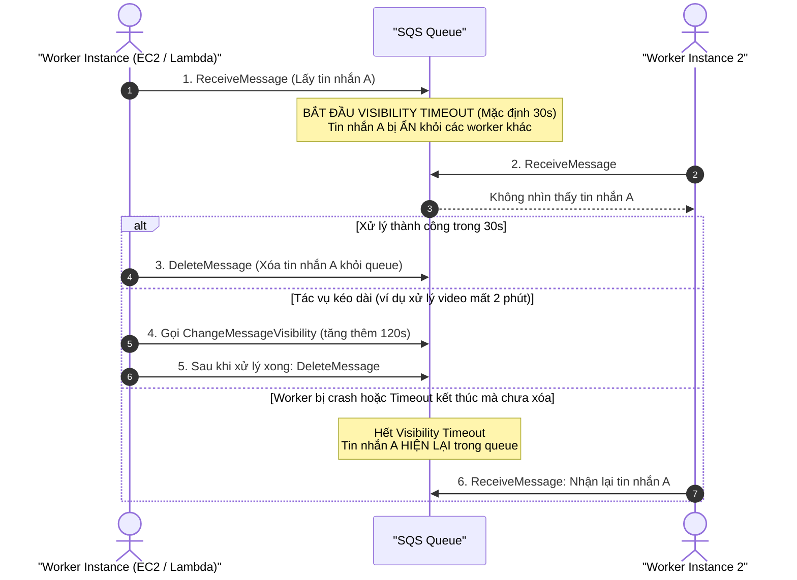
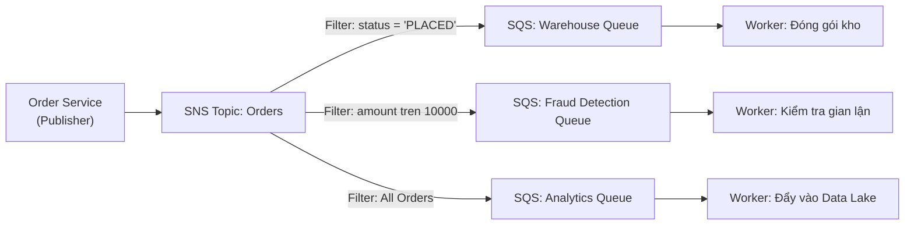

# 📬 Decoupling with Amazon SQS & SNS: Hàng Đợi, Fan-Out & Message Filtering

> Thuộc: [[Task-2.1-Scalable-and-Loosely-Coupled]] | So sánh nhanh: [[Matrix-SQS-vs-SNS-vs-EventBridge-vs-Kinesis]] | Trở về: [[00-Domain-2-MOC]]

---

## 1. Khái niệm cốt lõi (Core Concepts)

Trong kiến trúc đám mây có tính phục hồi cao (Resilient Architectures), việc liên kết lỏng lẻo (**Loose Coupling**) là nguyên tắc sống còn. Thay vì để các dịch vụ gọi trực tiếp lẫn nhau qua synchronous HTTP:
- **Amazon SQS (Simple Queue Service):** Dịch vụ hàng đợi thông điệp theo mô hình **Pull-based (Consumer chủ động kéo tin)**. Đóng vai trò làm bộ đệm (Buffer) điều hòa tải giữa Web Tier và Worker Tier.
- **Amazon SNS (Simple Notification Service):** Dịch vụ phát tán thông điệp theo mô hình **Push-based (Publisher đẩy tin tới nhiều Subscriber)** dạng Pub/Sub (Publish/Subscribe).
- **Amazon MQ:** Dịch vụ Message Broker được quản lý đầy đủ (Managed Apache ActiveMQ / RabbitMQ) hỗ trợ các giao thức chuẩn công nghiệp (JMS, AMQP, MQTT) dành riêng cho bài toán di chuyển ứng dụng truyền thống lên cloud mà không muốn viết lại mã nguồn.

---

## 2. Amazon SQS Deep Dive: Các thông số kỹ thuật thi cử sống còn

### A. Vòng đời tin nhắn & Visibility Timeout

- **Mặc định:** 30 giây.
- **Tối đa:** 12 giờ.
- **API quan trọng:** `ChangeMessageVisibility` — Dùng khi worker nhận ra tác vụ mất nhiều thời gian hơn dự kiến, cần gia hạn để ngăn worker khác nhặt lại tin nhắn và xử lý trùng lặp.

### B. Long Polling vs Short Polling
- **Short Polling (`WaitTimeSeconds = 0`):** SQS chỉ quét một tập con các máy chủ lưu trữ ngầm và trả về kết quả ngay lập tức, ngay cả khi không có tin nhắn nào $\rightarrow$ gây tốn chi phí API request và có thể trả về rỗng dù hàng đợi có tin.
- **Long Polling (`WaitTimeSeconds: 1 - 20s`):** SQS giữ kết nối mở và chờ cho đến khi có tin nhắn mới xuất hiện mới trả về $\rightarrow$ **Giảm 90% chi phí API calls và giảm độ trễ nhận tin**. Khuyến nghị luôn cấu hình Long Polling trong đề thi.

### C. Dead Letter Queue (DLQ) & `maxReceiveCount`
- Khi một tin nhắn bị lỗi (Poison Pill message) khiến worker crash liên tục, tin nhắn đó sẽ quay lại queue sau khi hết Visibility Timeout.
- Thiết lập **Dead Letter Queue (DLQ)** với ngưỡng **`maxReceiveCount`** (ví dụ: 5 lần). Nếu một tin nhắn bị đọc thất bại quá 5 lần, SQS sẽ tự động chuyển nó sang DLQ để cách ly và phục vụ điều tra lỗi.

### D. Xử lý tin nhắn dung lượng lớn (> 256 KB)
- Giới hạn payload tối đa của SQS là **256 KB**.
- Khi cần gửi file lớn (lên tới 2 GB): Sử dụng **Amazon SQS Extended Client Library for Java/Python**. Thư viện này tự động upload payload thực tế lên **Amazon S3**, và chỉ gửi con trỏ tham chiếu (S3 pointer metadata) qua SQS.

### E. Standard Queue vs FIFO Queue

| Tiêu chí | SQS Standard Queue | SQS FIFO Queue |
| :--- | :--- | :--- |
| **Thứ tự (Ordering)** | Best-effort (Có thể không đúng thứ tự) | **Thứ tự tuyệt đối First-In-First-Out** |
| **Số lần nhận (Delivery)**| **At-least-once** (Có thể nhận trùng tin) | **Exactly-once** (Xử lý đúng 1 lần duy nhất) |
| **Throughput (Tải)** | **Gần như vô hạn** (Unlimited transactions/sec)| **300 msg/s** (Lên tới 3,000 msg/s với Batching) |
| **Chống trùng lặp** | Không hỗ trợ tự động | Dùng **`MessageDeduplicationId`** hoặc Content-based |
| **Nhóm thứ tự** | Không hỗ trợ | Dùng **`MessageGroupId`** (Các message cùng group ID được xử lý tuần tự) |
| **Tên queue** | Tùy ý (ví dụ: `my-orders-queue`) | Bắt buộc phải có đuôi **`.fifo`** |

---

## 3. Mô hình SNS Fan-Out và Message Filtering

### Tại sao mô hình SNS Fan-out lại quan trọng trong SAA-C03?
1. **Khả năng mở rộng độc lập:** Publisher chỉ cần gửi thông điệp 1 lần duy nhất tới SNS Topic. Mỗi hệ thống downstream có một SQS Queue riêng, tự động mở rộng theo tải mà không ảnh hưởng lẫn nhau.
2. **SNS Message Filtering (Filter Policy):**
   - Trước đây, mọi subscriber đều nhận 100% messages và worker phải tự filter bỏ tin không cần.
   - Với **Filter Policy**, SNS kiểm tra các thuộc tính (Message Attributes) dưới dạng JSON và chỉ chuyển phát thông điệp tới SQS thỏa mãn điều kiện $\rightarrow$ tiết kiệm chi phí xử lý và hạ tải cho worker.

---

## 4. Amazon MQ: Chiến lược Di chuyển ứng dụng cũ (Migration)

- **Khi nào chọn SQS/SNS?** Khi xây dựng ứng dụng mới (Cloud-native) trên AWS.
- **Khi nào chọn Amazon MQ?** Khi khách hàng muốn di chuyển ứng dụng On-premises hiện có đang sử dụng **RabbitMQ** hoặc **Apache ActiveMQ** với các giao thức như **JMS, NMS, AMQP, STOMP, MQTT, WebSocket** lên AWS mà **KHÔNG muốn viết lại mã nguồn**.

---

## ⚠️ Bẫy đề thi & Mẹo ghi nhớ (Exam Traps)

| Tình huống đề thi | Đáp án bẫy (SAI) | Đáp án chuẩn (ĐÚNG) |
| :--- | :--- | :--- |
| Worker mất 4 phút để xử lý tác vụ nhưng tin nhắn bị worker khác nhận lại sau 30 giây | Thêm EC2 worker vào Auto Scaling Group | Tăng **Visibility Timeout** của SQS hoặc gọi **`ChangeMessageVisibility`** trong code |
| Cần xử lý đơn hàng chứng khoán/ngân hàng bắt buộc đúng thứ tự và không được trùng | Sử dụng SQS Standard Queue và tự sort trong code | Sử dụng **Amazon SQS FIFO Queue** (có đuôi `.fifo`) |
| Hệ thống cần gửi thông báo đơn hàng tới nhiều dịch vụ khác nhau và từng dịch vụ chỉ nhận đơn hàng thỏa mãn tiêu chí riêng | Gửi message tuần tự tới từng dịch vụ | Sử dụng **SNS Fan-out kết hợp SNS Message Filtering** trỏ tới các hàng đợi SQS |
| Ứng dụng doanh nghiệp cũ dùng RabbitMQ cần chuyển lên AWS với ít công sức sửa đổi code nhất | Thiết kế lại toàn bộ luồng sang Amazon SQS | Triển khai **Amazon MQ** (Managed RabbitMQ broker) |

---

## 🔗 Liên kết liên quan
- [[Task-2.1-Scalable-and-Loosely-Coupled]]
- [[Matrix-SQS-vs-SNS-vs-EventBridge-vs-Kinesis]]
- [[Event-Driven-Architectures-EventBridge-StepFunctions]]
- [[Domain-2-Scenario-Walkthroughs]]
