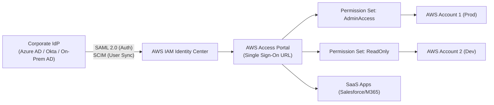

# 🏢 Directory Service & AWS IAM Identity Center (SSO)

> Thuộc: [[Task-1.1-Design-Secure-Access-Resources]] | So sánh nhanh: [[Matrix-AD-Integration-Modes]] | Trở về: [[00-Domain-1-MOC]]

---

## 1. Khái niệm cốt lõi (Core Concepts)

- **AWS IAM Identity Center (trước đây là AWS Single Sign-On - SSO):** Dịch vụ quản lý danh tính tập trung hàng đầu của AWS. Cho phép người dùng đăng nhập một lần (Single Sign-On) qua một cổng duy nhất (User Portal) để truy cập vào nhiều tài khoản AWS và các ứng dụng SaaS đám mây (như Salesforce, Slack, Microsoft 365).
- **AWS Directory Service:** Cung cấp các phương án tích hợp và vận hành máy chủ thư mục Microsoft Active Directory trên đám mây AWS.

---

## 2. Kiến trúc tổng thể IAM Identity Center & Phân quyền

### Các thành phần cốt lõi của IAM Identity Center:
1. **Identity Source (Nguồn định danh):**
   - Kho lưu trữ nội bộ (Identity Center Directory).
   - Tích hợp bên ngoài qua **SAML 2.0 IdP** (Microsoft Entra ID / Okta / PingFederate).
   - Tự động đồng bộ hóa người dùng và nhóm qua giao thức **SCIM (System for Cross-domain Identity Management)**.
   - Kết nối với Active Directory thông qua **AWS Directory Service**.
2. **Permission Sets (Bộ phân quyền):**
   - Bản chất là tập hợp các IAM policies được định nghĩa tập trung trên Identity Center.
   - Khi gán một Permission Set cho một User/Group vào một tài khoản con, IAM Identity Center sẽ **tự động sinh ra một IAM Role tương ứng** trong tài khoản con đó.

---

## 3. Các loại dịch vụ trong AWS Directory Service

AWS cung cấp 3 tùy chọn Directory Service chính, xuất hiện liên tục trong các câu hỏi tình huống:

| Dịch vụ | Bản chất kỹ thuật | Kịch bản đề thi điển hình (When to choose) |
| :--- | :--- | :--- |
| **AWS Managed Microsoft AD** | Domain Controller Windows thật sự chạy trên AWS (Multi-AZ). Hỗ trợ Group Policy, Schema Extensions. | - Cần thiết lập **Two-way Forest Trust** với Active Directory On-premises. - Ứng dụng chạy trên EC2 Windows cần join domain. - Quy mô lớn (> 5,000 users). |
| **AD Connector** | Một **Proxy chuyển tiếp xác thực**, KHÔNG lưu trữ hay đồng bộ hóa user nào trên AWS. | - Doanh nghiệp muốn dùng tài khoản On-premises AD hiện có để đăng nhập AWS. - **Không muốn tạo thêm Domain Controller trên cloud**. - Yêu cầu cấu hình tối thiểu, chi phí thấp. |
| **Simple AD** | Bản sao tương thích Active Directory dựa trên mã nguồn mở **Samba 4**. | - Môi trường nhỏ (< 5,000 users), độc lập. - **Không hỗ trợ Trust Relationships** với on-premises AD. - Không hỗ trợ schema extensions, MFA. |

---

## 4. Cơ chế đồng bộ và tích hợp Doanh nghiệp (Enterprise Federation)

Khi doanh nghiệp muốn nhân viên sử dụng email/mật khẩu công ty đăng nhập vào AWS Management Console:
1. **Phương án 1 (Khuyên dùng - Least Overhead):** Sử dụng **AWS IAM Identity Center** cấu hình SAML 2.0 với Identity Provider (IdP) của công ty (Azure AD/Okta) và bật SCIM để đồng bộ người dùng.
2. **Phương án 2 (Direct IAM Federation):** Cấu hình IAM SAML 2.0 Identity Provider trực tiếp trong từng tài khoản IAM (chỉ dùng cho môi trường đơn tài khoản cũ, nhiều overhead khi có hàng chục tài khoản).

---

## ⚠️ Bẫy đề thi & Mẹo ghi nhớ (Exam Traps)

| Tình huống đề thi | Đáp án bẫy (SAI) | Đáp án chuẩn (ĐÚNG) |
| :--- | :--- | :--- |
| Doanh nghiệp có sẵn On-premises AD, muốn đăng nhập AWS Console mà không muốn nhân bản hay lưu trữ user trên AWS | Cài AWS Managed Microsoft AD và sync toàn bộ dữ liệu lên cloud | Sử dụng **AD Connector** làm proxy chuyển tiếp yêu cầu xác thực về On-premises |
| Cần kết nối AD trên AWS với AD On-premises bằng Forest Trust | Dùng Simple AD (Simple AD không hỗ trợ Trust) | Dùng **AWS Managed Microsoft AD** (có hỗ trợ One-way / Two-way Forest Trust) |
| Cần quản lý đăng nhập cho 50 tài khoản AWS với ít công sức nhất | Tạo IAM User và Password trong từng tài khoản con | Kích hoạt **AWS IAM Identity Center** trong AWS Organizations |
| Tự động tạo và hủy user trên AWS khi nhân viên vào/nghỉ việc ở công ty | Viết script chạy hàng ngày gọi AWS CLI `create-user` | Bật tính năng đồng bộ tự động **SCIM** giữa Corporate IdP và IAM Identity Center |

---

## 🔗 Liên kết liên quan
- [[Task-1.1-Design-Secure-Access-Resources]]
- [[Matrix-AD-Integration-Modes]]
- [[AWS-Organizations-and-SCPs]]
- [[Domain-1-Scenario-Walkthroughs]]
