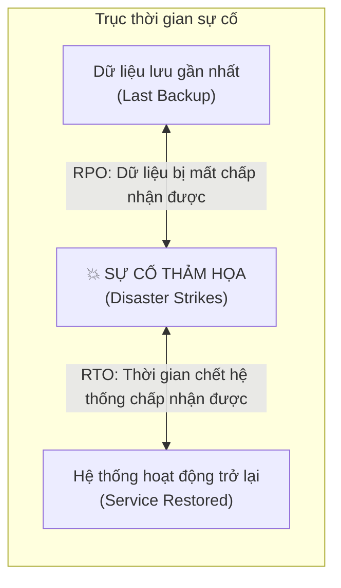
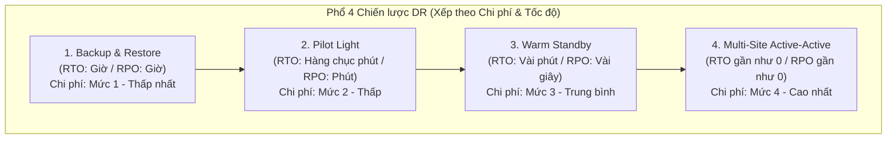

# 🚨 Disaster Recovery (DR) Strategies: RTO, RPO & 4 Cấp Độ Kiến Trúc Phục Hồi

> Thuộc: [[Task-2.2-Highly-Available-and-Fault-Tolerant]] | So sánh nhanh: [[Matrix-Disaster-Recovery-Tiers]] | Trở về: [[00-Domain-2-MOC]]

---

## 1. Hai chỉ số cốt lõi: RTO và RPO

Mọi bài toán phục hồi thảm họa trong đề thi SAA-C03 đều xoay quanh việc cân bằng giữa **Chi phí đầu tư** và **Mức độ chấp nhận rủi ro**:

- **RPO (Recovery Point Objective - Mục tiêu điểm phục hồi):** Lượng thời gian dữ liệu bị mất tối đa mà doanh nghiệp có thể chấp nhận được kể từ thời điểm thảm họa xảy ra.
  - *Ví dụ:* Nếu RPO = 1 giờ, hệ thống phải sao lưu ít nhất mỗi giờ 1 lần.
- **RTO (Recovery Time Objective - Mục tiêu thời gian phục hồi):** Khoảng thời gian tối đa mà hệ thống được phép ngừng hoạt động (downtime) trước khi được khôi phục trở lại.
  - *Ví dụ:* Nếu RTO = 15 phút, đội ngũ kỹ thuật phải đưa hệ thống online trở lại trong vòng 15 phút.

---

## 2. Bốn Mô hình Khắc phục Thảm họa (4 Disaster Recovery Strategies)

### 1. Backup & Restore (Sao lưu & Khôi phục)
- **Cơ chế:** Dữ liệu và cấu hình được sao lưu định kỳ lên Amazon S3 hoặc qua AWS Backup. Không có máy chủ nào chạy ở Region dự phòng.
- **Khi thảm họa xảy ra:** Dùng mã nguồn hạ tầng (CloudFormation/Terraform) để tạo lại toàn bộ VPC, EC2, và nạp lại dữ liệu từ backup.
- **Ưu điểm:** Chi phí rẻ nhất.
- **Nhược điểm:** RTO và RPO lớn nhất (mất nhiều giờ để khôi phục).

### 2. Pilot Light (Ngọn lửa mồi)
- **Cơ chế:** 
  - **Tầng dữ liệu (Database):** Được bật và chạy ở **kích thước nhỏ nhất** (Small instance) tại Region dự phòng và liên tục nhận dữ liệu sao chép (ví dụ: RDS Cross-Region Read Replica hoặc Aurora Global DB).
  - **Tầng tính toán (Compute):** Máy chủ EC2 hoàn toàn **TẮT (Stopped)** hoặc chỉ lưu dưới dạng AMI Templates.
- **Khi thảm họa xảy ra:** Tăng kích thước Database lên cỡ lớn (Scale-up) và bật Auto Scaling Group để tạo các máy chủ EC2 mới đón traffic.
- **RTO:** Hàng chục phút (thời gian khởi động EC2 và scale DB). **RPO:** Vài phút.

### 3. Warm Standby (Dự phòng ấm - Hệ thống thu nhỏ)
- **Cơ chế:** Một phiên bản thu nhỏ hoàn chỉnh (**Scaled-down version**) của toàn bộ hệ thống (Web, App, DB) được **bật và chạy liên tục 24/7** tại Region dự phòng. Hệ thống này có thể xử lý một phần nhỏ lưu lượng (ví dụ: phục vụ nội bộ hoặc chạy test).
- **Khi thảm họa xảy ra:** Route 53 chuyển hướng người dùng sang Region dự phòng, đồng thời Auto Scaling Group nhanh chóng **Scale Out** thêm nhiều máy chủ EC2 để gánh 100% lưu lượng thực tế.
- **RTO:** Vài phút. **RPO:** Vài giây đến vài phút.

### 4. Multi-Site Active-Active (Đa vùng Hoạt động song song)
- **Cơ chế:** Hệ thống đầy đủ tải (**Full-capacity production**) được triển khai và chạy song song đồng thời tại từ 2 Region trở lên.
- **Amazon Route 53** phân phối lưu lượng truy cập liên tục tới tất cả các Region (dùng Weighted hoặc Latency routing).
- **Khi thảm họa xảy ra:** Route 53 phát hiện Region bị sập qua Health Check và tự động ngừng gửi traffic tới đó. Người dùng hầu như không cảm nhận thấy bất kỳ sự gián đoạn nào.
- **RTO:** Gần như bằng 0. **RPO:** Gần như bằng 0. Chi phí đầu tư đắt nhất.

---

## 3. So sánh trực quan 4 mô hình DR trong đề thi

| Chiến lược DR | RPO (Mất dữ liệu) | RTO (Thời gian chết) | Trạng thái Compute ở DR Region | Chi phí tương đối |
| :--- | :--- | :--- | :--- | :--- |
| **Backup & Restore** | Vài giờ | Vài giờ tới ngày | Không có gì chạy | **$ (Rẻ nhất)** |
| **Pilot Light** | Vài phút | Hàng chục phút | Không chạy EC2 (chỉ có AMI & DB nhỏ)| **$$ (Tiết kiệm)** |
| **Warm Standby** | Giây đến Phút | Vài phút | Chạy phiên bản thu nhỏ (Scale-down) | **$$$ (Trung bình)** |
| **Multi-Site Active-Active**| **Gần như 0** | **Gần như 0** | Chạy đầy đủ 100% công suất song song | **$$$$ (Đắt nhất)** |

---

## 4. AWS Elastic Disaster Recovery (AWS DRS)

- Dịch vụ chuyên dụng của AWS để sao chép liên tục mức khối đĩa (**Continuous Block-Level Replication**) từ máy chủ vật lý on-premises hoặc giữa các AWS Regions vào một khu vực tạm thời chi phí thấp (**Low-cost Staging Area**).
- Khi có sự cố, AWS DRS tự động dựng máy chủ EC2 thay thế trong vòng vài phút mà không cần duy trì phần cứng đắt đỏ 24/7 tại vùng phục hồi.

---

## ⚠️ Bẫy đề thi & Mẹo ghi nhớ (Exam Traps)

| Tình huống đề thi | Đáp án bẫy (SAI) | Đáp án chuẩn (ĐÚNG) |
| :--- | :--- | :--- |
| Yêu cầu RTO dưới 15 phút với chi phí thấp hơn Warm Standby | Chọn Multi-Site Active-Active (quá tốn kém) | Chọn **Pilot Light** (duy trì core database sao chép liên tục, compute bật khi cần) |
| Khách hàng yêu cầu RTO và RPO xấp xỉ bằng 0 và không chấp nhận bất kỳ downtime nào | Chọn Warm Standby (Warm Standby vẫn mất vài phút scale up) | Chọn **Multi-Site Active-Active** |
| Giải pháp DR tiết kiệm chi phí nhất cho ứng dụng không yêu cầu thời gian phục hồi nhanh (RTO > 24h) | Chọn Pilot Light | Chọn **Backup and Restore** |
| Doanh nghiệp cần giải pháp DR cho 100 máy chủ ảo VMware on-premise lên AWS với RPO tính bằng giây | Viết script export file OVA/VMDK định kỳ lên S3 | Triển khai **AWS Elastic Disaster Recovery (AWS DRS)** |

---

## 🔗 Liên kết liên quan
- [[Task-2.2-Highly-Available-and-Fault-Tolerant]]
- [[Matrix-Disaster-Recovery-Tiers]]
- [[Route-53-Routing-Policies-and-Failover]]
- [[RDS-and-Aurora-High-Availability]]
