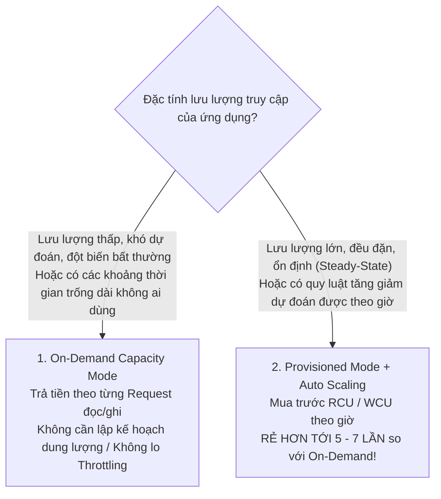

# ⚡ DynamoDB Cost Models: On-Demand vs Provisioned & Điểm Giao Cắt Chi Phí

> Thuộc: [[Task-4.3-Cost-Optimized-Databases]] | So sánh nhanh: [[Matrix-DynamoDB-On-Demand-vs-Provisioned]] | Trở về: [[00-Domain-4-MOC]]

---

## 1. Khái niệm cốt lõi (Core Concepts)

**Amazon DynamoDB** cung cấp 2 mô hình định giá dung lượng đọc/ghi (Capacity Modes) độc lập:
1. **On-Demand Capacity Mode:** Định giá theo từng yêu cầu thực tế (Pay-per-request).
2. **Provisioned Capacity Mode (kết hợp Auto Scaling):** Mua trước chỉ số năng lực theo giờ.

Việc chọn nhầm chế độ có thể khiến hóa đơn NoSQL của doanh nghiệp đắt hơn từ **5 đến 7 lần** so với mức cần thiết!

---

## 2. So Sánh Hai Chế Độ Dung Lượng DynamoDB



| Tiêu chí | On-Demand Mode | Provisioned Mode (với Auto Scaling) |
| :--- | :--- | :--- |
| **Đơn vị tính tiền** | **Read / Write Request Units (RRU / WRU)** | **Read / Write Capacity Units (RCU / WCU) theo giờ** |
| **Lập kế hoạch dung lượng** | **Không cần** (Hoàn toàn tự động 100%) | Cần chỉ định mức tối thiểu, tối đa và ngưỡng mục tiêu |
| **Độ trễ khi có tải tăng vọt đột ngột**| **Thích ứng tức thì** (Lên tới gấp đôi đỉnh trước đó)| Mất vài phút để Auto Scaling tăng RCU/WCU |
| **Nguy cơ bị Throttling** | Gần như không (Trừ khi vượt quá 2x đỉnh tải tức thì)| Có thể bị lỗi `ProvisionedThroughputExceededException` nếu tải tăng quá sốc |
| **Chi phí khi hệ thống rảnh (Idle)**| **$0.00** (Không có request là không mất tiền) | Vẫn phải trả tiền duy trì mức RCU/WCU tối thiểu |
| **Chi phí khi tải cao liên tục**| **Rất đắt** (Tính lẻ từng request) | **Rẻ hơn từ 5 đến 7 lần** |

---

## 3. Công Thức Tính Năng Lực Đọc (RCU) & Ghi (WCU)

Trong các câu hỏi tính toán tối ưu chi phí của SAA-C03:

### A. Năng lực Ghi (Write Capacity Units - WCU):
$$1 \text{ WCU} = 1 \text{ Thao tác ghi dữ liệu tiêu chuẩn (kích thước tối đa 1 KB) mỗi giây}$$
- *Ví dụ:* Ghi 10 items mỗi giây, mỗi item nặng 2.5 KB:
  $$\text{Số WCU cần cho 1 item} = \text{Làm tròn lên}(2.5 \text{ KB}) = 3 \text{ WCU}$$
  $$\text{Tổng WCU} = 10 \times 3 = 30 \text{ WCU}$$

### B. Năng lực Đọc (Read Capacity Units - RCU):
- **Strongly Consistent Read (Đọc nhất quán mạnh):**
  $$1 \text{ RCU} = 1 \text{ Thao tác đọc mỗi giây (kích thước tối đa 4 KB)}$$
- **Eventually Consistent Read (Đọc nhất quán cuối cùng - Mặc định & Tiết kiệm 50% chi phí):**
  $$1 \text{ RCU} = 2 \text{ Thao tác đọc mỗi giây (kích thước tối đa 4 KB)}$$
- *Mẹo chi phí:* Luôn ưu tiên dùng **Eventually Consistent Reads** khi ứng dụng không bắt buộc phải đọc dữ liệu mới nhất ngay tức khắc để **tiết kiệm ngay một nửa số tiền RCU**!

---

## 4. Điểm Giao Cắt Chi Phí (The Cost Crossover Point)

```text
QUY TẮC FINOPS THỰC TẾ:

- Nếu tỷ lệ sử dụng trung bình của bảng < 15% mức đỉnh (Lưu lượng thưa thớt, không đều):
  -> Chọn ON-DEMAND CAPACITY MODE (Tiết kiệm nhất vì không tốn tiền duy trì rỗng).

- Nếu tỷ lệ sử dụng trung bình > 20% và duy trì đều đặn:
  -> Chọn PROVISIONED MODE KẾT HỢP AUTO SCALING (Rẻ hơn rõ rệt).
```

---

## ⚠️ Bẫy đề thi & Mẹo ghi nhớ (Exam Traps)

| Tình huống đề thi | Đáp án bẫy (SAI) | Đáp án chuẩn (ĐÚNG) |
| :--- | :--- | :--- |
| Một dịch vụ xử lý khảo sát người dùng chỉ hoạt động 2 giờ mỗi tuần, thời gian còn lại không có truy cập | Mua Provisioned RCU/WCU và dùng script tắt/bật | Cấu hình bảng DynamoDB ở chế độ **On-Demand Capacity Mode** |
| Ứng dụng đọc dữ liệu DynamoDB hàng triệu lượt/giây liên tục 24/7 ổn định, hóa đơn On-Demand quá cao | Chuyển sang Aurora PostgreSQL | Chuyển sang **Provisioned Capacity Mode kết hợp Auto Scaling** (tiết kiệm tới 70%) |
| Cần giảm 50% chi phí đọc dữ liệu trên bảng DynamoDB mà không ảnh hưởng cấu trúc dữ liệu | Thu hẹp kích thước Partition Key | Chuyển các câu truy vấn từ Strongly Consistent sang **Eventually Consistent Reads** |

---

## 🔗 Liên kết liên quan
- [[Task-4.3-Cost-Optimized-Databases]]
- [[Matrix-DynamoDB-On-Demand-vs-Provisioned]]
- [[Caching-Deep-Dive-ElastiCache-and-DAX]]
- [[Domain-4-Scenario-Walkthroughs]]
