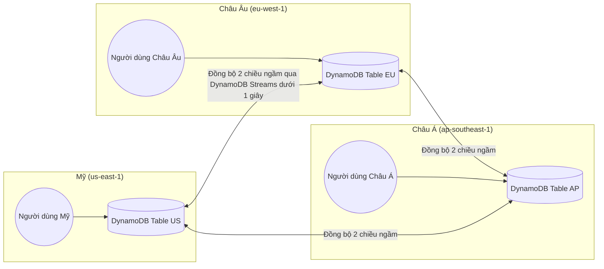

# ⚡ DynamoDB Resilience & Global Tables: Tính Sẵn Sàng NoSQL & Active-Active

> Thuộc: [[Task-2.2-Highly-Available-and-Fault-Tolerant]] | Trở về: [[00-Domain-2-MOC]]

---

## 1. Khái niệm cốt lõi (Core Concepts)

**Amazon DynamoDB** là dịch vụ cơ sở dữ liệu NoSQL Serverless được quản lý hoàn toàn của AWS, cung cấp hiệu năng phản hồi ổn định ở mức mili-giây ở bất kỳ quy mô nào:
- **Khả dụng cao mặc định (Native High Availability):** Không giống như EC2 hay RDS đòi hỏi người dùng phải cấu hình Multi-AZ, DynamoDB **mặc định tự động nhân bản dữ liệu trên 3 cơ sở hạ tầng (Availability Zones)** trong cùng một Region ngay khi bạn tạo bảng.
- **DynamoDB Global Tables:** Tính năng nhân bản cơ sở dữ liệu **Active-Active đa vùng (Multi-Region)** hoàn toàn tự động, cho phép người dùng trên khắp thế giới đọc và ghi dữ liệu tại Region gần nhất với độ trễ tối thiểu.

---

## 2. Kiến trúc DynamoDB Global Tables (Active-Active Multi-Region)

### Các đặc điểm quan trọng trong đề thi:
1. **Active-Active Replication:** Người dùng ở bất kỳ Region nào cũng có thể thực hiện thao tác **CẢ ĐỌC VÀ GHI (Read/Write)** trên bảng cục bộ của Region đó. Hệ thống không có khái niệm Primary/Secondary.
2. **Yêu cầu kỹ thuật:** Bắt buộc phải kích hoạt **DynamoDB Streams** với định dạng `NEW_AND_OLD_IMAGES` để làm kênh truyền dữ liệu đồng bộ giữa các bảng.
3. **Cơ chế giải quyết xung đột (Conflict Resolution):** Khi có 2 thao tác ghi vào cùng một khóa chính ở 2 Region cùng lúc, DynamoDB sử dụng cơ chế **Last-Writer-Wins** dựa trên timestamp.
4. **Tính nhất quán dữ liệu:** Đọc cục bộ tại từng Region có thể hỗ trợ *Strongly Consistent Read*, nhưng đọc dữ liệu nhân bản từ Region khác là *Eventually Consistent*.

---

## 3. Khôi phục theo thời gian (Point-In-Time Recovery - PITR)

Trong các bài toán yêu cầu bảo vệ dữ liệu chống lại sự cố thao tác nhầm của con người (ví dụ: Developer lỡ chạy lệnh xóa nhầm bảng hoặc ghi đè dữ liệu):
- **Bật PITR chỉ bằng 1 click:** DynamoDB tự động sao lưu liên tục trạng thái bảng trong **35 ngày gần nhất**.
- **Khôi phục chuẩn xác tới từng giây (Per-second granularity):** Bạn có thể khôi phục bảng về đúng trạng thái tại thời điểm `14:32:15` của 2 tuần trước.
- **Không ảnh hưởng hiệu năng:** Quá trình sao lưu ngầm không tiêu tốn Read/Write Capacity Units và **hoàn toàn không làm ảnh hưởng đến độ trễ hay hiệu năng** của bảng chính đang chạy.

---

## 4. DynamoDB Streams: Ghi nhận biến động dữ liệu (CDC)

**DynamoDB Streams** là luồng thời gian thực ghi lại toàn bộ các sự kiện thay đổi dữ liệu (tạo mới, sửa, xóa item) trên bảng:
- Dữ liệu sự kiện được lưu giữ trong đúng **24 giờ**.
- Đảm bảo thứ tự xuất hiện của các thay đổi trên từng Partition Key.
- **Ứng dụng kinh điển:** Kích hoạt **AWS Lambda** để thực thi logic nghiệp vụ (ví dụ: Mỗi khi có một đơn hàng mới được ghi vào DynamoDB $\rightarrow$ trigger Lambda gửi email thông báo qua SNS và cập nhật bảng tổng kết).

---

## 5. Tối ưu độ trễ với DynamoDB Accelerator (DAX)

- Khi ứng dụng đòi hỏi độ trễ đọc ở mức **Micro-giây (Microsecond latency)** cho các dữ liệu được đọc lặp đi lặp lại nhiều lần (Read-heavy cache):
- **DAX** là cụm In-Memory Cache được quản lý hoàn toàn nằm ngay phía trước DynamoDB.
- Không cần sửa đổi logic code ứng dụng (DAX tương thích 100% với các API của DynamoDB SDK).

---

## ⚠️ Bẫy đề thi & Mẹo ghi nhớ (Exam Traps)

| Tình huống đề thi | Đáp án bẫy (SAI) | Đáp án chuẩn (ĐÚNG) |
| :--- | :--- | :--- |
| Ứng dụng toàn cầu cần ghi và đọc dữ liệu tại nhiều Region với độ trễ thấp nhất và tự động đồng bộ | Dùng Aurora Multi-AZ (Multi-AZ chỉ nằm trong 1 Region) hoặc Aurora Global DB (chỉ cho phép ghi ở 1 Region Primary) | Triển khai **DynamoDB Global Tables** (hỗ trợ Active-Active ghi trên toàn bộ các Region) |
| Bảo vệ bảng DynamoDB chống lại lỗi xóa nhầm dữ liệu của nhân viên mà không ảnh hưởng hiệu năng production | Viết script định kỳ scan toàn bộ bảng xuất file ra S3 | Kích hoạt tính năng **Point-In-Time Recovery (PITR)** trên bảng DynamoDB |
| Kích hoạt quy trình xử lý thông báo mỗi khi có thay đổi dữ liệu trên một bảng NoSQL | Dùng CloudWatch Events thăm dò định kỳ | Bật **DynamoDB Streams** và gắn trigger trực tiếp tới **AWS Lambda** |
| Ứng dụng đọc dữ liệu từ DynamoDB cần giảm độ trễ từ mili-giây xuống micro-giây với ít công sức sửa code nhất | Tự dựng cụm Memcached và viết lại toàn bộ tầng database access | Triển khai **Amazon DynamoDB Accelerator (DAX)** |

---

## 🔗 Liên kết liên quan
- [[Task-2.2-Highly-Available-and-Fault-Tolerant]]
- [[RDS-and-Aurora-High-Availability]]
- [[Storage-Durability-S3-EBS-EFS-FSx]]
- [[Domain-2-Scenario-Walkthroughs]]
