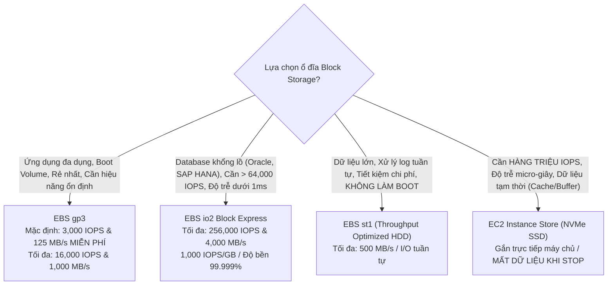
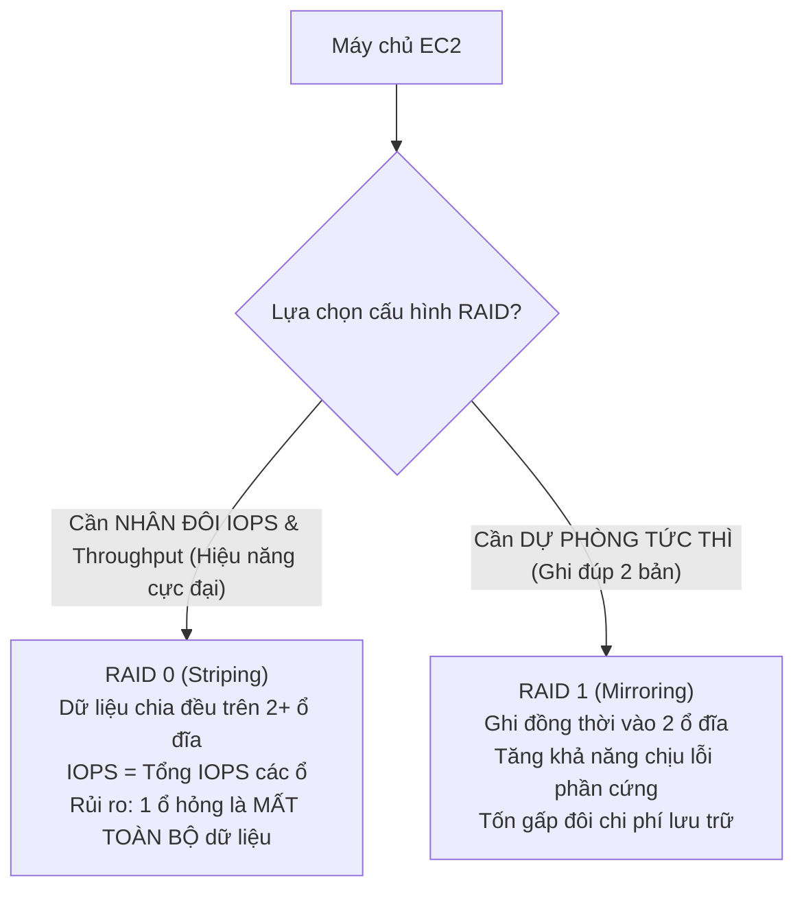

# 💽 Amazon EBS Volume Types & Performance Tuning: gp3, io2 Block Express, RAID & Instance Store

> Thuộc: [[Task-3.1-High-Performing-Storage]] | So sánh nhanh: [[Matrix-EBS-Volume-Types]] | Trở về: [[00-Domain-3-MOC]]

---

## 1. Khái niệm cốt lõi (Core Concepts)

**Amazon Elastic Block Store (EBS)** cung cấp ổ đĩa lưu trữ khối (Block Storage) độ trễ thấp gắn liền với các máy chủ Amazon EC2. Để đạt điểm tối đa trong Domain 3, bạn cần hiểu rõ cơ chế phân tách giữa **Dung lượng (Storage Size)**, **Số lượng thao tác I/O mỗi giây (IOPS)**, và **Thông lượng truyền tải (Throughput - MB/s)**.

---

## 2. So sánh Chuyên Sâu Các Loại Ổ Đĩa Amazon EBS

### Bảng thông số kỹ thuật chuẩn SAA-C03 (2026):

| Loại ổ đĩa EBS | Công nghệ | IOPS tối đa | Throughput tối đa | Làm Boot Volume? | Kịch bản sử dụng chuẩn |
| :--- | :--- | :--- | :--- | :---: | :--- |
| **`gp3` (General Purpose)** | SSD | **16,000 IOPS** | **1,000 MB/s** | **CÓ** | Hầu hết các ứng dụng thông thường, web servers, môi trường dev/test, boot volume. |
| **`gp2` (Thế hệ cũ)** | SSD | 16,000 IOPS | 250 MB/s | CÓ | Thế hệ cũ (IOPS bị trói chặt theo dung lượng: 3 IOPS/GB). Nên thay bằng gp3. |
| **`io2 Block Express`** | SSD | **256,000 IOPS** | **4,000 MB/s** | **CÓ** | **Cơ sở dữ liệu quan hệ Mission-Critical (Oracle, SAP HANA, SQL Server)**, độ trễ sub-ms. |
| **`st1` (Throughput HDD)** | HDD từ tính | 500 IOPS | **500 MB/s** | **KHÔNG** | **Big Data, Hadoop HDFS, Apache Kafka, Log processing, Data Warehousing**. |
| **`sc1` (Cold HDD)** | HDD từ tính | 250 IOPS | 250 MB/s | **KHÔNG** | Dữ liệu lưu trữ ít truy cập, sao lưu lạnh chi phí thấp nhất của EBS. |

---

## 3. Điểm Đột Phá Của `gp3` so với `gp2`

- Trong `gp2`, nếu bạn muốn có 3,000 IOPS, bạn bắt buộc phải mua ổ đĩa dung lượng 1,000 GB (vì tỷ lệ cố định 3 IOPS/GB) $\rightarrow$ lãng phí tiền lưu trữ khi chỉ cần IOPS.
- Với **`gp3`**, AWS cho phép **cấu hình độc lập 3 thông số**:
  1. **Dung lượng (GB):** Mua tùy ý từ 1 GB đến 16 TB.
  2. **IOPS:** Tặng sẵn **3,000 IOPS miễn phí**, có thể mua thêm lên tới 16,000 IOPS.
  3. **Throughput:** Tặng sẵn **125 MB/s miễn phí**, có thể mua thêm lên tới 1,000 MB/s.
- `gp3` giúp tiết kiệm chi phí tới **20%** so với `gp2`.

---

## 4. EC2 Instance Store: Ổ Cứng Tạm Siêu Tốc Độ (Ephemeral Storage)

- **Bản chất phần cứng:** Là các ổ đĩa SSD NVMe được cắm vật lý trực tiếp trên cùng bo mạch chủ của máy chủ vật lý chứa instance EC2.
- **Ưu điểm vượt trội:** 
  - Đem lại **hàng triệu IOPS** và thông lượng hàng chục GB/s.
  - Độ trễ phản hồi ở mức **Micro-giây** (nhanh hơn nhiều so với EBS vốn phải truyền qua mạng nội bộ).
- **Rủi ro mất dữ liệu (CỰC KỲ QUAN TRỌNG TRONG ĐỀ THI):**
  - Dữ liệu trên Instance Store **vẫn tồn tại khi Reboot hệ điều hành**.
  - **NHƯNG dữ liệu sẽ BỊ MẤT TRẮNG (Data Lost)** khi:
    1. Máy chủ bị **Stop** (Dừng máy).
    2. Máy chủ bị **Terminate** (Hủy máy).
    3. Phần cứng máy chủ vật lý bên dưới gặp sự cố (Hardware failure).
- **Ứng dụng chuẩn:** Bộ đệm tạm thời (Cache), vùng tráo đổi (Swap space), dữ liệu tính toán tạm (Scratchpad), hoặc các cụm dữ liệu phân tán tự có cơ chế replication như **Hadoop, Cassandra, Elasticsearch**.

---

## 5. Kỹ Thuật Ghép Ổ Đĩa RAID trên Amazon EBS

Khi một ổ đĩa đơn lẻ (kể cả cấu hình tối đa) không đủ đáp ứng nhu cầu I/O của ứng dụng, bạn có thể gắn nhiều ổ EBS vào 1 máy chủ EC2 và tạo cấu hình RAID phần mềm:

> **Quy tắc thi cử:** Khi câu hỏi yêu cầu *"Đạt thông lượng hoặc IOPS vượt quá giới hạn của một ổ đĩa EBS duy nhất"* $\rightarrow$ Chọn phương án cấu hình **RAID 0 Striping trên nhiều ổ EBS**.

---

## ⚠️ Bẫy đề thi & Mẹo ghi nhớ (Exam Traps)

| Tình huống đề thi | Đáp án bẫy (SAI) | Đáp án chuẩn (ĐÚNG) |
| :--- | :--- | :--- |
| Cần ổ cứng boot volume chi phí rẻ cho máy chủ xử lý log bằng ổ HDD | Chọn ổ `st1` hoặc `sc1` (EBS HDD **không thể làm boot volume**) | Sử dụng ổ **`gp3` SSD** |
| Database đòi hỏi 150,000 IOPS và độ trễ dưới 1ms với khả năng chịu lỗi cao | Dùng Instance Store (Instance Store mất dữ liệu khi stop) | Chọn **Amazon EBS `io2 Block Express`** |
| Ứng dụng xử lý ảnh cần không gian lưu trữ đệm tạm thời với IOPS cực đại và chi phí rẻ nhất | Tạo ổ `io2` gắn vào EC2 | Sử dụng **EC2 Instance Store** có sẵn của máy chủ |
| Muốn đạt thông lượng 1,500 MB/s trên một máy chủ EC2 duy nhất | Mua 1 ổ gp3 (gp3 tối đa chỉ đạt 1,000 MB/s) | Gắn **nhiều ổ EBS gp3 và cấu hình RAID 0** |

---

## 🔗 Liên kết liên quan
- [[Task-3.1-High-Performing-Storage]]
- [[Matrix-EBS-Volume-Types]]
- [[S3-Express-One-Zone-and-Storage-Performance]]
- [[Domain-3-Scenario-Walkthroughs]]
