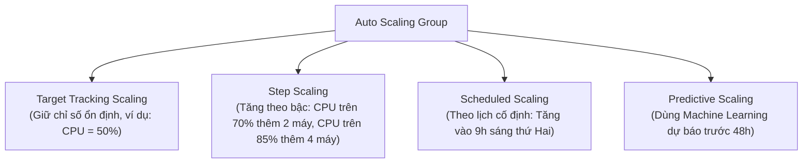
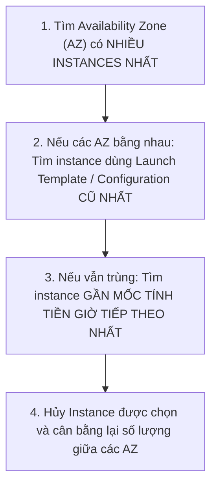
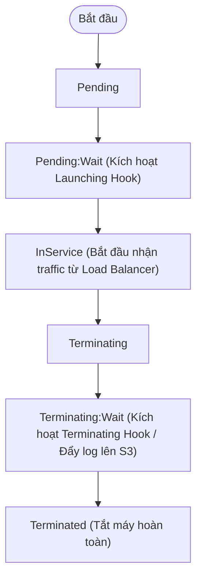

# 🚀 EC2 Auto Scaling & Compute Resilience: Policies, Vòng Đời & Khả Năng Chịu Lỗi

> Thuộc: [[Task-2.2-Highly-Available-and-Fault-Tolerant]] | Trở về: [[00-Domain-2-MOC]]

---

## 1. Khái niệm cốt lõi (Core Concepts)

**Amazon EC2 Auto Scaling** giúp duy trì tính sẵn sàng cao của ứng dụng bằng cách tự động thêm hoặc bớt các máy chủ EC2 theo các điều kiện định trước:
- **Tự động phục hồi máy chủ hỏng (Self-Healing):** Nếu một instance bị crash hoặc trượt bài kiểm tra Health Check (của EC2 hoặc ELB), Auto Scaling Group (ASG) sẽ tự động hủy máy chủ lỗi và tạo một máy chủ mới để thay thế, đảm bảo luôn duy trì số lượng máy mong muốn (**Desired Capacity**).
- **Trải rộng trên nhiều Availability Zones (Multi-AZ):** ASG luôn cố gắng cân bằng số lượng máy chủ đồng đều giữa các AZ được chỉ định để chịu được sự cố sập cả một trung tâm dữ liệu.

---

## 2. Launch Templates vs Launch Configurations

Trong các bài thi SAA-C03 hiện đại, **Launch Templates** đã hoàn toàn thay thế Launch Configurations:

| Tiêu chí | Launch Configurations (Cũ) | Launch Templates (Chuẩn Hiện Đại) |
| :--- | :--- | :--- |
| **Hỗ trợ phiên bản (Versioning)**| Không (Mỗi lần đổi phải tạo mới) | **Có** (Hỗ trợ versioning v1, v2, v3, rollback dễ dàng) |
| **Kết hợp On-Demand & Spot**| Không hỗ trợ | **Hỗ trợ kết hợp cả On-Demand và Spot Instances** trong cùng 1 ASG |
| **Đa dạng loại máy chủ** | Chỉ chọn 1 loại instance type duy nhất | Cho phép chỉ định **nhiều Instance Types** khác nhau |
| **Tính năng EC2 mới** | Không hỗ trợ | Hỗ trợ T2/T3 Unlimited, Dedicated Hosts, IAM Role, Nitro |
| **Khuyến nghị của AWS** | Đã dừng phát triển tính năng mới | **Bắt buộc sử dụng theo Best Practice** |

---

## 3. Các loại Chính sách Mở rộng (Scaling Policies)

### A. Target Tracking Scaling (Khuyên dùng nhiều nhất trong đề thi)
- Bạn chỉ cần đặt một giá trị mục tiêu mong muốn (Target value), ví dụ:
  - *"Giữ mức sử dụng CPU trung bình của cụm ASG ở mức 50%"*
  - *"Giữ số lượng Request mỗi Target trên ALB ở mức 1000 req/min"*
- ASG tự động tính toán tăng hoặc giảm số lượng máy chủ tương ứng để đưa chỉ số về mức mục tiêu. **Cực kỳ dễ cấu hình và ít tốn công sức vận hành nhất (Least operational effort)**.

### B. Step Scaling (Mở rộng theo bậc)
- Phản ứng dựa trên độ lớn của cảnh báo CloudWatch Alarm:
  - Nếu CPU từ 60% đến 80%: Thêm 2 instances.
  - Nếu CPU vượt quá 80%: Thêm 5 instances.
- Phù hợp với các hệ thống có lưu lượng biến động nhanh, cần phản ứng mạnh mẽ khi quá tải đột ngột.

### C. Scheduled Scaling (Mở rộng theo lịch định kỳ)
- Dành cho các mô hình kinh doanh có quy luật thời gian rõ ràng (ví dụ: Hệ thống thương mại điện tử luôn quá tải vào dịp Black Friday hoặc 12h trưa mỗi ngày).

### D. Predictive Scaling (Mở rộng dự đoán bằng Machine Learning)
- Tự động phân tích dữ liệu lịch sử sử dụng trong quá khứ và dự báo trước xu hướng tải trong 48 giờ tới, chủ động bật máy chủ trước khi lưu lượng tăng đột biến.

---

## 4. Thứ tự hủy máy chủ khi Scale-In (Default Termination Policy)

Khi hệ thống hết giờ cao điểm và cần giảm số lượng máy chủ (Scale In), ASG sẽ chọn máy chủ nào để tắt theo thứ tự ưu tiên mặc định sau:

> **Lợi ích kiến trúc:** Đảm bảo hệ thống luôn duy trì sự cân bằng tối đa giữa các Availability Zones để sẵn sàng chịu lỗi.

---

## 5. ASG Lifecycle Hooks: Can thiệp vào vòng đời máy chủ

Thông thường, khi EC2 được tạo, nó sẽ nhận traffic ngay lập tức; khi bị xóa, nó bị tắt phụt ngay. **Lifecycle Hooks** cho phép bạn tạm dừng tiến trình này để thực thi các tác vụ quan trọng:

1. **`autoscaling:EC2_INSTANCE_LAUNCHING` (Trạng thái `Pending:Wait`):**
   - Tạm dừng máy chủ trước khi gắn vào Load Balancer.
   - **Ứng dụng:** Chờ cài đặt phần mềm, tải các mô hình ML nặng hoặc bộ dữ liệu cấu hình lớn từ S3 về máy chủ xong xuôi mới cho phép phục vụ người dùng.
2. **`autoscaling:EC2_INSTANCE_TERMINATING` (Trạng thái `Terminating:Wait`):**
   - Tạm dừng máy chủ trước khi bị xóa hẳn.
   - **Ứng dụng:** Tải toàn bộ log file từ ổ cứng cục bộ lên Amazon S3, hoặc chờ máy chủ hoàn thành nốt các job xử lý ngầm đang dang dở trước khi bị tiêu hủy.

---

## ⚠️ Bẫy đề thi & Mẹo ghi nhớ (Exam Traps)

| Tình huống đề thi | Đáp án bẫy (SAI) | Đáp án chuẩn (ĐÚNG) |
| :--- | :--- | :--- |
| Cần lưu lại toàn bộ log của máy chủ EC2 lên S3 trước khi máy chủ bị Auto Scaling hủy bỏ | Viết script cronjob chạy mỗi phút | Sử dụng **Auto Scaling Lifecycle Hook (`EC2_INSTANCE_TERMINATING`)** để giữ máy chủ ở trạng thái chờ và upload log lên S3 |
| Máy chủ EC2 mới tạo bắt đầu nhận request từ ALB khi code ứng dụng chưa kịp khởi động xong | Tăng kích thước máy chủ EC2 | Sử dụng **Lifecycle Hook (`EC2_INSTANCE_LAUNCHING`)** hoặc tăng thời gian Health Check Grace Period |
| Hệ thống web có lượng truy cập tăng vọt mỗi buổi sáng lúc 8h30 theo lịch cố định | Dùng Simple Scaling hoặc để máy chủ chạy 24/7 | Sử dụng **Scheduled Scaling Policy** để tự động tăng số lượng máy chủ trước 8h30 |
| Cần tối ưu chi phí cho hệ thống chịu tải nền bằng On-Demand và tải đỉnh bằng Spot Instances | Tạo 2 ASG riêng biệt | Sử dụng **1 Launch Template duy nhất** kết hợp cả **On-Demand và Spot Instances** trong cùng 1 ASG |

---

## 🔗 Liên kết liên quan
- [[Task-2.2-Highly-Available-and-Fault-Tolerant]]
- [[Elastic-Load-Balancing-Deep-Dive]]
- [[Storage-Durability-S3-EBS-EFS-FSx]]
- [[Domain-2-Scenario-Walkthroughs]]
