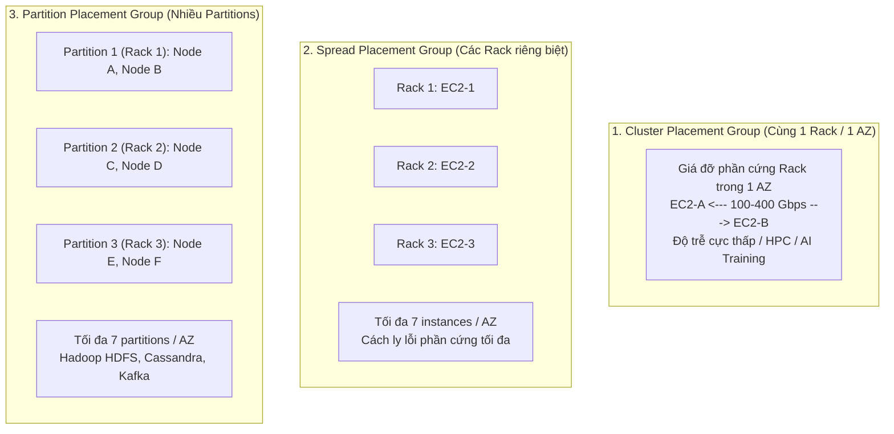
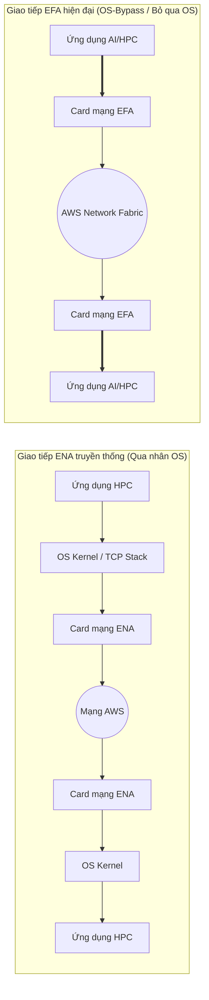

# 🖥️ EC2 Placement Groups & HPC Accelerators: Định Vị Vật Lý, EFA & Graviton

> Thuộc: [[Task-3.2-High-Performing-Compute]] | So sánh nhanh: [[Matrix-EC2-Placement-Groups]] | Trở về: [[00-Domain-3-MOC]]

---

## 1. Khái niệm cốt lõi (Core Concepts)

Khi triển khai các cụm máy chủ Amazon EC2 quy mô lớn, vị trí vật lý tương đối giữa các máy chủ trên các giá đỡ phần cứng (Hardware Racks) của trung tâm dữ liệu AWS ảnh hưởng trực tiếp tới:
1. **Độ trễ mạng giữa các máy (Inter-node Latency).**
2. **Băng thông mạng tối đa (Network Throughput).**
3. **Mức độ cô lập khi phần cứng gặp sự cố (Hardware Fault Isolation).**

AWS cung cấp công cụ **Placement Groups** để bạn chủ động ra lệnh cho AWS sắp xếp các máy chủ ảo EC2 trên phần cứng vật lý theo ý muốn.

---

## 2. Ba Loại EC2 Placement Groups: So Sánh Toàn Diện

| Tiêu chí | Cluster Placement Group | Spread Placement Group | Partition Placement Group |
| :--- | :--- | :--- | :--- |
| **Bố trí vật lý** | Gom vào **cùng 1 rack** trong **1 AZ duy nhất** | Phân tán trên **các rack độc lập hoàn toàn** | Gom thành các nhóm (**Partitions**), mỗi partition ở 1 rack riêng |
| **Độ trễ mạng** | **Thấp nhất có thể** (Sub-millisecond) | Độ trễ bình thường | Độ trễ bình thường |
| **Băng thông mạng** | **Tối đa (100 Gbps đến 400 Gbps)** | Băng thông chuẩn | Băng thông chuẩn |
| **Giới hạn số lượng** | Khuyến nghị cùng 1 instance type | **Tối đa 7 instances mỗi AZ** | **Tối đa 7 partitions mỗi AZ** (chứa hàng trăm instances) |
| **Mức độ chịu lỗi** | **Thấp** (Nếu rack hỏng $\rightarrow$ hỏng cả cụm) | **Cao nhất** (Hỏng 1 rack chỉ mất 1 máy duy nhất) | **Cao** (Các partition độc lập, không dùng chung rack) |
| **Kịch bản đề thi** | **HPC, AI/ML Distributed Training, Mô phỏng thời tiết** | **Hệ thống Core Banking, Ứng dụng quan trọng sống còn** | **Hệ thống dữ liệu lớn: Hadoop HDFS, Apache Cassandra, Kafka** |

---

## 3. Tăng Tốc Mạng HPC: ENA vs Elastic Fabric Adapter (EFA)

Trong các bài toán tính toán hiệu năng cao (HPC) hoặc huấn luyện mô hình ngôn ngữ lớn (LLM / Deep Learning) chạy trên hàng chục máy chủ có GPU:

- **Enhanced Networking (ENA):** Sử dụng chuẩn công nghệ ảo hóa I/O đơn căn (SR-IOV), cung cấp băng thông từ 10 Gbps đến 100 Gbps với giao thức mạng TCP/IP truyền thống.
- **Elastic Fabric Adapter (EFA):** 
  - Tính năng độc quyền của AWS có khả năng **Bỏ qua nhân hệ điều hành (OS-bypass)**.
  - Cho phép ứng dụng tầng người dùng giao tiếp trực tiếp với card mạng phần cứng thông qua giao thức **MPI (Message Passing Interface)** và **NVIDIA GPUDirect RDMA**.
  - **Lợi ích:** Giảm độ trễ giao tiếp giữa các node xuống mức cực hạn, giúp tăng tốc độ huấn luyện cụm Deep Learning phân tán lên gấp nhiều lần.

---

## 4. Bộ Vi Xử Lý AWS Graviton: Tối Ưu Hiệu Năng & Chi Phí

- **Kiến trúc:** Được AWS tự thiết kế riêng dựa trên kiến trúc tập lệnh **64-bit ARM Neoverse**.
- **Thế hệ mới nhất trong đề thi (Graviton3 / Graviton4):**
  - Cung cấp hiệu năng tính toán cao hơn tới **25%** so với Graviton thế hệ trước.
  - Đem lại tỉ lệ **Hiệu năng / Giá thành (Price-Performance) tốt hơn tới 40%** so với các dòng chip x86 truyền thống tương đương (Intel Xeon / AMD EPYC).
- **Quy tắc thi cử:** Khi đề bài yêu cầu *"Tối ưu hóa chi phí và đạt hiệu năng tính toán cao nhất cho ứng dụng web container hoặc database"* $\rightarrow$ Hãy tìm các dòng máy chủ có chữ **`g`** ở tên (ví dụ: **`c7g`** cho Compute, **`r7g`** cho Memory, **`m7g`** cho General Purpose).

---

## ⚠️ Bẫy đề thi & Mẹo ghi nhớ (Exam Traps)

| Tình huống đề thi | Đáp án bẫy (SAI) | Đáp án chuẩn (ĐÚNG) |
| :--- | :--- | :--- |
| Cụm tính toán mô phỏng động lực học chất lưu chạy thư viện OpenMPI yêu cầu độ trễ mạng thấp nhất | Cấu hình máy chủ trong Spread Placement Group | Đặt các máy chủ trong **Cluster Placement Group** và gắn card mạng **Elastic Fabric Adapter (EFA)** |
| Cần triển khai 5 máy chủ Web quan trọng đảm bảo không bao giờ bị sập cùng lúc do lỗi phần cứng | Dùng Cluster Placement Group | Triển khai trong **Spread Placement Group** |
| Cụm Hadoop HDFS 50 node cần tối ưu hóa vị trí vật lý để các node replica không nằm chung phần cứng | Dùng Spread Placement Group (Spread bị giới hạn 7 instances/AZ) | Triển khai trong **Partition Placement Group** |
| Ứng dụng tính toán microservices trên ECS cần giảm 20% chi phí hạ tầng compute mà vẫn tăng hiệu năng | Giảm kích thước instance x86 | Chuyển đổi kiến trúc sang chạy trên các máy chủ **AWS Graviton (ví dụ `c7g`)** |

---

## 🔗 Liên kết liên quan
- [[Task-3.2-High-Performing-Compute]]
- [[Matrix-EC2-Placement-Groups]]
- [[Lambda-Performance-and-Provisioned-Concurrency]]
- [[Domain-3-Scenario-Walkthroughs]]
