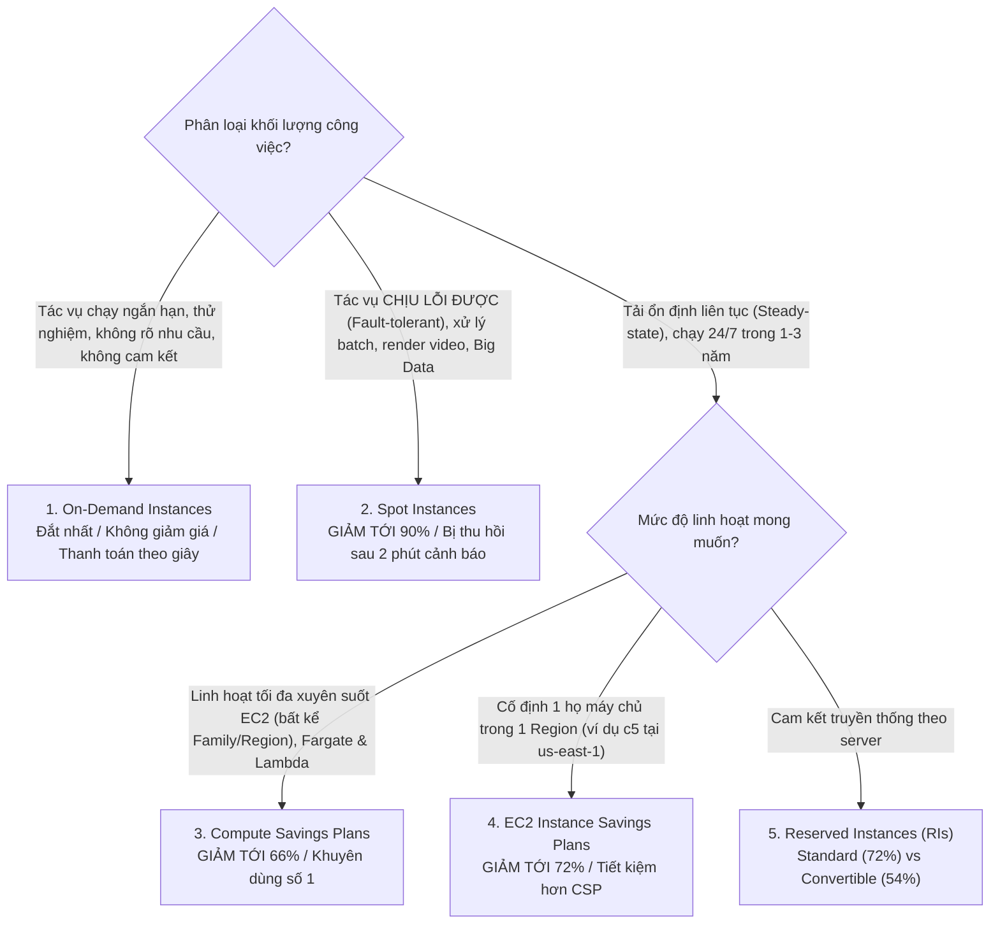

# 🏷️ Amazon EC2 Pricing Models: Spot Instances, Savings Plans & Reserved Instances

> Thuộc: [[Task-4.2-Cost-Optimized-Compute]] | So sánh nhanh: [[Matrix-EC2-Pricing-Models]] | Trở về: [[00-Domain-4-MOC]]

---

## 1. Khái niệm cốt lõi (Core Concepts)

Chi phí điện toán (Compute) thường chiếm từ **50% đến 70%** toàn bộ hóa đơn AWS của doanh nghiệp. Việc lựa chọn đúng mô hình định giá cho từng loại khối lượng công việc là kỹ năng sống còn được kiểm tra dày đặc trong SAA-C03:
- **On-Demand:** Không cam kết, linh hoạt tối đa, chi phí đắt nhất.
- **Spot Instances:** Tận dụng năng lực tính toán dư thừa của AWS, **giảm giá tới 90%**, có thể bị thu hồi với cảnh báo trước 2 phút.
- **Savings Plans:** Mô hình cam kết chi tiêu linh hoạt theo giờ ($/hr) trong 1 hoặc 3 năm, **giảm tới 66% - 72%**, áp dụng tự động xuyên suốt EC2, Fargate và Lambda.
- **Reserved Instances (RIs):** Mô hình cam kết truyền thống theo máy chủ.

---

## 2. Bảng So Sánh Toàn Diện Các Mô Hình Định Giá

| Mô hình mua | Mức giảm giá tối đa | Thời hạn cam kết | Mức độ linh hoạt | Xử lý khi bị thu hồi | Khối lượng công việc phù hợp |
| :--- | :---: | :---: | :--- | :--- | :--- |
| **On-Demand** | 0% (Giá gốc) | Không cam kết | Linh hoạt tuyệt đối | Không bao giờ bị thu hồi | Ứng dụng ngắn hạn, dev/test, tải tăng vọt bất ngờ |
| **Spot Instances** | **Lên tới 90%** | Không cam kết | Không cam kết | **Bị thu hồi sau 2 phút cảnh báo** | **Xử lý hàng loạt (Batch), Render 3D, CI/CD, Big Data (EMR), Web stateless** |
| **Compute Savings Plans**| **Lên tới 66%** | **1 hoặc 3 năm** | **Linh hoạt nhất (EC2, Fargate, Lambda)** | Không bị thu hồi | **Tải ổn định hỗn hợp của doanh nghiệp hiện đại** |
| **EC2 Instance Savings Plans**| **Lên tới 72%** | **1 hoặc 3 năm** | Cố định 1 họ máy trong 1 Region | Không bị thu hồi | Tải ổn định trên một dòng máy cụ thể (ví dụ cụm `c6g`) |
| **Standard RIs** | **Lên tới 72%** | 1 hoặc 3 năm | Cố định Family, OS, Region | Không bị thu hồi | Tải cơ sở dữ liệu quan hệ ổn định |
| **Convertible RIs**| **Lên tới 54%** | 1 hoặc 3 năm | Cho phép đổi Family, OS | Không bị thu hồi | Muốn đổi dòng máy mới khi AWS ra mắt thế hệ chip mới |

---

## 3. Spot Instances: Cơ Chế Thu Hồi & Chiến Lược Phân Bổ (Spot Fleets)

### A. Cảnh báo thu hồi 2 phút (2-Minute Interruption Notice)
- Khi AWS cần lấy lại tài nguyên Spot để phục vụ khách hàng On-Demand, AWS sẽ gửi cảnh báo trước **2 phút** thông qua:
  1. **Amazon EventBridge** (Sự kiện: `EC2 Spot Instance Interruption Warning`).
  2. **Instance Metadata Service** (`http://169.254.169.254/latest/meta-data/spot/instance-action`).
- **Ứng dụng:** Kết hợp **Auto Scaling Lifecycle Hook** hoặc script lắng nghe sự kiện để kịp lưu checkpoint tiến trình tính toán lên Amazon S3 trước khi máy chủ bị tắt.

### B. Chiến lược phân bổ Spot Fleet (Allocation Strategies):
- **`capacity-optimized` (Khuyên dùng tốt nhất):** Tự động chọn các nhóm Spot Pool có dung lượng phần cứng rảnh rỗi nhiều nhất của AWS $\rightarrow$ **giảm thiểu tối đa nguy cơ máy chủ bị thu hồi giữa chừng**.
- **`price-capacity-optimized`:** Cân bằng giữa giá rẻ nhất và độ sẵn sàng dung lượng cao.
- **`lowest-price`:** Chỉ chọn nhóm máy chủ rẻ nhất (dễ bị thu hồi khi nhóm đó hết hàng).

---

## 4. Compute Savings Plans: Vũ Khí FinOps Hiện Đại

Trong đề thi hiện đại, **Compute Savings Plans** được ưu tiên hơn rất nhiều so với Reserved Instances truyền thống:
- Bạn cam kết một mức chi tiêu cố định tính theo đơn vị **USD / giờ** (ví dụ: cam kết trả $15/giờ trong 3 năm).
- Mọi tài nguyên tính toán bạn chạy bên dưới sẽ được tự động trừ dần vào mức cam kết này theo giá ưu đãi (giảm tới 66%):
  - Bạn đổi từ máy chủ x86 (`m5.large`) sang chip ARM Graviton (`c7g.xlarge`) $\rightarrow$ **Vẫn được giảm giá tự động!**
  - Bạn chuyển máy chủ từ `us-east-1` sang `ap-southeast-1` $\rightarrow$ **Vẫn được giảm giá tự động!**
  - Bạn chuyển đổi mã nguồn từ chạy EC2 sang chạy **AWS Fargate** hoặc **AWS Lambda** $\rightarrow$ **Vẫn được giảm giá tự động!**

---

## 5. Tùy Chọn Thanh Toán (Payment Options)

Đối với cả Savings Plans và Reserved Instances, AWS cung cấp 3 hình thức thanh toán:
1. **All Upfront (Trả trước 100%):** Trả toàn bộ tiền của 1 hoặc 3 năm ngay khi đăng ký $\rightarrow$ **Mức chiết khấu giảm giá CAO NHẤT**.
2. **Partial Upfront (Trả trước một phần):** Trả trước tối thiểu 50%, phần còn lại trả dần hàng tháng $\rightarrow$ Mức giảm giá trung bình.
3. **No Upfront (Không trả trước):** Trả tiền đều đặn hàng tháng trong suốt 1 hoặc 3 năm $\rightarrow$ Mức chiết khấu thấp nhất trong 3 lựa chọn, nhưng không cần vốn đầu tư ban đầu.

---

## ⚠️ Bẫy đề thi & Mẹo ghi nhớ (Exam Traps)

| Tình huống đề thi | Đáp án bẫy (SAI) | Đáp án chuẩn (ĐÚNG) |
| :--- | :--- | :--- |
| Ứng dụng xử lý ảnh hàng loạt (Batch image processing) có thể chịu lỗi, cần tiết kiệm chi phí tối đa | Dùng On-Demand với Auto Scaling | Sử dụng **Amazon EC2 Spot Instances** (tiết kiệm tới 90%) |
| Hệ thống web chạy 24/7 ổn định liên tục trong 3 năm tới, cần tối ưu chi phí mà vẫn linh hoạt chuyển đổi công nghệ sang Fargate | Mua Standard Reserved Instances (Standard RI không đổi được công nghệ) | Đăng ký gói **Compute Savings Plans** thời hạn 3 năm |
| Chạy các tác vụ Spot instances và muốn giảm thiểu tối đa xác suất bị AWS thu hồi máy giữa chừng | Chọn chiến lược phân bổ `lowest-price` | Chọn chiến lược phân bổ **`capacity-optimized`** trong Spot Fleet |
| Doanh nghiệp cần cam kết giảm giá cho EC2 nhưng muốn có quyền đổi từ dòng chip Intel sang dòng chip Graviton sau này | Mua Standard Reserved Instances | Mua **Convertible Reserved Instances** hoặc **Compute Savings Plans** |

---

## 🔗 Liên kết liên quan
- [[Task-4.2-Cost-Optimized-Compute]]
- [[Matrix-EC2-Pricing-Models]]
- [[AWS-Compute-Optimizer-and-Right-Sizing]]
- [[Domain-4-Scenario-Walkthroughs]]
