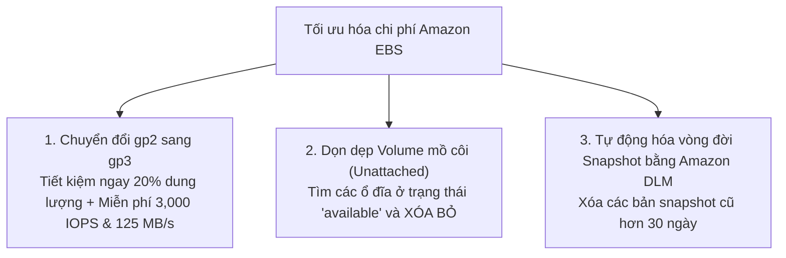
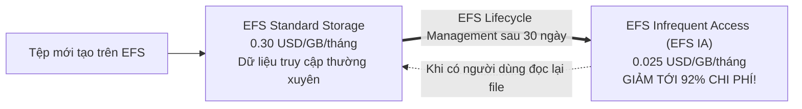

# 💾 EFS & EBS Storage Cost Optimization: Nâng Cấp gp3, Dọn Rác & EFS IA

> Thuộc: [[Task-4.1-Cost-Optimized-Storage]] | Trở về: [[00-Domain-4-MOC]]

---

## 1. Khái niệm cốt lõi (Core Concepts)

Chi phí lưu trữ ổ cứng khối (**Amazon EBS**) và hệ thống tệp chia sẻ (**Amazon EFS**) thường phát sinh lãng phí do:
1. Tiếp tục duy trì các loại ổ đĩa công nghệ cũ (`gp2`) đắt tiền hơn.
2. Quên không xóa các ổ đĩa mồ côi (**Unattached EBS Volumes**) sau khi hủy máy chủ EC2.
3. Không thiết lập vòng đời tự động xóa các bản sao lưu Snapshot định kỳ.
4. Lưu toàn bộ dữ liệu tệp ít truy cập trên tầng lưu trữ EFS Standard đắt đỏ.

---

## 2. Amazon EBS Cost Optimization: Ba Bước Cắt Giảm Chi Phí

### Bước 1: Nâng cấp toàn bộ ổ `gp2` sang `gp3`
- **`gp2`:** Chi phí ~$0.10 / GB / tháng. IOPS bị trói buộc cứng vào dung lượng (3 IOPS / GB). Muốn có 3,000 IOPS phải mua ổ 1,000 GB!
- **`gp3`:** Chi phí **~$0.08 / GB / tháng (Rẻ hơn 20%)**. Tặng sẵn **3,000 IOPS và 125 MB/s hoàn toàn miễn phí** cho bất kỳ kích thước ổ đĩa nào!
- **Chuyển đổi không gián đoạn (Zero Downtime):** Sử dụng tính năng **EBS Elastic Volumes**, bạn có thể đổi trực tiếp loại ổ đĩa từ `gp2` sang `gp3` ngay khi máy chủ EC2 đang hoạt động bình thường mà không cần tắt máy!

### Bước 2: Nhận diện và Xóa các ổ đĩa mồ côi (Unattached Volumes)
- Mặc định khi bạn tạo thêm ổ EBS phụ gắn vào EC2, cờ `DeleteOnTermination` được đặt là `false`. Khi bạn hủy máy chủ EC2, ổ đĩa phụ này **vẫn tiếp tục tồn tại ở trạng thái `available` và âm thầm tính tiền đầy đủ hàng tháng**!
- **Giải pháp:** Sử dụng **AWS Trusted Advisor** hoặc script tự động quét tìm toàn bộ các volume có trạng thái `available` để chụp snapshot lưu trữ rồi xóa bỏ.

### Bước 3: Quản lý vòng đời Snapshot với Amazon Data Lifecycle Manager (DLM)
- Mặc dù EBS Snapshot là dạng sao lưu gia tăng (Incremental), việc chụp snapshot hàng ngày mà không có chính sách xóa các bản cũ sẽ khiến số lượng snapshot phình to hàng trăm Terabyte trên S3.
- Sử dụng **Amazon Data Lifecycle Manager (DLM)** để tạo chính sách tự động:
  - Chụp snapshot mỗi 12 giờ.
  - Tự động xóa các bản snapshot cũ hơn **14 ngày**.
  - **Lưu ý kỹ thuật:** Khi xóa một bản snapshot cũ, AWS sẽ tự động hợp nhất các block dữ liệu cần thiết vào bản snapshot kế tiếp $\rightarrow$ **dữ liệu của các bản snapshot còn lại không bao giờ bị hỏng**.

---

## 3. Amazon EFS Cost Optimization: EFS Infrequent Access (EFS IA)

Amazon EFS là hệ thống tệp chia sẻ cực kỳ mạnh mẽ, nhưng tầng lưu trữ mặc định (**EFS Standard**) có chi phí khá cao: **~$0.30 / GB / tháng**.

### So sánh chi phí các tầng lưu trữ EFS:
- **EFS Standard:** ~$0.30 / GB / tháng.
- **EFS Infrequent Access (EFS IA):** **~$0.025 / GB / tháng (Tiết kiệm tới 92%)**.
  - Có thu phí truy xuất khi đọc file ($0.01 / GB).
  - Tích hợp hoàn toàn trong suốt với người dùng (người dùng và ứng dụng vẫn nhìn thấy file trong thư mục như bình thường mà không hề hay biết file đã bị chuyển tầng).
- **EFS One Zone:** Đối với các môi trường Dev/Test hoặc dữ liệu phụ không cần Multi-AZ, chọn **EFS One Zone** kết hợp **One Zone IA** giúp tiết kiệm thêm **47%** chi phí.

---

## ⚠️ Bẫy đề thi & Mẹo ghi nhớ (Exam Traps)

| Tình huống đề thi | Đáp án bẫy (SAI) | Đáp án chuẩn (ĐÚNG) |
| :--- | :--- | :--- |
| Doanh nghiệp muốn giảm 20% chi phí lưu trữ EBS cho 100 máy chủ EC2 mà không muốn downtime | Tạo ổ mới rồi copy dữ liệu thủ công | Dùng tính năng **EBS Elastic Volumes để sửa đổi trực tiếp volume type từ `gp2` sang `gp3`** |
| Hóa đơn lưu trữ EBS tăng cao do các ổ cứng cũ không còn sử dụng sau khi tắt máy chủ | Thu hẹp kích thước ổ đĩa | Tìm và **xóa các EBS Volume ở trạng thái `available` (Unattached)** |
| Tự động hóa lịch chụp snapshot và xóa snapshot EBS quá 30 ngày với ít công sức nhất | Viết hàm Lambda và cronjob CloudWatch | Thiết lập chính sách vòng đời trong **Amazon Data Lifecycle Manager (Amazon DLM)** |
| Thư mục EFS 50 TB có 80% tài liệu không ai truy cập trong 3 tháng qua, cần giảm chi phí lưu trữ | Chuyển file sang S3 Glacier bằng script rsync | Bật **EFS Lifecycle Management** để tự động chuyển tệp sang **EFS Infrequent Access (EFS IA)** |

---

## 🔗 Liên kết liên quan
- [[Task-4.1-Cost-Optimized-Storage]]
- [[S3-Lifecycle-and-Storage-Classes-Cost-Tuning]]
- [[Matrix-S3-Storage-Classes-Cost-and-Retrieval]]
- [[Domain-4-Scenario-Walkthroughs]]
