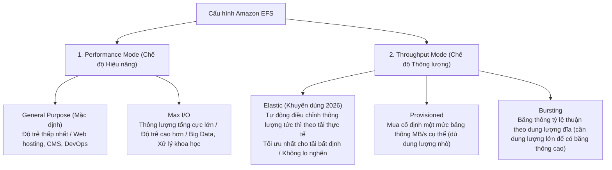
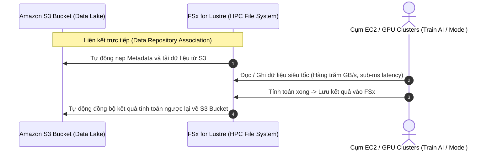

# 📁 Amazon EFS & FSx High-Throughput Modes: Tối Ưu Hệ Thống Tệp Chia Sẻ

> Thuộc: [[Task-3.1-High-Performing-Storage]] | Trở về: [[00-Domain-3-MOC]]

---

## 1. Khái niệm cốt lõi (Core Concepts)

Khi nhiều máy chủ EC2 hoặc container cần cùng chia sẻ một hệ thống tệp tin qua mạng (**Shared File Storage**) với chuẩn giao tiếp quen thuộc (POSIX / NFS / SMB), AWS cung cấp 2 dòng dịch vụ chủ lực:
- **Amazon EFS (Elastic File System):** Hệ thống tệp Serverless chuẩn POSIX/NFSv4 dành cho Linux, tự động co giãn dung lượng từ vài Megabyte lên tới hàng Petabyte.
- **Amazon FSx Family:** Bộ các hệ thống tệp chuyên dụng của bên thứ ba được tối ưu hóa cho các khối lượng công việc chuyên biệt (Lustre cho HPC, Windows cho SMB, NetApp ONTAP cho lưu trữ đa giao thức).

---

## 2. Amazon EFS: Chế Độ Hiệu Năng & Thông Lượng (Performance & Throughput Modes)

### A. Performance Modes (Chế độ Hiệu năng)
1. **General Purpose (Mặc định):** Đem lại độ trễ cho mỗi thao tác tệp là thấp nhất. Phù hợp cho 95% trường hợp (Web serving, Content Management Systems như WordPress, môi trường lập trình).
2. **Max I/O:** Cho phép hàng nghìn máy chủ EC2 cùng đọc ghi đồng thời với tổng thông lượng cực đại, nhưng chấp nhận độ trễ thao tác tệp cao hơn một chút. Dành cho: Phân tích dữ liệu lớn, tính toán phân tán.

### B. Throughput Modes (Chế độ Thông lượng)
1. **Elastic Throughput (Khuyến nghị chuẩn 2026):** EFS tự động theo dõi và mở rộng băng thông đọc/ghi tức thì dựa trên khối lượng công việc thực tế của ứng dụng. Bạn chỉ trả tiền cho dung lượng dữ liệu thực tế đã đọc/ghi. **Lý tưởng cho các ứng dụng có lưu lượng tăng giảm đột ngột khó lường**.
2. **Provisioned Throughput:** Dành cho trường hợp bạn có dung lượng lưu trữ nhỏ (ví dụ 10 GB) nhưng lại cần thông lượng cực lớn (ví dụ 100 MB/s). Bạn trả thêm tiền để mua cố định băng thông này.
3. **Bursting Throughput:** Băng thông cơ bản tỷ lệ thuận theo dung lượng dữ liệu lưu trong EFS (50 KB/s trên mỗi 1 GB lưu trữ) + có điểm tích lũy Burst Credit.

---

## 3. Amazon FSx for Lustre: Tăng Tốc Tính Toán Hiệu Năng Cao (HPC) & AI

Khi khối lượng công việc đòi hỏi tốc độ đọc ghi tệp ở mức hàng trăm Gigabyte/giây và hàng triệu IOPS với độ trễ dưới 1 mili-giây:

### So sánh 2 loại cấu hình FSx for Lustre:
- **Scratch File System:** Thiết kế cho các tác vụ tính toán tạm thời ngắn hạn. Dữ liệu **không được nhân bản dự phòng**. Nếu máy chủ lưu trữ bên dưới hỏng, dữ liệu sẽ mất. Chi phí rẻ nhất.
- **Persistent File System:** Dữ liệu được nhân bản tự động trong cùng 1 Availability Zone để đảm bảo tính sẵn sàng cao cho các tác vụ tính toán dài hạn.

---

## 4. Bảng So Sánh Các Giải Pháp File Storage trên AWS

| Đặc tính | Amazon EFS | FSx for Lustre | FSx for Windows | FSx for NetApp ONTAP |
| :--- | :--- | :--- | :--- | :--- |
| **Giao thức** | **NFSv4** (Linux) | **Lustre client** (Linux) | **SMB** (Windows) | **NFS, SMB, iSCSI** |
| **Độ trễ** | Vài mili-giây | **Dưới 1 mili-giây (sub-ms)** | Vài mili-giây | Dưới 1 mili-giây |
| **Thông lượng** | Lên tới hàng chục GB/s | **Lên tới hàng trăm GB/s** | Lên tới 12 GB/s | Lên tới hàng chục GB/s |
| **Tích hợp S3** | Không trực tiếp | **Đồng bộ 2 chiều tự động với S3** | Không trực tiếp | Hỗ trợ FabricPool chuyển lạnh sang S3 |
| **Mô hình tính toán** | Web servers, CI/CD, Container shared | **HPC, AI/ML Training, Video Render** | Doanh nghiệp Windows, AD, DFS | Di chuyển SAN/NAS On-premise |

---

## ⚠️ Bẫy đề thi & Mẹo ghi nhớ (Exam Traps)

| Tình huống đề thi | Đáp án bẫy (SAI) | Đáp án chuẩn (ĐÚNG) |
| :--- | :--- | :--- |
| Cụm huấn luyện Machine Learning cần đọc dữ liệu khổng lồ từ S3 với thông lượng hàng trăm GB/s và độ trễ sub-ms | Đọc trực tiếp từ S3 hoặc tạo ổ EFS | Triển khai **Amazon FSx for Lustre** liên kết trực tiếp với Amazon S3 Bucket |
| Hệ thống web trên Linux có lưu lượng truy cập biến động mạnh, cần hệ thống tệp chia sẻ tự động mở rộng thông lượng tức thì | Dùng EFS Bursting Throughput | Chọn Amazon EFS với **Elastic Throughput Mode** |
| Khối lượng công việc xử lý dữ liệu tài chính chạy trong 4 giờ và có thể chạy lại từ đầu nếu gặp lỗi phần cứng | Tạo FSx for Lustre Persistent | Chọn **FSx for Lustre Scratch File System** để tiết kiệm chi phí tối đa |
| Doanh nghiệp cần di chuyển hệ thống chia sẻ file doanh nghiệp chạy Windows Server tích hợp Active Directory lên AWS | Dùng Amazon EFS | Triển khai **Amazon FSx for Windows File Server (Multi-AZ)** |

---

## 🔗 Liên kết liên quan
- [[Task-3.1-High-Performing-Storage]]
- [[S3-Express-One-Zone-and-Storage-Performance]]
- [[EBS-Volume-Types-gp3-and-io2-Block-Express]]
- [[Domain-3-Scenario-Walkthroughs]]
