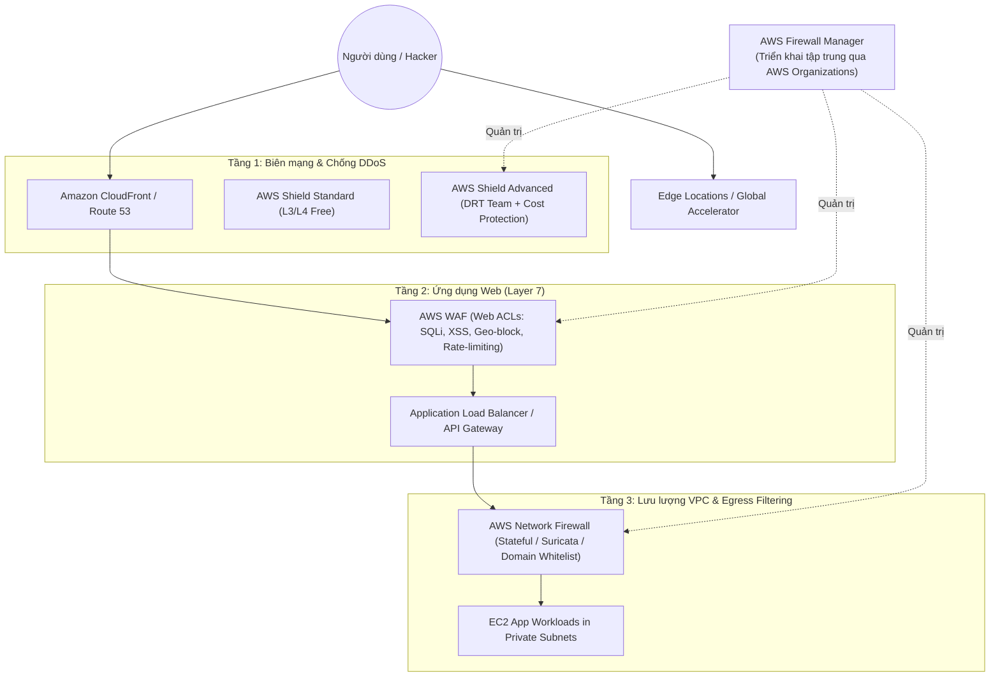

# 🌐 Edge & Application Defense: WAF, Shield, Network Firewall & Firewall Manager

> Thuộc: [[Task-1.2-Design-Secure-Workloads-Apps]] | So sánh nhanh: [[Matrix-WAF-vs-Shield-vs-Firewall]] | Trở về: [[00-Domain-1-MOC]]

---

## 1. Khái niệm cốt lõi (Core Concepts)

Khi bảo vệ ứng dụng trước các cuộc tấn công từ bên ngoài Internet, AWS chia thành các tầng phòng thủ dựa trên mô hình OSI:
- **Tầng 3/4 (Network / Transport Layer):** Tấn công DDoS hạ tầng (SYN Flood, UDP Reflection). $\rightarrow$ Được bảo vệ bởi **AWS Shield**.
- **Tầng 7 (Application Layer):** Tấn công khai thác lỗ hổng web (SQL Injection, XSS, HTTP Flood, Web Scraping). $\rightarrow$ Được bảo vệ bởi **AWS WAF**.
- **Tầng VPC Nội bộ (Stateful Deep Packet Inspection):** Kiểm soát lưu lượng ra vào VPC sâu đến từng domain URL FQDN. $\rightarrow$ Được bảo vệ bởi **AWS Network Firewall**.
- **Quản trị tập trung toàn doanh nghiệp:** Tự động triển khai luật an ninh cho hàng trăm tài khoản. $\rightarrow$ Được quản lý bởi **AWS Firewall Manager**.

---

## 2. Kiến trúc phòng thủ đa lớp (Defense-in-Depth Architecture)

---

## 3. Phân biệt AWS WAF vs AWS Shield Standard vs Shield Advanced

| Tiêu chí | AWS WAF | AWS Shield Standard | AWS Shield Advanced |
| :--- | :--- | :--- | :--- |
| **Tầng bảo vệ (OSI)**| **Layer 7** (Application) | **Layer 3 & 4** (Network/Transport) | **Layer 3, 4 & 7** |
| **Mối đe dọa xử lý** | SQL Injection, Cross-site scripting (XSS), Rate-limiting (HTTP Flood), Geo-blocking. | SYN Flood, UDP reflection, Slowloris. | Tấn công DDoS quy mô lớn, phức tạp, kéo dài. |
| **Gắn vào dịch vụ** | CloudFront, ALB, API Gateway, AppSync, Cognito. | Mặc định tự động gắn trên mọi tài nguyên AWS. | CloudFront, Route 53, ALB, Global Accelerator, Elastic IPs. |
| **Chi phí** | Tính theo số Web ACLs + Rules + Số request ($5/ACL + $1/rule + $0.6/triệu req). | **Hoàn toàn miễn phí** (Bật sẵn 100%). | **$3,000 / tháng** (Hợp đồng 1 năm) + Data transfer fee. |
| **Hỗ trợ chuyên gia** | Không có (tự cấu hình). | Không có. | **AWS Shield Response Team (DRT)** hỗ trợ 24/7 trực tiếp ứng cứu. |
| **Bảo vệ tài chính**| Không có. | Không có. | **DDoS Cost Protection:** AWS hoàn tiền tín dụng nếu hệ thống tự mở rộng (Auto Scaling) do bị tấn công DDoS. |

---

## 4. AWS Network Firewall

Khi bài thi yêu cầu kiểm tra gói tin sâu hơn những gì Security Groups và Network ACLs có thể làm:
- **Stateful Deep Packet Inspection (DPI):** Kiểm tra nội dung bên trong gói tin mạng ở cấp độ VPC.
- **Lọc Domain ra ngoài (Egress Domain Filtering):** Cho phép EC2 chỉ được kết nối ra danh sách domain được phê duyệt (ví dụ: chỉ cho phép `*.github.com` và chặn toàn bộ các trang web khác).
- **Hỗ trợ bộ luật Suricata:** Cho phép import hàng nghìn luật bảo mật mã nguồn mở theo chuẩn Suricata IPS/IDS.

---

## 5. AWS Firewall Manager: Quản trị tập trung đa tài khoản

- Điều kiện bắt buộc để sử dụng:
  1. Phải bật **AWS Organizations** (gồm tất cả các tính năng - All Features).
  2. Bắt buộc phải bật **AWS Config** trên tất cả các tài khoản thành viên.
  3. Chỉ định một tài khoản làm **Firewall Manager Administrator Account**.
- Tác dụng chính:
  - Tự động áp dụng chung một bộ Web ACL của AWS WAF cho toàn bộ các Application Load Balancer được tạo mới trong bất kỳ tài khoản con nào.
  - Tự động cảnh báo và khắc phục khi một Security Group trong tài khoản con bị mở cổng trái phép.

---

## ⚠️ Bẫy đề thi & Mẹo ghi nhớ (Exam Traps)

| Tình huống đề thi | Đáp án bẫy (SAI) | Đáp án chuẩn (ĐÚNG) |
| :--- | :--- | :--- |
| Bảo vệ trang web trước tấn công SQL Injection và XSS | Cấu hình Security Group hoặc Network ACL (SG/NACL chỉ nhìn thấy IP/Port, không đọc được payload HTTP) | Sử dụng **AWS WAF** gắn vào Application Load Balancer hoặc CloudFront |
| Website bị tấn công DDoS gây tăng đột biến hóa đơn do EC2 Auto Scaling, muốn được bảo vệ tài chính | Mua bảo hiểm bên ngoài hoặc dùng Shield Standard | Kích hoạt **AWS Shield Advanced** (có tính năng *DDoS Cost Protection*) |
| Yêu cầu các máy chủ trong VPC chỉ được phép gọi ra ngoài Internet tới danh sách các domain URLs cụ thể | Dùng NAT Gateway hoặc Network ACL (NACL chỉ lọc được IP, không lọc được Domain Name/URL) | Triển khai **AWS Network Firewall** với tính năng *Stateful Domain List rule group* |
| Tự động triển khai bộ luật WAF cho 100 tài khoản con trong doanh nghiệp mỗi khi có ALB mới được tạo | Viết CloudFormation script chạy thủ công cho từng tài khoản | Sử dụng **AWS Firewall Manager** kết hợp **AWS Organizations** |

---

## 🔗 Liên kết liên quan
- [[Task-1.2-Design-Secure-Workloads-Apps]]
- [[Matrix-WAF-vs-Shield-vs-Firewall]]
- [[VPC-Network-Security-Layers]]
- [[Domain-1-Scenario-Walkthroughs]]
