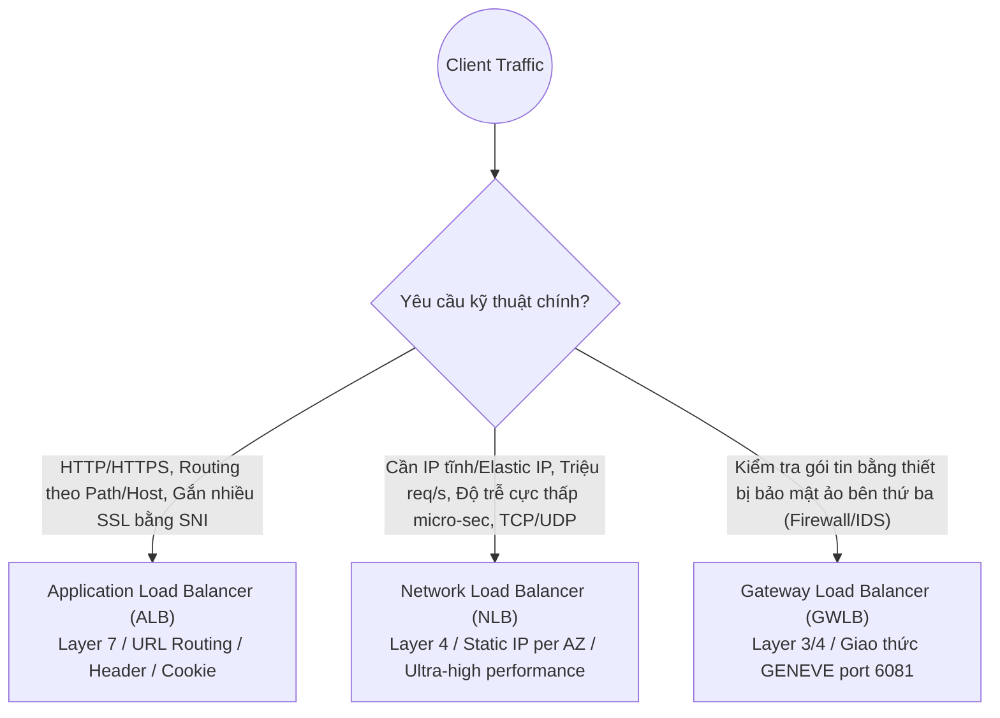
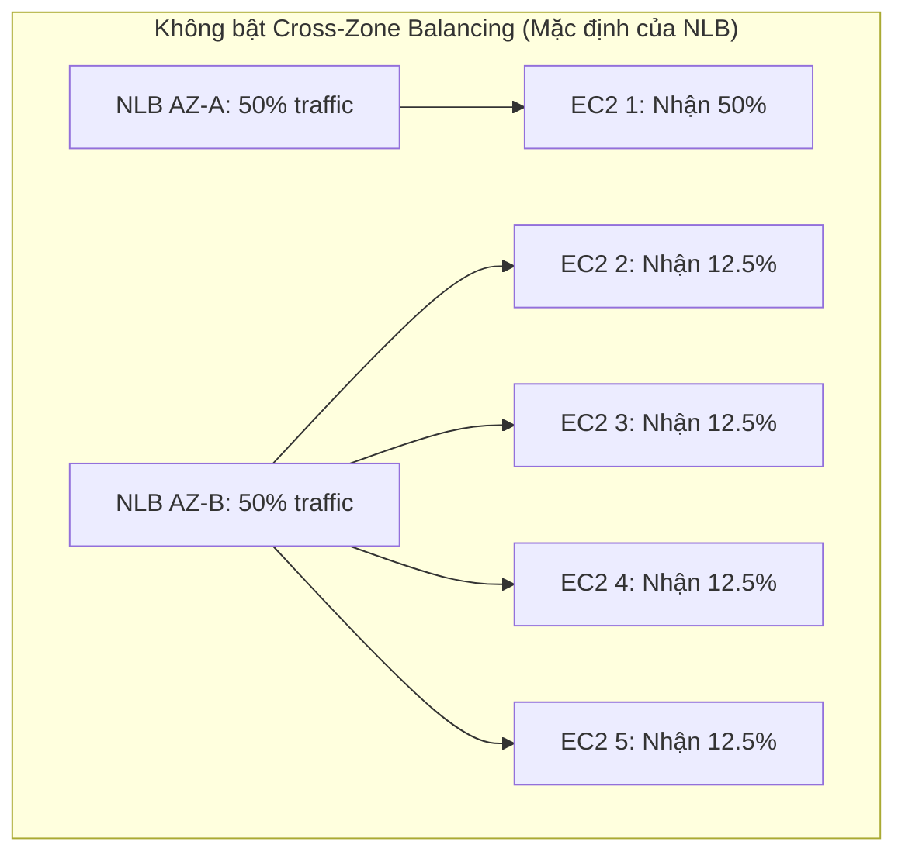

# ⚖️ Elastic Load Balancing (ELB) Deep Dive: ALB vs NLB vs GWLB & Tính Năng Nâng Cao

> Thuộc: [[Task-2.2-Highly-Available-and-Fault-Tolerant]] | So sánh nhanh: [[Matrix-ALB-vs-NLB-vs-GWLB]] | Trở về: [[00-Domain-2-MOC]]

---

## 1. Khái niệm cốt lõi (Core Concepts)

**Elastic Load Balancing (ELB)** là dịch vụ phân phối tự động lưu lượng truy cập đến trên nhiều mục tiêu (Targets) như EC2 instances, containers (ECS), địa chỉ IP, và Lambda functions trải dài trên nhiều **Availability Zones (AZs)**, giúp kiến trúc ứng dụng đạt tính sẵn sàng cao (**High Availability**) và khả năng chịu lỗi (**Fault Tolerance**).

AWS cung cấp 3 loại Load Balancer hiện đại được kiểm tra chuyên sâu trong SAA-C03:
1. **Application Load Balancer (ALB):** Tầng 7 (HTTP / HTTPS / gRPC). Thông minh, định tuyến linh hoạt.
2. **Network Load Balancer (NLB):** Tầng 4 (TCP / UDP / TLS). Siêu tốc độ, độ trễ micro-giây, hỗ trợ địa chỉ IP tĩnh.
3. **Gateway Load Balancer (GWLB):** Tầng 3/4 (IP packets / GENEVE). Triển khai và mở rộng cụm tường lửa ảo của bên thứ ba.

---

## 2. So sánh chuyên sâu 3 loại Load Balancer

| Tiêu chí kỹ thuật | Application Load Balancer (ALB) | Network Load Balancer (NLB) | Gateway Load Balancer (GWLB) |
| :--- | :--- | :--- | :--- |
| **Tầng OSI** | **Layer 7** (Application) | **Layer 4** (Transport) | **Layer 3 & 4** (Network/Gateway) |
| **Giao thức hỗ trợ** | HTTP, HTTPS, gRPC | TCP, UDP, TLS | IP (GENEVE encapsulation - port 6081) |
| **Định tuyến thông minh**| Path (`/api`), Host (`app.domain.com`), HTTP Header, Query string | Chỉ chuyển tiếp theo Port & Protocol | Chuyển tiếp toàn bộ gói tin IP trong suốt |
| **Địa chỉ IP cung cấp** | **DNS Name động** (IP thay đổi liên tục, không hỗ trợ gắn Elastic IP) | **Static IP hoặc Elastic IP cố định trên từng AZ** | Endpoint ENI riêng biệt |
| **Hiệu năng & Độ trễ** | Mili-giây (phù hợp app web) | **Micro-giây (hàng triệu req/giây)** | Trong suốt, độ trễ tối thiểu |
| **Server Name Indication (SNI)**| **Hỗ trợ** (Gắn nhiều chứng chỉ SSL lên 1 Listener) | **Hỗ trợ** (Gắn nhiều chứng chỉ TLS) | Không áp dụng |
| **Xác thực người dùng** | **Hỗ trợ** (Tích hợp trực tiếp Cognito / OIDC) | Không hỗ trợ | Không hỗ trợ |
| **Cross-Zone Balancing** | **Mặc định BẬT (Miễn phí 100%)** | **Mặc định TẮT** (Tính phí data transfer nếu bật) | Không áp dụng |

---

## 3. Các tính năng cốt lõi bắt buộc phải nhớ trong phòng thi

### A. Server Name Indication (SNI)
- **Vấn đề truyền thống:** Một Load Balancer truyền thống chỉ có thể nạp 1 chứng chỉ SSL. Nếu bạn chạy nhiều trang web trên cùng một cụm máy chủ (`siteA.com`, `siteB.com`, `siteC.com`), bạn phải tạo nhiều Load Balancer rất tốn tiền.
- **Giải pháp SNI:** Client gửi hostname mong muốn ngay trong gói tin bắt tay TLS handshake đầu tiên. ALB/NLB đọc hostname này và tự động trả về **đúng chứng chỉ SSL tương ứng**.
- **Quy tắc thi cử:** Khi câu hỏi yêu cầu *"Host multiple secure websites on the same load balancer with different SSL certificates at lowest cost"* $\rightarrow$ Chọn **ALB với tính năng SNI**.

### B. Cross-Zone Load Balancing (Cân bằng tải xuyên vùng)

- **Khi không bật Cross-Zone:** Mỗi node của Load Balancer chỉ chia tải cho các instance nằm trong cùng AZ của nó. Ở ví dụ trên, EC2 #1 phải gánh tới 50% toàn bộ traffic hệ thống trong khi các máy ở AZ-B chỉ chịu 12.5%!
- **Khi BẬT Cross-Zone:** Load Balancer phân phối đều tải tới **tất cả các instance trên toàn bộ các AZ** (mỗi instance nhận đúng 20% traffic).
- **Lưu ý chi phí:**
  - **ALB:** Mặc định luôn **BẬT** và **hoàn toàn MIỄN PHÍ**.
  - **NLB:** Mặc định **TẮT**. Nếu bật lên, bạn sẽ phải **trả phí truyền tải dữ liệu xuyên AZ (Inter-AZ data transfer charge)**.

### C. Sticky Sessions (Session Affinity)
- Dùng cho các ứng dụng có trạng thái (**Stateful applications**), yêu cầu các request tiếp theo của cùng một client phải luôn được điều hướng tới đúng máy chủ EC2 ban đầu.
- ALB hỗ trợ 2 loại Cookie:
  1. **Duration-based Cookie:** Do ALB tự sinh ra (tên: `AWSALB`), có thời hạn hết hạn cụ thể do bạn cấu hình.
  2. **Application-based Cookie:** Do ứng dụng của bạn tự sinh ra (ALB bọc thêm cookie riêng của nó để track).
- **Mẹo kiến trúc:** Chỉ dùng Sticky Sessions khi ứng dụng cũ chưa thể nâng cấp. Best practice chuẩn vẫn là lưu session vào **ElastiCache / DynamoDB** để giữ máy chủ Stateless.

### D. Deregistration Delay (Connection Draining)
- Thời gian giữ kết nối (mặc định **300 giây**) khi một instance đang bị gỡ bỏ khỏi Target Group (do Auto Scaling Scale-in hoặc do người dùng sửa đổi).
- Trong khoảng thời gian này, ALB/NLB sẽ **ngừng gửi request mới** tới máy chủ đó, nhưng cho phép các kết nối đang dang dở (In-flight requests) được tiếp tục xử lý cho đến khi hoàn tất, ngăn chặn việc người dùng nhận lỗi `502 Bad Gateway` hoặc đứt kết nối đột ngột.

---

## ⚠️ Bẫy đề thi & Mẹo ghi nhớ (Exam Traps)

| Tình huống đề thi | Đáp án bẫy (SAI) | Đáp án chuẩn (ĐÚNG) |
| :--- | :--- | :--- |
| Khách hàng yêu cầu hệ thống cung cấp địa chỉ IP tĩnh cố định để cấu hình tường lửa on-premise | Dùng ALB và gán Elastic IP cho nó (ALB không hỗ trợ gán Elastic IP) | Sử dụng **Network Load Balancer (NLB)** (cung cấp 1 Elastic IP cố định cho từng AZ) |
| Chạy 10 tên miền HTTPS khác nhau trên cùng một Application Load Balancer với chi phí tối ưu nhất | Tạo 10 cái ALB riêng biệt cho từng website | Sử dụng **1 ALB duy nhất kết hợp tính năng Server Name Indication (SNI)** |
| Ứng dụng web cần xác thực người dùng qua Google/Facebook trước khi chuyển tiếp request vào backend | Tự code xác thực trên từng EC2 | Sử dụng tính năng **Authenticate with Cognito/OIDC** tích hợp trực tiếp trên Listener của **ALB** |
| Phân phối đều lưu lượng giữa các EC2 trên các AZ cho NLB mà không lo lệch tải | Tăng thêm số lượng EC2 ở AZ quá tải | Bật tính năng **Cross-Zone Load Balancing trên NLB** (chấp nhận phát sinh phí data transfer) |

---

## 🔗 Liên kết liên quan
- [[Task-2.2-Highly-Available-and-Fault-Tolerant]]
- [[Matrix-ALB-vs-NLB-vs-GWLB]]
- [[EC2-Auto-Scaling-and-Compute-Resilience]]
- [[Domain-2-Scenario-Walkthroughs]]
