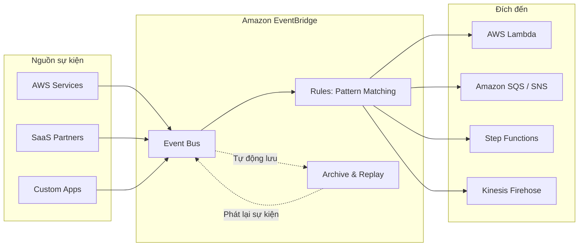
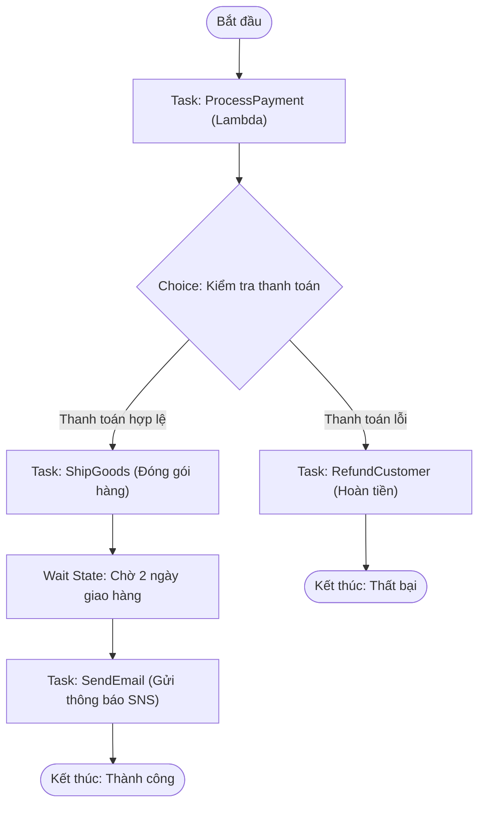

# ⚡ Event-Driven Architectures: EventBridge & AWS Step Functions

> Thuộc: [[Task-2.1-Scalable-and-Loosely-Coupled]] | So sánh nhanh: [[Matrix-SQS-vs-SNS-vs-EventBridge-vs-Kinesis]] | Trở về: [[00-Domain-2-MOC]]

---

## 1. Khái niệm cốt lõi (Core Concepts)

Kiến trúc hướng sự kiện (**Event-Driven Architecture - EDA**) cho phép các hệ thống phản ứng với các thay đổi trạng thái theo thời gian thực mà không cần thăm dò liên tục (Polling):
- **Amazon EventBridge (trước đây là CloudWatch Events):** Dịch vụ Serverless Event Bus hàng đầu của AWS. Kết nối các ứng dụng thông qua dữ liệu từ chính các dịch vụ AWS, các ứng dụng SaaS bên thứ ba (như Zendesk, Datadog, Shopify), hoặc các ứng dụng tùy biến của doanh nghiệp.
- **AWS Step Functions:** Dịch vụ điều phối Serverless điều khiển luồng công việc nhiều bước (Multi-step workflows) trực quan bằng các cỗ máy trạng thái (**State Machines**), tích hợp sẵn cơ chế kiểm soát lỗi và thử lại tự động.

---

## 2. Amazon EventBridge: Kiến trúc Event Bus & Tính năng Phục hồi

### Các loại Event Bus trong EventBridge:
1. **Default Event Bus:** Tự động có sẵn trong mọi tài khoản AWS, nhận sự kiện phát sinh từ hơn 200 dịch vụ của AWS.
2. **Custom Event Bus:** Dành riêng cho các ứng dụng tùy biến của doanh nghiệp tự đẩy sự kiện vào qua API `PutEvents`.
3. **Partner Event Bus:** Nhận sự kiện trực tiếp từ các đối tác SaaS tích hợp sẵn.

### Tính năng Phục hồi sau sự cố: EventBridge Archive & Replay (Rất quan trọng trong SAA-C03)
- **Archive:** Tự động ghi lại và lưu trữ toàn bộ sự kiện đã đi qua Event Bus theo khoảng thời gian xác định (hoặc vô hạn).
- **Replay:** Khi dịch vụ xử lý downstream (ví dụ: Lambda hoặc Database) gặp sự cố khiến một loạt sự kiện bị xử lý lỗi hoặc mất mát, sau khi sửa xong bug, bạn có thể **kích hoạt tính năng Replay để phát lại toàn bộ sự kiện từ quá khứ** bắt đầu từ mốc thời gian cụ thể. Đây là công cụ đắc lực cho tính phục hồi (Resilience).

---

## 3. AWS Step Functions: Điều phối quy trình phức tạp (Orchestration)

Khi một quy trình nghiệp vụ gồm nhiều bước có điều kiện rẽ nhánh (ví dụ: Thanh toán $\rightarrow$ nếu thành công thì Đóng gói, nếu thất bại thì Hủy đơn và hoàn tiền), việc code logic lồng nhau trong AWS Lambda sẽ dẫn đến mã nguồn spaghetti khó bảo trì. **AWS Step Functions** giải quyết bài toán này.

### So sánh: Standard Workflows vs Express Workflows

| Tiêu chí kỹ thuật | Standard Workflows | Express Workflows |
| :--- | :--- | :--- |
| **Thời gian chạy tối đa** | **Lên tới 1 năm** | **Tối đa 5 phút** |
| **Tần suất thực thi** | Lên tới 2,000 executions/giây | **Hơn 100,000 executions/giây** |
| **Mô hình tính giá** | Tính theo **số bước chuyển trạng thái (State transitions: $0.025/1,000)** | Tính theo **thời gian chạy (ms) và bộ nhớ tiêu thụ** |
| **Lịch sử thực thi** | Xem lại chi tiết toàn bộ từng bước trong Console và API | Ghi log vào Amazon CloudWatch Logs |
| **Cơ chế phân phát** | Exactly-once (Chính xác 1 lần) | At-least-once hoặc At-most-once |
| **Kịch bản phù hợp** | Quy trình thanh toán, đơn hàng, phê duyệt con người, di chuyển dữ liệu lớn | Xử lý IoT dữ liệu lớn, chuyển đổi streaming, microservices phản hồi cực nhanh |

### Xử lý lỗi linh hoạt (Error Handling):
- **`Retry` Block:** Tự động thử lại khi gặp lỗi tạm thời (ví dụ: `Lambda.ServiceException`) với các tham số: `IntervalSeconds`, `MaxAttempts`, `BackoffRate` (thử lại với thời gian giãn cách theo cấp số nhân).
- **`Catch` Block:** Bắt lỗi ngoại lệ và chuyển hướng luồng công việc sang một nhánh xử lý thay thế (Fallback state) thay vì làm sập toàn bộ quy trình.

---

## ⚠️ Bẫy đề thi & Mẹo ghi nhớ (Exam Traps)

| Tình huống đề thi | Đáp án bẫy (SAI) | Đáp án chuẩn (ĐÚNG) |
| :--- | :--- | :--- |
| Dịch vụ downstream bị lỗi làm mất nhiều giao dịch trong 3 giờ qua, cần nạp lại các giao dịch này sau khi sửa xong bug | Tải lại từ CloudWatch Logs hoặc nạp tay | Bật tính năng **EventBridge Archive & Replay** để phát lại các sự kiện trong khoảng thời gian 3 giờ đó |
| Quy trình nghiệp vụ đòi hỏi phối hợp 5 dịch vụ Lambda với điều kiện rẽ nhánh và chờ phê duyệt 24 giờ | Viết 1 hàm Lambda khổng lồ chạy vòng lặp sleep | Sử dụng **AWS Step Functions Standard Workflow** (hỗ trợ Wait state lên tới 1 năm) |
| Xử lý hàng trăm ngàn lượt click chuột/sự kiện IoT mỗi giây với chi phí rẻ nhất bằng Step Functions | Sử dụng Step Functions Standard Workflow (chi phí state transition sẽ cực đắt) | Sử dụng **AWS Step Functions Express Workflow** |
| Tự động thực thi hành động khi có thay đổi trạng thái instance EC2 từ `running` sang `stopped` | Viết script cronjob chạy định kỳ 1 phút quét API DescribeInstances | Tạo một **EventBridge Rule** lắng nghe sự kiện `EC2 Instance State-change Notification` |

---

## 🔗 Liên kết liên quan
- [[Task-2.1-Scalable-and-Loosely-Coupled]]
- [[Decoupling-with-SQS-and-SNS]]
- [[Matrix-SQS-vs-SNS-vs-EventBridge-vs-Kinesis]]
- [[Domain-2-Scenario-Walkthroughs]]
