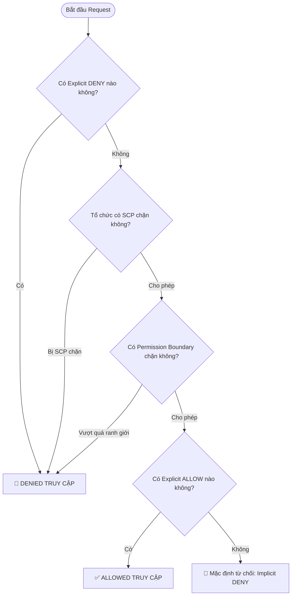
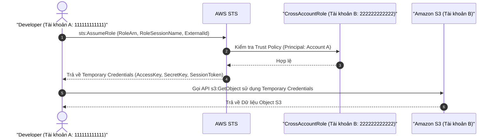

# 🔑 IAM & STS Deep Dive: Evaluation Logic & Temporary Credentials

> Thuộc: [[Task-1.1-Design-Secure-Access-Resources]] | Trở về: [[00-Domain-1-MOC]]

---

## 1. Khái niệm cốt lõi (Core Concepts)

- **AWS Identity and Access Management (IAM):** Dịch vụ quản lý định danh và quyền truy cập toàn cầu (Global Service) của AWS. Cung cấp cơ chế xác thực (Authentication) và phân quyền (Authorization) theo nguyên tắc đặc quyền tối thiểu (**Principle of Least Privilege**).
- **AWS Security Token Service (STS):** Dịch vụ cấp phát chứng chỉ bảo mật tạm thời (Temporary Credentials gồm `AccessKeyId`, `SecretAccessKey`, và `SessionToken`), có thời hạn ngắn (từ 15 phút đến 36 giờ), tự động hết hạn mà không cần thu hồi thủ công.

---

## 2. Cơ chế đánh giá Policy (Policy Evaluation Logic)

Khi một Principal (User, Role) gửi một request tới tài nguyên AWS, luồng quyết định thẩm định quyền diễn ra theo thứ tự nghiêm ngặt sau:



### Công thức vàng cần nhớ trong phòng thi:
$$\textbf{Explicit Deny} > \textbf{Explicit Allow} > \textbf{Implicit Deny}$$
1. Bất kỳ một điều khoản `Deny` rõ ràng nào ở bất kỳ cấp độ nào (Identity Policy, Resource Policy, SCP, Permission Boundary) sẽ **ngay lập tức hủy bỏ** mọi quyền `Allow`.
2. Mặc định mọi hành động đều bị từ chối (**Implicit Deny**) cho đến khi có một câu lệnh `Allow` rõ ràng.

---

## 3. Các loại IAM Policy quan trọng

| Loại Policy                      | Đối tượng gắn                 | Điểm đặc thù trong đề thi                                                                                                                                                          |
| :------------------------------- | :---------------------------- | :--------------------------------------------------------------------------------------------------------------------------------------------------------------------------------- |
| **Identity-based Policy**        | User, Group, Role             | Quản lý Principal được phép làm gì (Managed Policy vs Inline Policy).                                                                                                              |
| **Resource-based Policy**        | S3 Bucket, SQS Queue, KMS Key | Gắn trực tiếp vào tài nguyên, xác định **ai (Principal)** được phép truy cập tài nguyên đó. Hỗ trợ truy cập chéo tài khoản mà Principal không cần rời tài khoản của mình.          |
| **Permissions Boundary**         | IAM User, IAM Role            | Thiết lập quyền hạn tối đa mà một Identity-based Policy có thể cấp. **Thường dùng để ủy quyền tạo User cho team Dev mà không cho Dev leo thang đặc quyền (Privilege Escalation)**. |
| **Service Control Policy (SCP)** | AWS Organizations OU/Account  | Rào chắn an ninh cho toàn bộ tài khoản, không cấp quyền mà chỉ giới hạn quyền tối đa.                                                                                              |

---

## 4. IAM Roles vs STS AssumeRole & Cross-Account Access

### Sơ đồ ủy quyền chéo tài khoản (Cross-Account Access Flow)



### Cấu tạo của một IAM Role gồm 2 phần bắt buộc:
1. **Trust Policy (Chính sách tin cậy):** Định nghĩa **AI** được phép đảm nhận Role này (Principal: AWS Service như `ec2.amazonaws.com`, hoặc Account ID khác).
2. **Permissions Policy (Chính sách phân quyền):** Định nghĩa Role này **ĐƯỢC LÀM GÌ** sau khi đã được đảm nhận.

### EC2 Instance Profile:
- Khi ứng dụng chạy trên EC2 cần gọi AWS API (ví dụ ghi log vào CloudWatch, đọc file từ S3), **tuyệt đối không nhúng access keys** vào file `.aws/credentials` trên máy chủ.
- Gắn **IAM Role thông qua Instance Profile** vào EC2. AWS metadata service (`http://169.254.169.254/latest/meta-data/iam/security-credentials/`) sẽ tự động cấp và xoay vòng chứng chỉ tạm thời cho máy chủ.

---

## 5. Phòng chống "Confused Deputy Problem" với `sts:ExternalId`

- **Tình huống:** Công ty thuê một nhà cung cấp dịch vụ SaaS (Tài khoản bên thứ ba) để quản lý tài nguyên AWS của mình.
- **Rủi ro:** Kẻ tấn công có thể lừa dịch vụ SaaS đó sử dụng quyền mà công ty bạn đã cấp để truy cập dữ liệu của nạn nhân khác (Confused Deputy).
- **Giải pháp chuẩn:** Khi tạo IAM Role Trust Policy cho bên thứ ba, bắt buộc thêm điều kiện kiểm tra mã định danh duy nhất:
```json
{
  "Version": "2012-10-17",
  "Statement": [
    {
      "Effect": "Allow",
      "Principal": { "AWS": "arn:aws:iam::3rdparty-account-id:root" },
      "Action": "sts:AssumeRole",
      "Condition": {
        "StringEquals": {
          "sts:ExternalId": "unique-client-secret-id-998877"
        }
      }
    }
  ]
}
```

---

## ⚠️ Bẫy đề thi & Mẹo ghi nhớ (Exam Traps)

| Tình huống đề thi                                          | Đáp án bẫy (SAI)                                    | Đáp án chuẩn (ĐÚNG)                                                                                               |
| :--------------------------------------------------------- | :-------------------------------------------------- | :---------------------------------------------------------------------------------------------------------------- |
| Cho phép ứng dụng trên EC2 đọc S3                          | Tạo IAM User với Access Key rồi cấu hình vào EC2    | Tạo **IAM Role**, gán quyền S3, đính kèm vào **EC2 Instance Profile**                                             |
| Cho phép Dev tự tạo IAM Role mà không được cấp quyền Admin | Cấp quyền `iam:*` và tin tưởng Dev                  | Dùng **Permissions Boundary** giới hạn quyền tối đa mà Dev có thể gán cho Role mới                                |
| Kết nối dịch vụ SaaS giám sát AWS của công ty              | Chỉ dùng ARN tài khoản bên thứ 3 trong Trust Policy | Kết hợp thêm **`sts:ExternalId`** trong Condition của Trust Policy                                                |
| Khóa tài khoản khẩn cấp khi nghi ngờ rò rỉ Access Key      | Xóa User                                            | Xóa hoặc **Vô hiệu hóa (Deactivate)** Access Key bị lộ; thu hồi các session STS hiện tại (`RevokeActiveSessions`) |

---

## 🔗 Liên kết liên quan
- [[Task-1.1-Design-Secure-Access-Resources]]
- [[AWS-Organizations-and-SCPs]]
- [[Directory-Service-and-IAM-Identity-Center]]
- [[Domain-1-Scenario-Walkthroughs]]
