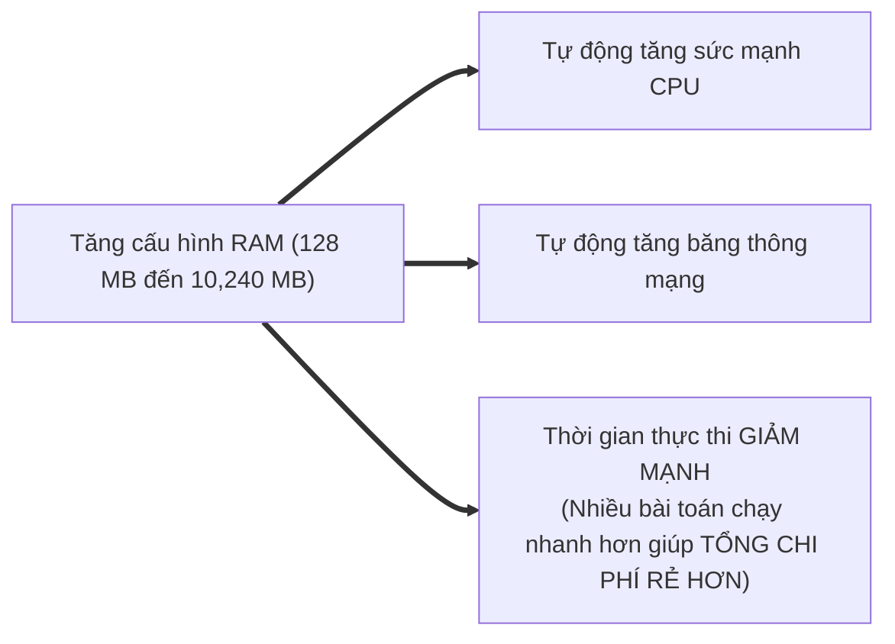
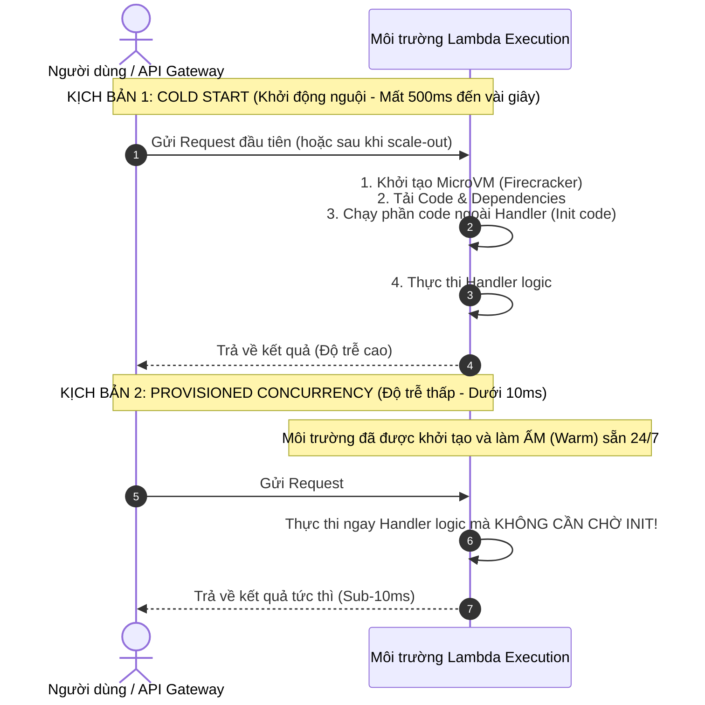

# ⚡ AWS Lambda Performance & Provisioned Concurrency: Tối Ưu Serverless

> Thuộc: [[Task-3.2-High-Performing-Compute]] | Trở về: [[00-Domain-3-MOC]]

---

## 1. Khái niệm cốt lõi (Core Concepts)

**AWS Lambda** là dịch vụ tính toán phi máy chủ (Serverless Compute) theo mô hình hướng sự kiện. Để đạt hiệu năng cao nhất trên Lambda trong đề thi SAA-C03, kiến trúc sư phải giải quyết 2 bài toán lớn:
1. **Khởi động nguội (Cold Starts):** Độ trễ phát sinh khi AWS phải tải container, nạp mã nguồn và khởi tạo runtime cho một request mới.
2. **Tối ưu hóa tài nguyên (Memory-to-CPU proportionality):** Cơ chế cấp phát sức mạnh CPU và băng thông mạng tỷ lệ thuận theo dung lượng RAM cấu hình.

---

## 2. Cơ Chế Cấp Phát Tài Nguyên: Tăng RAM = Tăng CPU & Mạng

AWS Lambda **không cho phép bạn trực tiếp chọn số lượng vCPU hay xung nhịp chip**. Thay vào đó:
- Bạn chỉ cấu hình duy nhất một thông số: **Dung lượng bộ nhớ RAM** (từ **128 MB** lên tối đa **10,240 MB** - 10 GB).
- AWS sẽ **tự động phân bổ tỷ lệ sức mạnh CPU và băng thông mạng tương ứng** theo dung lượng RAM bạn đã chọn:
  - Ở mức **1,769 MB RAM**: Hàm Lambda nhận được tương đương **1 vCPU đầy đủ**.
  - Nếu cấu hình trên 1,769 MB RAM, hàm Lambda sẽ có quyền truy cập vào kiến trúc đa nhân (Multi-threading).

> **Mẹo kiến trúc:** Đôi khi việc tăng gấp đôi RAM cho Lambda không làm tăng chi phí, vì thời gian thực thi (Execution duration) giảm đi một nửa, trong khi trải nghiệm người dùng nhanh hơn rõ rệt.

---

## 3. Khởi Động Nguội (Cold Start) vs Provisioned Concurrency

### So sánh các chế độ Concurrency của Lambda:
1. **Unreserved Concurrency (Mặc định):** Dùng chung hạn mức tài khoản (Account-level limit: mặc định 1,000 concurrent executions). Khi có request đột biến mới, các instance mới sẽ bị dính Cold Start.
2. **Reserved Concurrency:** 
   - Đặt giới hạn trần (Cap) số lượng concurrent executions tối đa cho 1 hàm cụ thể.
   - **Tác dụng:** Ngăn chặn một hàm chạy lỗi làm cạn kiệt toàn bộ pool 1,000 concurrency của cả tài khoản AWS, và bảo vệ database phía sau không bị quá tải.
3. **Provisioned Concurrency (Chìa khóa hiệu năng):**
   - Giữ cố định một số lượng môi trường thực thi luôn ở trạng thái "Ấm" (Warm).
   - **LOẠI BỎ HOÀN TOÀN COLD STARTS**. Đáp ứng ngay lập tức các ứng dụng nhạy cảm về độ trễ (Web API, thanh toán trực tuyến).

---

## 4. Tái Sử Dụng Kết Nối (Execution Context Reuse)

Để tối ưu hóa hiệu năng của Lambda khi giao tiếp với cơ sở dữ liệu:
- **Nguyên tắc vàng:** Khởi tạo các kết nối Database client, HTTP client, hoặc AWS SDK client **ở BÊN NGOÀI hàm Handler (Initialization Code)**.
- Khi một môi trường Lambda được tái sử dụng (Warm instance), các kết nối này sẽ được giữ lại và tái sử dụng cho các request tiếp theo mà không cần phải thực hiện lại quá trình bắt tay kết nối (Handshake) tốn thời gian.

---

## ⚠️ Bẫy đề thi & Mẹo ghi nhớ (Exam Traps)

| Tình huống đề thi | Đáp án bẫy (SAI) | Đáp án chuẩn (ĐÚNG) |
| :--- | :--- | :--- |
| API tương tác người dùng trên Lambda thỉnh thoảng bị trễ 2-3 giây sau các đợt không có truy cập | Tăng thời gian Timeout của Lambda | Kích hoạt tính năng **Provisioned Concurrency** trên AWS Lambda |
| Hàm Lambda chạy thuật toán mã hóa nặng bị chậm do thiếu sức mạnh xử lý CPU | Đổi sang cấu hình vCPU (Lambda không có nút chọn vCPU) | **Tăng dung lượng RAM** cho hàm Lambda (từ 1,769 MB trở lên) để nhận thêm sức mạnh CPU |
| Một hàm Lambda chạy nền bị lặp vô tận làm cạn kiệt hạn mức tính toán của toàn bộ tài khoản AWS | Viết cronjob kiểm tra log | Cấu hình **Reserved Concurrency** để giới hạn số lượng luồng tối đa cho hàm đó |
| Cung cấp một HTTPS Endpoint công cộng đơn giản cho Lambda mà không muốn cấu hình API Gateway | Tạo ALB và gắn Lambda | Bật tính năng **Lambda Function URLs** |

---

## 🔗 Liên kết liên quan
- [[Task-3.2-High-Performing-Compute]]
- [[EC2-Placement-Groups-and-HPC-Accelerators]]
- [[Aurora-Serverless-v2-and-RDS-Proxy]]
- [[Domain-3-Scenario-Walkthroughs]]
