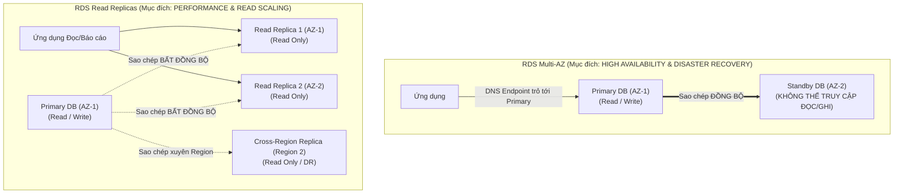
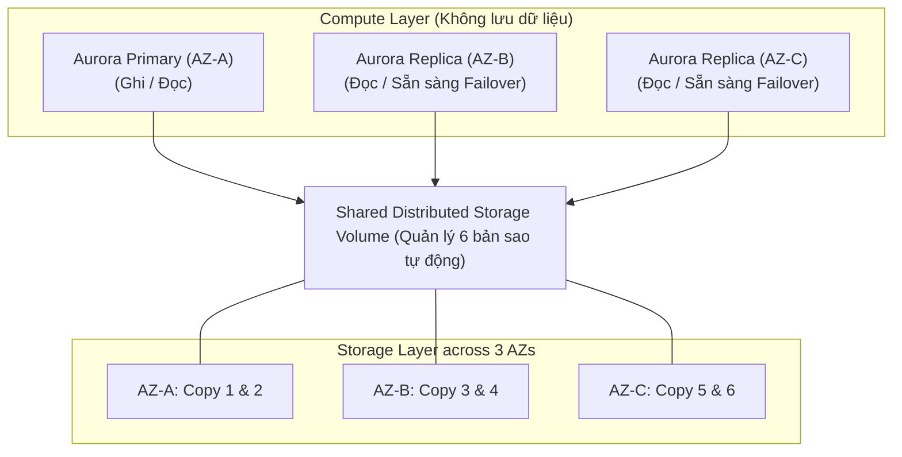
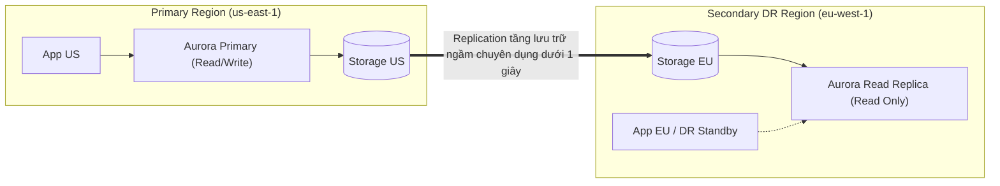

# 🗄️ RDS & Aurora High Availability: Multi-AZ, Read Replicas & Aurora Global Database

> Thuộc: [[Task-2.2-Highly-Available-and-Fault-Tolerant]] | So sánh nhanh: [[Matrix-RDS-Multi-AZ-vs-Read-Replica]] | Trở về: [[00-Domain-2-MOC]]

---

## 1. Khái niệm cốt lõi (Core Concepts)

Đảm bảo tính sẵn sàng cao (**High Availability - HA**) và khả năng phục hồi dữ liệu (**Resilience**) ở tầng cơ sở dữ liệu quan hệ đòi hỏi kiến trúc sư phải phân biệt rành rọt giữa 2 mục tiêu: **Chịu lỗi hạ tầng (Failover)** và **Mở rộng năng lực đọc (Read Scaling)**.

AWS cung cấp 2 giải pháp RDBMS chủ lực:
- **Amazon RDS:** Dịch vụ cơ sở dữ liệu quan hệ được quản lý (MySQL, PostgreSQL, MariaDB, Oracle, SQL Server).
- **Amazon Aurora:** Công nghệ cơ sở dữ liệu quan hệ thiết kế riêng cho điện toán đám mây của AWS, tương thích 100% với MySQL và PostgreSQL, đem lại hiệu năng gấp 3-5 lần và kiến trúc lưu trữ phân tán vượt trội.

---

## 2. Amazon RDS: Multi-AZ vs Read Replicas

### So sánh chi tiết 8 tiêu chí cốt lõi

| Tiêu chí so sánh | RDS Multi-AZ Deployment | RDS Read Replicas |
| :--- | :--- | :--- |
| **Mục tiêu chính** | **Khả dụng cao (High Availability / DR)** | **Mở rộng năng lực đọc (Scalability)** |
| **Cơ chế sao chép** | **Đồng bộ (Synchronous)** | **Bất đồng bộ (Asynchronous)** |
| **Ảnh hưởng hiệu năng ghi** | Có thể tăng nhẹ độ trễ ghi (phải chờ Standby xác nhận) | Không ảnh hưởng tới tiến trình ghi của Primary |
| **Khả năng đọc dữ liệu** | **KHÔNG THỂ ĐỌC ĐƯỢC** (Standby chỉ đứng chờ) | **Có thể đọc thoải mái** (Giảm tải cho Primary) |
| **Tự động Failover** | **Có (Tự động 100% trong 60-120 giây)** bằng cách trỏ lại DNS CNAME | **Không tự động failover** (Phải kích hoạt thủ công để promote lên Primary) |
| **Vị trí địa lý** | Trải dài trên **2 AZs trong cùng 1 Region** | Có thể ở **cùng AZ, khác AZ, hoặc khác Region (Cross-Region)** |
| **Số lượng tối đa** | Duy nhất 1 Standby (hoặc 2 với Multi-AZ DB Cluster) | Tối đa **15 Read Replicas** |
| **Bản sao lưu (Backup)** | Tự động snapshot từ Standby (không làm đơ Primary) | Không hỗ trợ backup riêng |

---

## 3. Amazon Aurora: Kiến trúc Lưu trữ 6 Bản Sao & Khả dụng Đỉnh cao

Không giống như RDS truyền thống (Compute gắn chặt với ổ cứng EBS), Amazon Aurora **tách biệt hoàn toàn tầng Tính toán (Compute Layer) và tầng Lưu trữ (Storage Layer)**.

### Điểm đột phá kiến trúc của Aurora cần ghi nhớ trong đề thi:
1. **Lưu trữ 6 bản sao trên 3 Availability Zones:** Dữ liệu tự động chia thành các khối 10GB và nhân bản 6 lần.
2. **Cơ chế Quorum biểu quyết:**
   - **Ghi dữ liệu (Write Quorum: 4/6):** Chỉ cần 4 trên 6 bản sao xác nhận ghi thành công $\rightarrow$ Chịu được việc **mất trắng 1 AZ hoàn toàn (2 bản sao) mà vẫn ghi bình thường**.
   - **Đọc dữ liệu (Read Quorum: 3/6):** Chỉ cần 3 trên 6 bản sao xác nhận $\rightarrow$ Chịu được việc **mất 1 AZ cộng thêm 1 node hỏng ở AZ khác (3 bản sao) mà vẫn đọc bình thường**.
3. **Tự phục hồi dữ liệu (Self-Healing Storage):** Các khối đĩa 10GB bị lỗi sẽ được tầng lưu trữ tự động quét và sửa ngầm mà không gây gián đoạn hệ thống.
4. **Aurora Replicas:** Hỗ trợ tối đa **15 replicas**, độ trễ sao chép cực thấp (**sub-10ms** vì cùng đọc chung 1 tầng lưu trữ dùng chung). Tự động đóng vai trò là Failover Target trong thời gian dưới 30 giây.

---

## 4. Aurora Global Database: Phục hồi thảm họa xuyên lục địa

Khi đề bài yêu cầu giải pháp khôi phục thảm họa (**Disaster Recovery**) xuyên quốc gia với **RTO dưới 1 phút và RPO dưới 1 giây**:

- **Replication không làm tốn CPU:** Việc đồng bộ dữ liệu diễn ra hoàn toàn ở tầng Storage phân tán của AWS, không tiêu tốn tài nguyên tính toán của database.
- **RPO < 1 giây:** Dữ liệu đồng bộ gần như ngay lập tức.
- **RTO < 1 phút:** Khi Primary Region sập, secondary database có thể được kích hoạt thành Primary (Promote to standalone) trong vòng chưa đầy 1 phút.

---

## ⚠️ Bẫy đề thi & Mẹo ghi nhớ (Exam Traps)

| Tình huống đề thi | Đáp án bẫy (SAI) | Đáp án chuẩn (ĐÚNG) |
| :--- | :--- | :--- |
| Database bị quá tải vì báo cáo BI đọc nhiều, cần nâng cấp lên RDS Multi-AZ | Chọn Bật RDS Multi-AZ (Standby instance không cho phép kết nối để đọc) | Tạo **RDS Read Replicas** và chuyển hướng các câu truy vấn báo cáo sang Reader Endpoint |
| RDS Primary gặp sự cố, cần chuyển đổi sang máy chủ phụ mà không cần đổi Connection String của ứng dụng | Cần cấu hình cập nhật IP thủ công trong file cấu hình web | RDS tự động xử lý bằng cách **chuyển bản ghi DNS CNAME** của DB Endpoint sang Standby instance |
| Hệ thống tài chính toàn cầu yêu cầu Disaster Recovery đa vùng với RPO < 1s và RTO < 1 phút | Thiết lập RDS Cross-Region Read Replica và tự viết script failover | Triển khai **Amazon Aurora Global Database** |
| Cần duy trì tính sẵn sàng cao (High Availability) cho Amazon RDS SQL Server | Dùng SQL Server Mirroring thủ công | Kích hoạt tính năng **RDS Multi-AZ (sử dụng Always On Availability Groups)** |

---

## 🔗 Liên kết liên quan
- [[Task-2.2-Highly-Available-and-Fault-Tolerant]]
- [[Matrix-RDS-Multi-AZ-vs-Read-Replica]]
- [[DynamoDB-Resilience-and-Global-Tables]]
- [[Disaster-Recovery-Strategies-RTO-RPO]]
