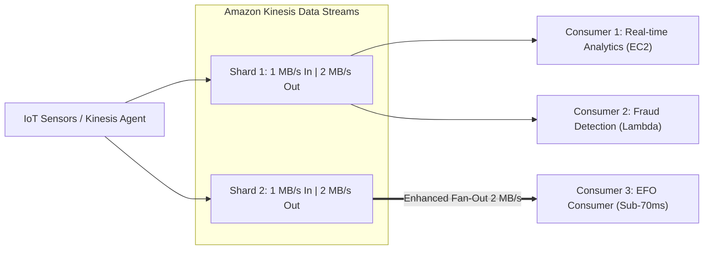

# 🌊 Real-Time Streaming: Amazon Kinesis Data Streams, Firehose & Amazon MSK

> Thuộc: [[Task-3.5-High-Performing-Data-Ingestion]] | So sánh nhanh: [[Matrix-Kinesis-Streams-vs-Firehose]] | Trở về: [[00-Domain-3-MOC]]

---

## 1. Khái niệm cốt lõi (Core Concepts)

Thu thập và xử lý luồng dữ liệu thời gian thực (**Real-Time Data Streaming**) cho phép doanh nghiệp phản ứng tức thì với các sự kiện kinh doanh (giao dịch thanh toán, clickstream người dùng, cảm biến IoT, phân tích log an ninh):
- **Amazon Kinesis Data Streams (KDS):** Dịch vụ streaming thời gian thực quy mô lớn, cho phép nhiều ứng dụng tùy biến cùng đọc và xử lý song song với độ trễ tính bằng mili-giây.
- **Amazon Kinesis Data Firehose:** Dịch vụ nạp dữ liệu Serverless tự động chuyển đổi và đưa luồng dữ liệu vào các kho chứa (S3, Redshift, OpenSearch) theo thời gian gần thực (**Near real-time**).
- **Amazon MSK (Managed Streaming for Apache Kafka):** Dịch vụ cụm Kafka được quản lý hoàn toàn cho các ứng dụng mã nguồn mở hiện có.

---

## 2. Amazon Kinesis Data Streams: Shards & Enhanced Fan-Out

### A. Năng lực xử lý của một Shard:
- **Ghi dữ liệu (Ingestion):** **1 MB/giây** hoặc **1,000 records/giây** cho mỗi shard.
- **Đọc dữ liệu (Consumption):** **2 MB/giây** tổng cộng cho tất cả các consumer thông thường dùng chung.
- **Chế độ Capacity Modes:**
  - *Provisioned Mode:* Bạn tự chỉ định số lượng shard cố định (phù hợp khi biết trước tải).
  - *On-Demand Mode:* Tự động mở rộng và thu hẹp số lượng shard theo lưu lượng thực tế (lên tới 200 MB/s ghi), **không cần quản lý shard thủ công**.

### B. Kỹ thuật Enhanced Fan-Out (EFO - Tăng tốc đọc đa ứng dụng)
- **Vấn đề của Standard Consumer:** Khi có 5 ứng dụng khác nhau cùng đọc 1 shard, chúng phải chia sẻ băng thông 2 MB/s (mỗi app chỉ được 400 KB/s) và bị giới hạn bởi cơ chế polling HTTP GET.
- **Enhanced Fan-Out (EFO):**
  - Cung cấp băng thông đọc **2 MB/giây RIÊNG BIỆT cho từng Consumer** trên mỗi shard.
  - Sử dụng giao thức **HTTP/2 Server Push**, đẩy độ trễ từ 200ms xuống **dưới 70 mili-giây**.
  - **Quy tắc thi:** Chọn EFO khi có nhiều ứng dụng độc lập cùng cần đọc 1 luồng dữ liệu thời gian thực với độ trễ thấp nhất.

---

## 3. Amazon Kinesis Data Firehose: Nạp Dữ Liệu Tự Động Serverless

Khác với Kinesis Data Streams đòi hỏi bạn phải tự viết mã nguồn cho consumer:
- **Kinesis Data Firehose:** Hoàn toàn Serverless, không có shard, không cần viết code nhận tin.
- **Cơ chế đệm dữ liệu (Buffering Window):**
  - Đệm theo **Dung lượng:** 1 MB đến 128 MB.
  - Đệm theo **Thời gian:** 60 giây đến 900 giây (15 phút).
  - Khi một trong hai điều kiện chạm ngưỡng trước, Firehose sẽ đẩy một khối dữ liệu vào đích đến. $\rightarrow$ Đây là lý do Firehose là **Near real-time (tối thiểu 60s trễ)**, không phải pure real-time.
- **Tự động chuyển đổi định dạng:** Tích hợp với **AWS Lambda** để chuyển đổi JSON thô thành định dạng cột **Apache Parquet / ORC** trước khi lưu vào Amazon S3.

---

## 4. Bảng So Sánh Kinesis Streams vs Firehose vs MSK

| Tiêu chí | Kinesis Data Streams | Kinesis Data Firehose | Amazon MSK |
| :--- | :--- | :--- | :--- |
| **Độ trễ** | **Mili-giây (Real-time)** | **Tối thiểu 60 giây (Near real-time)**| **Mili-giây (Real-time)** |
| **Mô hình tính toán** | Tự quản lý Shards hoặc On-demand | **Hoàn toàn Serverless 100%** | Quản lý Broker instances hoặc Serverless |
| **Thời gian lưu trữ** | 24 giờ đến **365 ngày** | **Không lưu trữ** | Theo cấu hình Kafka Topic |
| **Consumer hỗ trợ** | Ứng dụng tùy biến (EC2, Lambda, EFO) | **Chỉ nạp vào S3, Redshift, OpenSearch, Splunk** | Mọi ứng dụng tương thích Kafka client |
| **Tự chuyển đổi format** | Tự code | **Tự động chuyển đổi sang Parquet qua Lambda** | Tự xử lý qua Kafka Streams |

---

## ⚠️ Bẫy đề thi & Mẹo ghi nhớ (Exam Traps)

| Tình huống đề thi | Đáp án bẫy (SAI) | Đáp án chuẩn (ĐÚNG) |
| :--- | :--- | :--- |
| Cần nạp dữ liệu log từ hàng nghìn server vào Amazon S3 dưới định dạng Apache Parquet với ít code nhất | Dùng Kinesis Data Streams và viết code EC2 tự chuyển đổi | Sử dụng **Amazon Kinesis Data Firehose** với tính năng **Data Format Conversion (Parquet)** |
| Ứng dụng phân tích gian lận thời gian thực yêu cầu độ trễ đọc dưới 70ms khi có 5 microservices cùng đọc 1 stream | Tăng số lượng Shards của Kinesis Data Streams | Đăng ký các microservices làm **Enhanced Fan-Out (EFO) Consumers** |
| Doanh nghiệp muốn di chuyển hệ sinh thái dữ liệu lớn đang dùng Apache Kafka on-premise lên AWS mà không đổi code | Viết lại sang Amazon SQS hoặc Kinesis | Sử dụng **Amazon Managed Streaming for Apache Kafka (Amazon MSK)** |
| Cần một giải pháp streaming tự động mở rộng theo lưu lượng đột biến mà không cần quản lý capacity của shard | Tính toán số shard dự phòng tối đa | Chọn Kinesis Data Streams ở chế độ **On-Demand Capacity Mode** |

---

## 🔗 Liên kết liên quan
- [[Task-3.5-High-Performing-Data-Ingestion]]
- [[Matrix-Kinesis-Streams-vs-Firehose]]
- [[Data-Lake-Query-Tuning-Athena-Glue-Parquet]]
- [[Domain-3-Scenario-Walkthroughs]]
